# OpenIRP — Documento maestro de planificación y diseño técnico

**Open Incident Response Platform (OpenIRP)**  
**Título académico del proyecto:** “Implementación de una plataforma web para la recomendación contextual de playbooks de respuesta a incidentes de ciberseguridad con IA asistida para PYMES.”  
**Versión del documento:** 1.0 — línea base previa a implementación  
**Corte de información:** 21 de octubre de 2026  
**Estado:** planificación funcional y diseño físico preliminar consolidados; implementación del núcleo de negocio pendiente  
**Ámbito:** investigación académica, producto MVP open source y arquitectura de software segura para pymes  
**Repositorio de trabajo declarado:** `github.com/Romulo3094/OpenIRP`

> **Control de alcance.** Este documento recopila los acuerdos alcanzados en los pasos 1–25 de planificación. Especificaciones, reglas, esquemas SQL y diagramas representan diseños aprobados o propuestas de materialización; **no prueban que las tablas, controles ni funciones estén implementados**. Las pruebas locales históricas de Ollama, Docker y la API se distinguen expresamente de las pruebas de negocio futuras. No constituye todavía evidencia de validación productiva ni una tesis final.

## Índice de contenido

1. Resumen ejecutivo y estado del proyecto
2. Trazabilidad de los 25 pasos de planificación
3. Problema, objetivos y delimitación del MVP
4. Arquitectura y despliegue previstos
5. Usuarios, organizaciones, roles y seguridad multi-tenant
6. Capacidades organizacionales y activos tecnológicos
7. Incidentes: ciclo de vida, impacto CIA y aprobaciones
8. Playbooks: catálogo, versiones, pasos y publicación
9. Ejecuciones, tareas, dependencias y excepciones
10. Asistencia local mediante IA y propuestas supervisadas
11. Evidencias, archivos privados y trazabilidad
12. Auditoría de seguridad y separación de funciones
13. Modelo entidad-relación consolidado (32 entidades)
14. Diseño físico de PostgreSQL y reglas de integridad
15. Estrategia de migraciones y pruebas de aceptación
16. Metodología de evaluación de la investigación
17. Riesgos, decisiones pendientes y criterios de salida
18. Hoja de ruta a partir del Paso 26
19. Glosario y documentos de referencia
20. Anexos de reglas y casos de prueba

---

# 1. Resumen ejecutivo y estado del proyecto

OpenIRP es una **plataforma web abierta de apoyo a la respuesta a incidentes de ciberseguridad**, dirigida principalmente a pequeñas y medianas organizaciones con recursos humanos y tecnológicos limitados. Su propuesta consiste en combinar playbooks reutilizables y versionados, seguimiento operativo de tareas, evidencias y trazabilidad, con asistencia contextual de **inteligencia artificial local mediante Ollama**, sin conferirle capacidad de ejecutar acciones sobre la infraestructura de la empresa.

La plataforma será multiempresa (*multi-tenant*): utilizará una base de datos PostgreSQL compartida, pero protegerá los datos de cada organización mediante identidad, membresías, autorización, integridad referencial compuesta y, antes de cualquier uso operativo con información real de varias organizaciones, políticas Row-Level Security (RLS) verificadas.

**Situación al corte.** Se completaron 25 pasos de decisión funcional y diseño conceptual/físico preliminar. El paso 26 inicia la **implementación**. No quedan nuevos pasos de planificación obligatorios antes de comenzar, aunque aún existen detalles técnicos que deben resolverse al materializar las migraciones, pruebas y políticas operativas.

### 1.1. Hechos técnicos previamente reportados y alcance de su verificación

| Componente | Situación reportada en sesiones previas | Lo que no debe inferirse |
|---|---|---|
| Equipo de desarrollo | Windows, 32 GB RAM, CPU Intel Core i7-8700 y RTX 3070 8 GB | No implica capacidad dimensionada para producción multiusuario. |
| Infraestructura local | Docker Desktop/WSL2; PostgreSQL 17 y Ollama en contenedores; persistencia y conectividad local probadas | No se han realizado pruebas de carga, respaldo/restauración productiva ni seguridad completa. |
| Ollama | `qwen3:4b` y `qwen3:4b-instruct`; prueba local con aceleración GPU | No certifica seguridad o calidad de todas sus recomendaciones. |
| Pruebas de IA | Respuestas útiles, pero también errores de claves JSON y de campos de aprobación; aproximación de inferencia de unos segundos en un caso local | Los tiempos no son SLA y los errores impiden confiar en la salida sin validación. |
| Backend | Solución .NET 10 con proyectos Domain, Application, Infrastructure y Api; endpoint `/api/health` probado | No equivale a tener implementados incidentes, autenticación, playbooks o migraciones. |
| Base de datos | Contenedor PostgreSQL y acceso desde el entorno local, con persistencia revisada | No equivale a existencia de tablas del dominio ni RLS. |

**Entregables de esta línea base:** este Markdown, el documento Word equivalente y una biblioteca de figuras reproducibles. Una vez aceptados, se puede iniciar el Paso 26 sin regresar al levantamiento general de requisitos.

# 2. Trazabilidad de los 25 pasos de planificación

Los pasos se documentan según las decisiones de negocio y diseño realizadas a lo largo del proyecto. En los primeros pasos, los números agrupan el dominio trabajado; en los pasos 11–25 corresponden a los bloques de diseño expresamente revisados.

| Pasos | Materia | Acuerdo o resultado |
|---|---|---|
| 1 | Modelo de organizaciones | Multi-tenant compartido, aislamiento estricto por empresa. |
| 2 | Usuarios y roles | Un usuario puede pertenecer a varias empresas; rol independiente por membresía. |
| 3 | Gestión de incidentes | Seis estados; cierre por severidad con autorización. |
| 4 | Catálogo de playbooks | Catálogo público global + playbooks privados por organización. |
| 5 | Ejecución | Tareas flexibles con dependencias; evidencias y aprobaciones. |
| 6 | IA asistiva | Contextualización y propuestas reutilizables, siempre supervisadas. |
| 7 | Capacidades de las pymes | Perfil general más limitaciones por incidente. |
| 8 | Activos | Inventario flexible y activos todavía no inventariados. |
| 9 | Evidencias y auditoría | Documentación textual, adjuntos controlados, historia y trazabilidad. |
| 10 | Consolidación de negocio | Solo PLATFORM_ADMIN crea organizaciones y designa primer ORG_ADMIN. |
| 11 | Identidad ER | ASP.NET Core Identity + membresías propias de OpenIRP. |
| 12 | Capacidades ER | Instantáneas de contexto relevante para cada evaluación de IA. |
| 13 | Incidentes ER | Cierre según máxima severidad histórica alcanzada. |
| 14 | Playbooks ER | Solo versión vigente inicia nuevas ejecuciones. |
| 15 | Ejecuciones ER | Omisiones obligatorias excepcionales autorizadas por ORG_ADMIN. |
| 16 | IA ER | ORG_ADMIN autoriza convertir una propuesta en borrador privado. |
| 17 | Evidencias ER | Retirada controlada con mínimos metadatos y auditoría. |
| 18 | Auditoría y revisión | Autoaprobación excepcional de ORG_ADMIN con justificación explícita. |
| 19 | Diseño físico inicial | Integridad y permisos primero; RLS obligatorio antes de operación real multi-tenant. |
| 20 | Incidentes físicos | Impactos C/I/A estructurados y reglas deterministas de severidad pendientes. |
| 21 | Playbooks físicos | Retirada de versión vigente incluso sin sustituta. |
| 22 | Ejecución física | Bloqueo preventivo de tareas si versión retirada por seguridad. |
| 23 | IA física | Retención temporal protegida de respuestas originales de Ollama. |
| 24 | Evidencias físicas | Auditoría append-only con privilegios restringidos, transacciones y respaldos. |
| 25 | Revisión integral | Correcciones transversales y secuencia de migraciones validadas como línea base. |

# 3. Problema, objetivos y delimitación del MVP

## 3.1. Necesidad de investigación

Las organizaciones pequeñas pueden carecer de equipos SOC, personal de respuesta especializado, SIEM o herramientas de contención. Un procedimiento de respuesta genérico puede resultar poco aplicable si exige recursos ausentes. OpenIRP busca estudiar la **viabilidad y utilidad** de apoyar la ejecución documentada de playbooks mediante recomendaciones de IA contextualizadas a capacidades y condiciones del incidente, sin automatizar acciones peligrosas ni reemplazar el juicio humano.

## 3.2. Objetivo funcional central

Diseñar, implementar y evaluar un prototipo web open source que permita gestionar incidentes y ejecutar playbooks versionados, incorporando asistencia de IA local con controles deterministas, revisión humana, evidencia y auditoría en un contexto multiempresa.

### 3.2.1. Cinco objetivos específicos mantenidos en la presentación académica

Se conserva la redacción de los **cinco objetivos específicos** de la presentación académica de OpenIRP del 16 de octubre de 2026:

1. **Analizar** las necesidades de respuesta a incidentes de ciberseguridad en las PYMES, mediante la revisión de antecedentes técnicos y procedimientos existentes, para identificar los criterios que permitan contextualizar las recomendaciones de la plataforma.
2. **Diseñar** un conjunto de playbooks de respuesta a incidentes de ciberseguridad, mediante la definición de procedimientos estructurados para distintos tipos de incidentes, con la finalidad de establecer una base de conocimiento que permita orientar las recomendaciones.
3. **Implementar** una plataforma web que permita registrar las características de un incidente y el contexto de una organización, mediante el desarrollo de funcionalidades para la selección y presentación de playbooks de respuesta.
4. **Integrar** un componente de inteligencia artificial asistida para recomendar y adaptar playbooks de respuesta a incidentes, utilizando los procedimientos previamente definidos y la información contextual proporcionada por los usuarios.
5. **Evaluar** el funcionamiento de la plataforma y la pertinencia de sus recomendaciones, mediante la ejecución de casos de prueba basados en incidentes simulados, con la finalidad de verificar su correspondencia con las características y necesidades de respuesta establecidas.

Estos objetivos orientan la implementación y la evaluación. Aún resta concretar rúbricas, indicadores operacionales y alcance empírico de cada uno; **no corresponde reformularlos sin una decisión explícita**.

## 3.3. Alcance del MVP

**Incluye:** identidad y roles, organizaciones, incidentes de phishing/compromiso de cuentas/ransomware, clasificación por impacto CIA y severidad, catálogo público y privado de playbooks, versionado inmutable, ejecución manual guiada con tareas y dependencias, aprobaciones y excepciones, inventario simplificado, capacidades organizacionales y limitaciones de incidente, Ollama asistivo, evidencias textuales y adjuntos controlados, trazabilidad y auditoría.

**Excluye en esta fase:** integración SIEM/SOAR, respuesta autónoma, ejecución remota de comandos, aislamiento real de endpoints, motor BPMN, descubrimiento automático de activos, análisis forense de malware, entrenamiento/fine-tuning de modelos, despliegue multiempresa productivo sin RLS y controles pendientes.

## 3.4. Principios no negociables

1. El backend decide permisos y transiciones; el frontend nunca es fuente de autoridad.
2. La IA sugiere, explica y propone borradores; no modifica estados por sí misma.
3. Las versiones de playbooks publicadas no cambian de contenido.
4. Las acciones y omisiones se documentan, con permisos y trazabilidad.
5. Los datos privados nunca se mezclan entre organizaciones.
6. El prototipo debe funcionar sin Ollama, usando los playbooks originales.
7. Ningún esquema o control planificado se declarará probado sin evidencia verificable.

# 4. Arquitectura y despliegue previstos

<!-- FIG:01:Arquitectura funcional OpenIRP -->
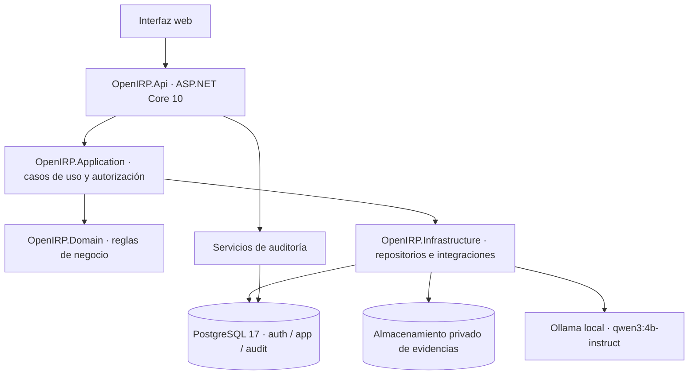

La solución está concebida como **modular monolith** para un MVP: dominio, aplicación, infraestructura y API separados, pero sin distribuir prematuramente el negocio en microservicios. La interfaz web consumirá la API; PostgreSQL gestionará persistencia transaccional, mientras Ollama operará como servicio local y los archivos se almacenarán en un volumen privado.

### 4.1. Componentes de proyecto ya creados (según reporte histórico)

- `apps/api/OpenIRP.slnx`
- `OpenIRP.Domain`: reglas y entidades de dominio, sin dependencia directa de EF Core.
- `OpenIRP.Application`: casos de uso, validaciones de negocio y coordinación.
- `OpenIRP.Infrastructure`: EF Core, Npgsql, almacenamiento, integración Ollama.
- `OpenIRP.Api`: controladores, autenticación, middleware y endpoints.
- `infra/compose.yaml`: infraestructura local para PostgreSQL/Ollama.

La API y la base de datos se consideran infraestructura inicial, **no** implementación completada del negocio. La adopción de Identity/EF Core y todas las migraciones siguen sujetas al Paso 26.

<!-- FIG:02:Despliegue local y límites de confianza -->
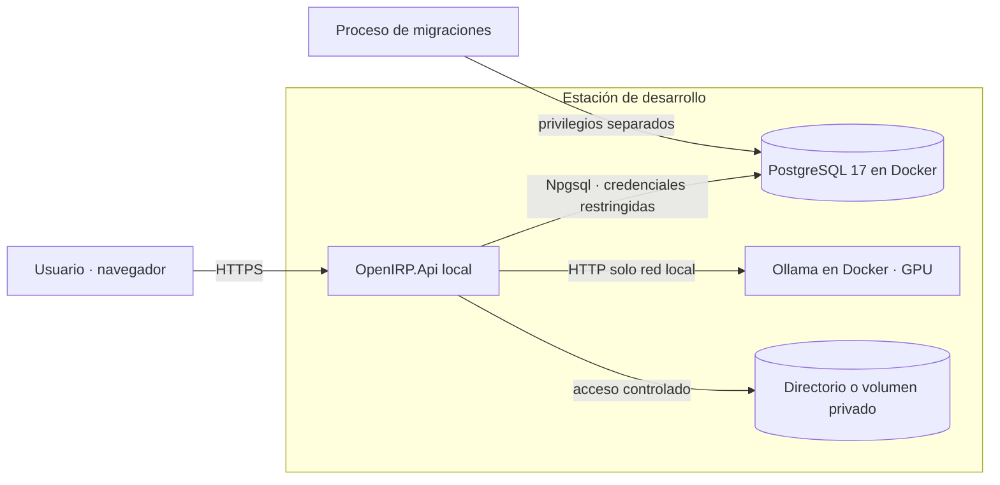

**Puertos reportados del desarrollo local:** PostgreSQL en `127.0.0.1:5433`, Ollama en `127.0.0.1:11435`, API de desarrollo en `https://localhost:7080` para su endpoint de salud. Estos son datos del entorno local histórico, no interfaces que deban exponerse públicamente.

# 5. Usuarios, organizaciones, roles y seguridad multi-tenant

## 5.1. Identidad y membresía

Un usuario dispone de una identidad global y puede mantener una membresía por organización, con rol distinto en cada una. `PLATFORM_ADMIN` es una facultad global independiente de los roles organizacionales; no obtiene acceso automático a información privada de incidentes y evidencias.

<!-- FIG:03:Identidad y pertenencia multiempresa -->
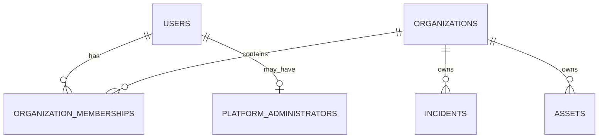

## 5.2. Matriz inicial de roles

| Acción | PLATFORM_ADMIN | ORG_ADMIN | ANALYST | VIEWER |
|---|---|---|---|---|
| Crear organización/primer administrador | Sí | No | No | No |
| Administración global de catálogo público | Sí | No | No | No |
| Ver incidentes privados sin membresía | No, por defecto | No | No | No |
| Administrar miembros de su organización | No por rol global | Sí | No | No |
| Publicar playbooks privados de su empresa | No por rol global | Sí | No | No |
| Registrar/gestionar incidentes propios del tenant | No por rol global | Sí | Sí | Solo lectura |
| Ejecutar tareas de playbook | No por rol global | Sí | Sí | No |
| Revisar recomendaciones de IA del incidente | No por rol global | Sí | Sí | Solo lectura autorizada |
| Aprobar cierre de incidente alto/crítico | No por rol global | Sí | No | No |
| Autorizar omisión obligatoria | No por rol global | Sí | No | No |
| Retirar evidencia | No por rol global | Sí, controlado | No | No |

La pertenencia y rol se revisan en **cada operación protegida**. La organización activa no se considera confiable por aparecer en la URL, cuerpo o encabezado de una solicitud. Debe existir al menos un `ORG_ADMIN` activo por organización; su revocación requiere operación segura frente a concurrencia.

## 5.3. Alta de organizaciones

Solo `PLATFORM_ADMIN` crea una organización y designa a su primer `ORG_ADMIN`. Ambas escrituras se ejecutarán dentro de una misma transacción. El primer administrador global se aprovisionará mediante proceso seguro de inicialización, sin credenciales predeterminadas ni endpoints públicos.

## 5.4. Defensa en profundidad

- **Autenticación:** ASP.NET Core Identity con UUID, hash y mecanismos estándar.
- **Autorización:** membresía y rol vigentes; separación entre roles globales y organizacionales.
- **Integridad:** claves foráneas compuestas con `organization_id`.
- **Persistencia:** usuario de API con privilegios limitados, distinto al de migraciones.
- **RLS:** políticas PostgreSQL diseñadas e implementadas antes del uso operativo con datos reales de varias empresas; no presentes en primera iteración local.
- **Pruebas:** acceso cruzado, suspensiones, duplicidad de membresía y carrera de último administrador.

# 6. Capacidades organizacionales y activos tecnológicos

Las recomendaciones de IA deberán considerar **recursos declarados por la empresa** y **limitaciones particulares del incidente**. Una capacidad ausente de catálogo organizacional se interpreta como `UNKNOWN`, no como no disponible. La disponibilidad en un incidente puede diferir del perfil general sin reescribirlo.

<!-- FIG:04:Capacidades generales y condiciones del incidente -->
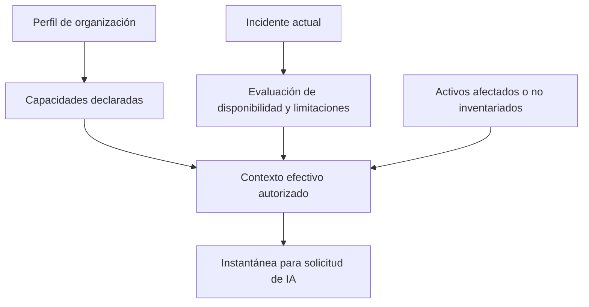

**Catálogo inicial:** IT_STAFF, SECURITY_SPECIALIST, EXTERNAL_SUPPORT, ENDPOINT_PROTECTION, SECURITY_LOGS, MFA, BACKUPS, DEVICE_ISOLATION y otras capacidades extensibles. Estados: AVAILABLE, UNAVAILABLE y UNKNOWN. Solamente ORG_ADMIN cambia el perfil general; un ANALYST puede documentar limitaciones específicas durante el incidente.

## 6.1. Activos y vinculación flexible

El inventario incluye servidores, estaciones de trabajo, servicios en nube, cuentas, aplicaciones, dispositivos de red y servicios críticos. Criticidad: LOW, MEDIUM, HIGH; distinta de la severidad del incidente. Un incidente puede afectar múltiples activos y un activo aparecer en varios incidentes.

Si un activo no está inventariado, el analista registra `reported_name`, `reported_type` y contexto dentro de `incident_assets` con `asset_id = NULL`. Puede vincularse más tarde a `assets`, **sin sobrescribir los datos y criticidad históricos registrados**.

# 7. Incidentes: ciclo de vida, impacto CIA y aprobaciones

## 7.1. Categorías y estados

Categorías iniciales: PHISHING, ACCOUNT_COMPROMISE y RANSOMWARE. El catálogo permite extensiones futuras. Estados: REGISTERED, UNDER_EVALUATION, IN_RESPONSE, RESOLVED, CLOSED, DISCARDED.

<!-- FIG:05:Ciclo de vida de incidentes -->
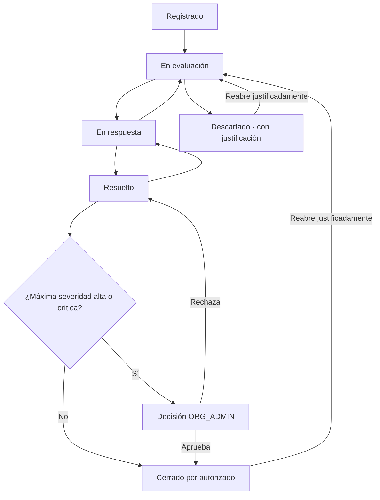

Cada cambio registra el usuario, instante y motivo en `incident_events`. No habrá eliminación física ordinaria de incidentes. El cambio de estado es transaccional y sujeto a permisos.

## 7.2. Severidad e impacto CIA

Se almacenan `confidentiality_impact`, `integrity_impact` y `availability_impact` con valores NONE/LOW/MEDIUM/HIGH y `NULL` cuando la dimensión aún no ha sido evaluada. `severity` expresa gravedad actual (LOW/MEDIUM/HIGH/CRITICAL); `maximum_severity_reached` mantiene el máximo histórico y nunca disminuye.

La severidad se determinará mediante una **regla determinista todavía por especificar y verificar**, considerando impactos CIA, criticidad de activos, alcance y afectación operacional. No se fija una fórmula arbitraria en este documento.

## 7.3. Cierre y autoaprobación

Incidentes LOW/MEDIUM pueden ser cerrados por el analista asignado autorizado, con resolución documentada. Si el incidente alcanzó HIGH o CRITICAL en cualquier momento, el cierre requiere autorización de ORG_ADMIN asociada a una revisión del incidente. Las decisiones APPROVED, REJECTED, PENDING e INVALIDATED se registran; una modificación relevante invalida la aprobación anterior.

Se admite **autoaprobación excepcional por ORG_ADMIN**, identificada expresamente como tal y con justificación. No se presenta como doble control independiente. Reaperturas, descartes y cambios de severidad requieren justificación y auditoría.

# 8. Playbooks: catálogo, versiones, pasos y publicación

Existen playbooks `PUBLIC` (globales; `organization_id IS NULL`) y `PRIVATE` (propiedad de la organización). Solo PLATFORM_ADMIN administra el catálogo público; ORG_ADMIN publica los procedimientos privados.

<!-- FIG:06:Ciclo de vida y clonación de playbooks -->
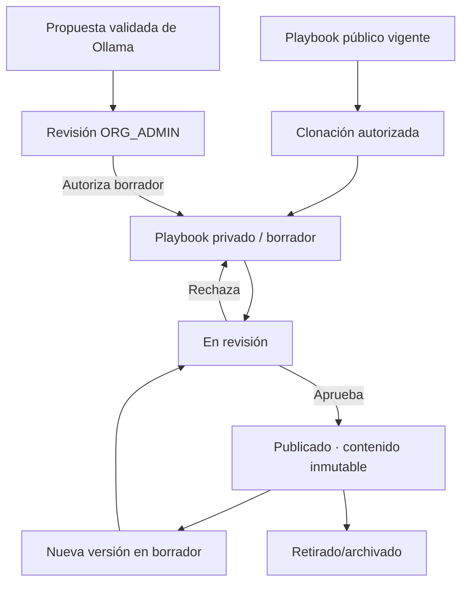

## 8.1. Reglas de versionado

- Cada playbook contiene versiones numeradas; `(playbook_id, version_number)` es único.
- Estados de versión: DRAFT, IN_REVIEW, PUBLISHED y ARCHIVED.
- La versión vigente se indica con `current_published_version_id`; no se infiere mediante `MAX(version_number)`.
- Solo la vigente inicia nuevas ejecuciones; las anteriores permanecen para consulta o ejecuciones históricas.
- Puede retirarse la versión vigente sin sustituta; el puntero pasa a NULL.
- Publicaciones y retiradas son transaccionales y auditadas.
- Un procedimiento clonado obtiene nuevos UUID para playbook, versión, pasos y dependencias, manteniendo `source_version_id` como referencia de origen.
- Las versiones publicadas son inmutables en contenido (objetivo, instrucciones, pasos, dependencias y requisitos); su vigencia administrativa puede cambiar.

## 8.2. Pasos, dependencias y capacidades

Los pasos registran código, posición recomendada, fase, instrucciones, `is_required`, `requires_approval` y `requires_evidence`. Las dependencias explícitas forman un grafo dirigido acíclico (DAG); una versión con ciclos no puede publicarse. Los requisitos del catálogo de capacidades pueden asignarse a la versión completa o a un paso específico, como REQUIRED o RECOMMENDED.

# 9. Ejecuciones, tareas, dependencias y excepciones

Cada ejecución se relaciona con un incidente y una versión publicada específica. Un índice único parcial impedirá más de una ejecución `IN_PROGRESS` por incidente. Estados de ejecución: IN_PROGRESS, COMPLETED y CANCELLED; no se añade un estado PAUSED al MVP.

<!-- FIG:07:Dependencias de tareas de un procedimiento -->
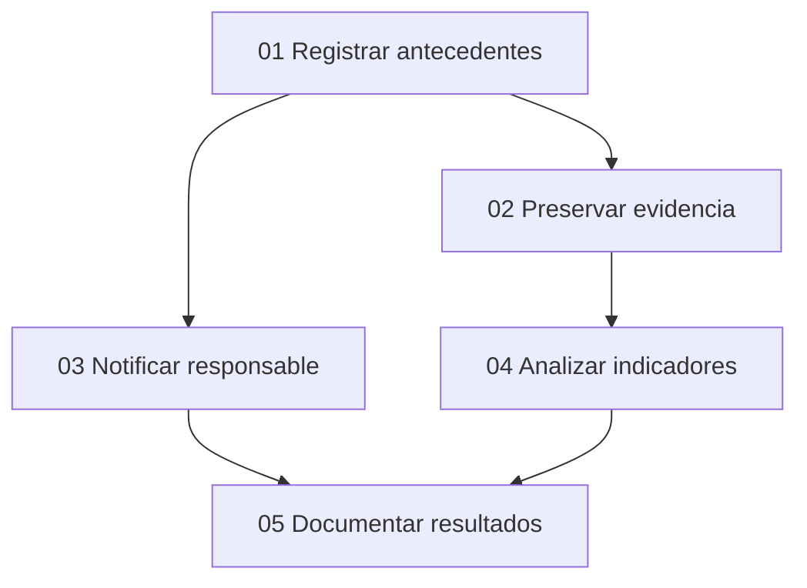

Una ejecución genera una tarea por cada paso de su versión, con estados PENDING, IN_PROGRESS, BLOCKED, COMPLETED y SKIPPED. Se valida que el paso corresponda exactamente a la versión y organización de su ejecución. Las tareas independientes pueden avanzar en paralelo.

## 9.1. Omisiones y autorizaciones

Una tarea bloqueada exige motivo; la omisión siempre exige justificación. Las tareas obligatorias pueden omitirse **excepcionalmente**, con autorización de ORG_ADMIN, evaluación de impacto, riesgo residual y dependencias afectadas. Omitida nunca equivale a completada ni satisface automáticamente dependencias posteriores. Cada dependencia sin satisfacer necesita alternativa validada o excepción independiente.

`STEP_APPROVAL` y `SKIP_AUTHORIZATION` son operaciones diferentes; aceptar una recomendación de IA es otra decisión, y aprobar el cierre de un incidente es una tercera. La autoaprobación del ORG_ADMIN es excepcional, auditable y documentada.

## 9.2. Retirada de versión insegura

Cuando una versión se retira **por seguridad**, las ejecuciones activas basadas en ella bloquean preventivamente nuevas transiciones de tareas. Se conserva la ejecución y puede seguir documentándose el incidente. ORG_ADMIN autoriza justificadamente continuidad o cancelación. La autorización debe referirse al **identificador del bloqueo actual** (`security_hold_id`), nunca a una autorización antigua reaprovechable.

<!-- FIG:08:Bloqueo y revisión de continuidad -->
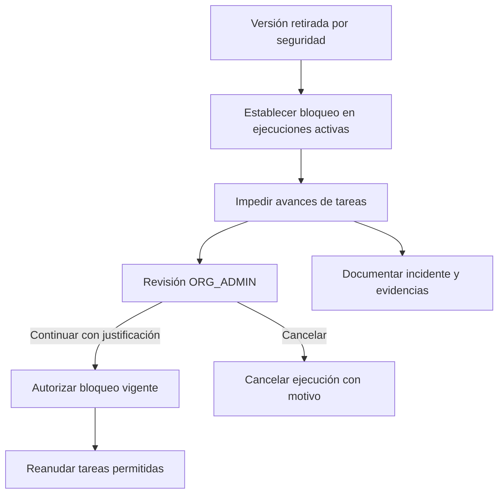

No se cerrará automáticamente un incidente solo porque la ejecución finalice. Las reglas de cierre del incidente siguen operando de forma independiente.

# 10. Asistencia local mediante IA y propuestas supervisadas

Ollama con Qwen3 4B Instruct es el modelo inicial, no una dependencia inamovible del dominio. La plataforma construye contextos mínimos autorizados, llama al modelo, comprueba estructura y reglas, y solicita revisión humana. Ante indisponibilidad de IA, la aplicación debe permitir ejecutar playbooks originales.

<!-- FIG:09:Pipeline de IA con validación determinista -->
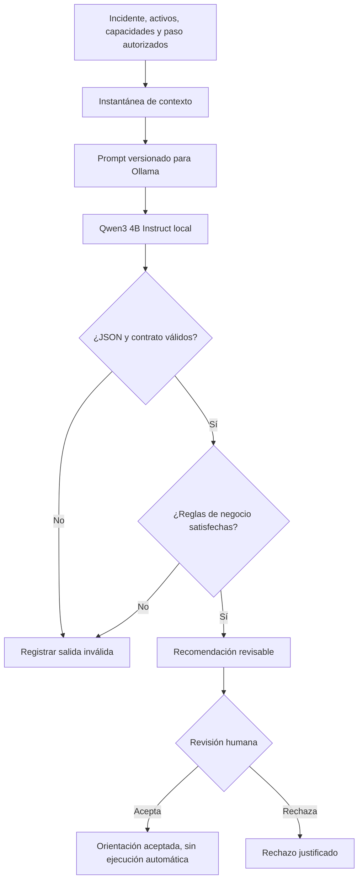

Tipos de solicitud: EXPLAIN_STEP, ADAPT_STEP, PROPOSE_PLAYBOOK y SUMMARIZE_INCIDENT. Cada evaluación conserva contexto (`jsonb` y hash), versión del esquema, modelo, digest si está disponible, plantilla de prompt/versionado, parámetros, duración, resultado y error.

Una recomendación estructuralmente válida **no** implica corrección técnica. El analista o administrador determina pertinencia. Cada recomendación tiene como máximo una decisión definitiva, para evitar sobrescribir el historial.

## 10.1. Propuestas de borradores

Una propuesta de cambios queda PENDING; ORG_ADMIN puede rechazarla o autorizar su conversión transaccional a borrador PRIVATE (`CONVERTED`). La publicación ocurre después mediante el flujo ordinario de playbooks. Las reglas deterministas prohíben degradar silenciosamente obligatoriedad, aprobaciones o dependencias.

## 10.2. Salidas originales del modelo

Las respuestas originales se conservarán **temporalmente** en `ai_response_payloads`, separadas de las métricas y recomendaciones válidas. El contenido se cifrará antes de su almacenamiento, con claves gestionadas fuera de la tabla, límites de tamaño, acceso restringido, expiración y eliminación controlada. Los plazos exactos, la gestión de claves y el tratamiento de respaldos están **pendientes** antes de habilitar almacenamiento real persistente.

# 11. Evidencias, archivos privados y trazabilidad

Las evidencias son de tipo TEXT, FILE o REFERENCE. Deben vincularse a un incidente y organización; su vínculo con una tarea es opcional. Si existe, la tarea deberá pertenecer al mismo incidente y tenant. Un registro FILE podrá tener un único archivo físico; varios adjuntos requieren evidencias independientes.

### 11.1. Tipos, clasificación y ciclo de vida

- Clasificación inicial: INTERNAL, CONFIDENTIAL, RESTRICTED; RESTRICTED exige permisos adicionales.
- Estado: ACTIVE o WITHDRAWN; no se sobrescribe silenciosamente la evidencia.
- ORG_ADMIN puede retirar con justificación. Se restringe acceso y se conserva la historia mínima compatible con retención y privacidad.
- Eliminación física condicionada a política operativa, registros de auditoría y control de almacenamiento.

### 11.2. Archivos

Formatos iniciales propuestos: PDF, PNG, JPEG y TXT; límite propuesto de 10 MB por adjunto. Se excluyen ejecutables y muestras de malware. La validación de extensión/MIME no equivale a detección antimalware. El backend establece un identificador físico seguro, calcula SHA-256 y controla toda descarga sin publicar el directorio de almacenamiento.

<!-- FIG:10:Carga y retirada de evidencias -->
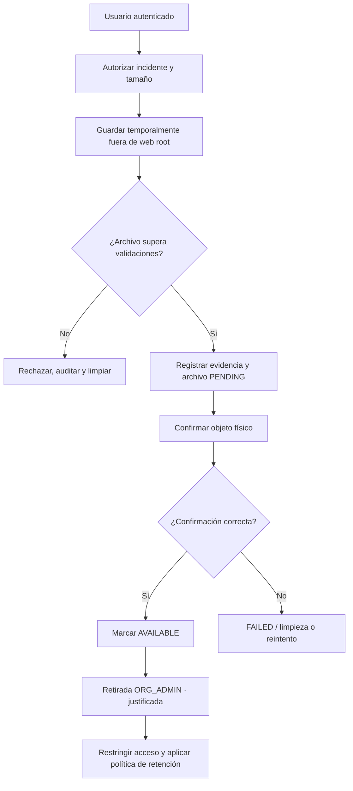

PostgreSQL y el sistema de archivos no comparten transacción: la persistencia se manejará mediante estados PENDING, AVAILABLE, QUARANTINED, FAILED y REMOVED, almacenamiento temporal y limpieza/reintentos idempotentes.

# 12. Auditoría de seguridad y separación de funciones

La auditoría conserva operaciones críticas en el esquema `audit`. Desde la aplicación será **append-only**: las credenciales normales no tendrán UPDATE, DELETE ni TRUNCATE sobre `audit_events`. La auditoría no será calificada como criptográficamente inmutable frente a administradores privilegiados; el encadenamiento criptográfico no forma parte del MVP.

<!-- FIG:11:Trazabilidad transversal -->
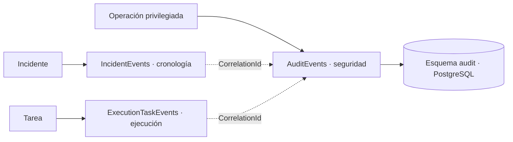

Campos principales: organization_id nullable para eventos globales, actor_user_id nullable, actor_type (USER, SYSTEM, ANONYMOUS), action, resource_type/id, outcome (SUCCESS, DENIED, FAILURE), correlation_id, detalles mínimos JSONB y fecha UTC. No se registrarán contraseñas, tokens, documentos adjuntos ni respuestas completas de Ollama.

Los eventos operativos de incidentes/tareas y la auditoría global son complementarios, no copias idénticas. Las modificaciones críticas de negocio y su evento de auditoría se insertarán en la misma transacción PostgreSQL. Los accesos denegados se registrarán por un mecanismo controlado separado.

# 13. Modelo entidad-relación consolidado (32 entidades)

## 13.1. Catálogo exhaustivo por dominio

| N.º | Entidad lógica | Tabla o implementación física | Datos/relaciones esenciales |
|---:|---|---|---|
| 1 | Users | `auth.asp_net_users` (Identity) | UUID, correo único normalizado, actividad, autenticación. |
| 2 | Organizations | `app.organizations` | UUID, slug único, estado, sector/país/tamaño, creador. |
| 3 | OrganizationMemberships | `app.organization_memberships` | organization_id, user_id, rol, estado; único org-usuario. |
| 4 | PlatformAdministrators | `app.platform_administrators` | user_id, otorgamiento/revocación de rol global. |
| 5 | CapabilityCatalog | `app.capability_catalog` | code único, categoría, descripción. |
| 6 | OrganizationCapabilities | `app.organization_capabilities` | organization_id, capability_id, estado y notas. |
| 7 | IncidentCapabilityAssessments | `app.incident_capability_assessments` | Incidente-capacidad, estado efectivo y motivo. |
| 8 | Assets | `app.assets` | Propiedad organizacional, tipo, criticidad, estado. |
| 9 | IncidentAssets | `app.incident_assets` | Incidente-activo opcional; nombre/tipo y criticidad histórica. |
| 10 | IncidentCategories | `app.incident_categories` | PHISHING, ACCOUNT_COMPROMISE, RANSOMWARE. |
| 11 | Incidents | `app.incidents` | Estado, CIA, severidad actual/máxima, responsables y revisión. |
| 12 | IncidentEvents | `app.incident_events` | Historial, actor, valores previos/nuevos y motivo. |
| 13 | IncidentClosureApprovals | `app.incident_closure_approvals` | Solicitud, revisor, severidad histórica y revisión. |
| 14 | Playbooks | `app.playbooks` | Público/privado, categoría, origen, versión vigente. |
| 15 | PlaybookVersions | `app.playbook_versions` | Número, estado, contenido publicado protegido. |
| 16 | PlaybookSteps | `app.playbook_steps` | Instrucción, posición, obligatorio, evidencia, aprobación. |
| 17 | PlaybookStepDependencies | `app.playbook_step_dependencies` | Predecesor, sucesor, misma versión y DAG. |
| 18 | PlaybookCapabilityRequirements | `app.playbook_capability_requirements` | Requisito por versión o paso. |
| 19 | PlaybookReviews | `app.playbook_reviews` | Revisión y decisión de publicación. |
| 20 | PlaybookExecutions | `app.playbook_executions` | Incidente, versión, estado, revisión, bloqueo de seguridad. |
| 21 | ExecutionTasks | `app.execution_tasks` | Instancia del paso, estado, incidente, asignación, revisión. |
| 22 | ExecutionTaskEvents | `app.execution_task_events` | Historial de cambios y excepciones. |
| 23 | ExecutionTaskApprovals | `app.execution_task_approvals` | Aprobación paso/omisión, riesgo residual y autoaprobación. |
| 24 | AIContextSnapshots | `app.ai_context_snapshots` | JSONB mínimo, esquema, hash y referencias de incidente/tarea. |
| 25 | AIRequests | `app.ai_requests` | Modelo, prompt, parámetros, latencia, resultado técnico. |
| 26 | AIRecommendations | `app.ai_recommendations` | Respuesta validada y estructura JSONB. |
| 27 | AIReviews | `app.ai_reviews` | Decisión definitiva humana única por recomendación. |
| 28 | AIPlaybookProposals | `app.ai_playbook_proposals` | Origen, cambios, revisión y borrador autorizado. |
| 29 | AIResponsePayloads | `app.ai_response_payloads` | Respuesta original cifrada, hash, expiración/eliminación. |
| 30 | Evidences | `app.evidences` | Texto, archivo o referencia, sensibilidad, retirada. |
| 31 | EvidenceFiles | `app.evidence_files` | Objeto privado, tamaño, tipo, hash, estado físico. |
| 32 | AuditEvents | `audit.audit_events` | Actor, acción, resultado, correlación, fecha. |

**Conteo:** 4 identidad + 5 capacidades/activos + 4 incidentes + 6 playbooks + 4 ejecución + 6 IA + 3 evidencias/auditoría = **32 entidades**. Las tablas técnicas adicionales de ASP.NET Core Identity (roles, claims, sesiones/tokens, etc.) no se incluyen en este conteo.

<!-- FIG:12:Mapa de dominios y relaciones -->
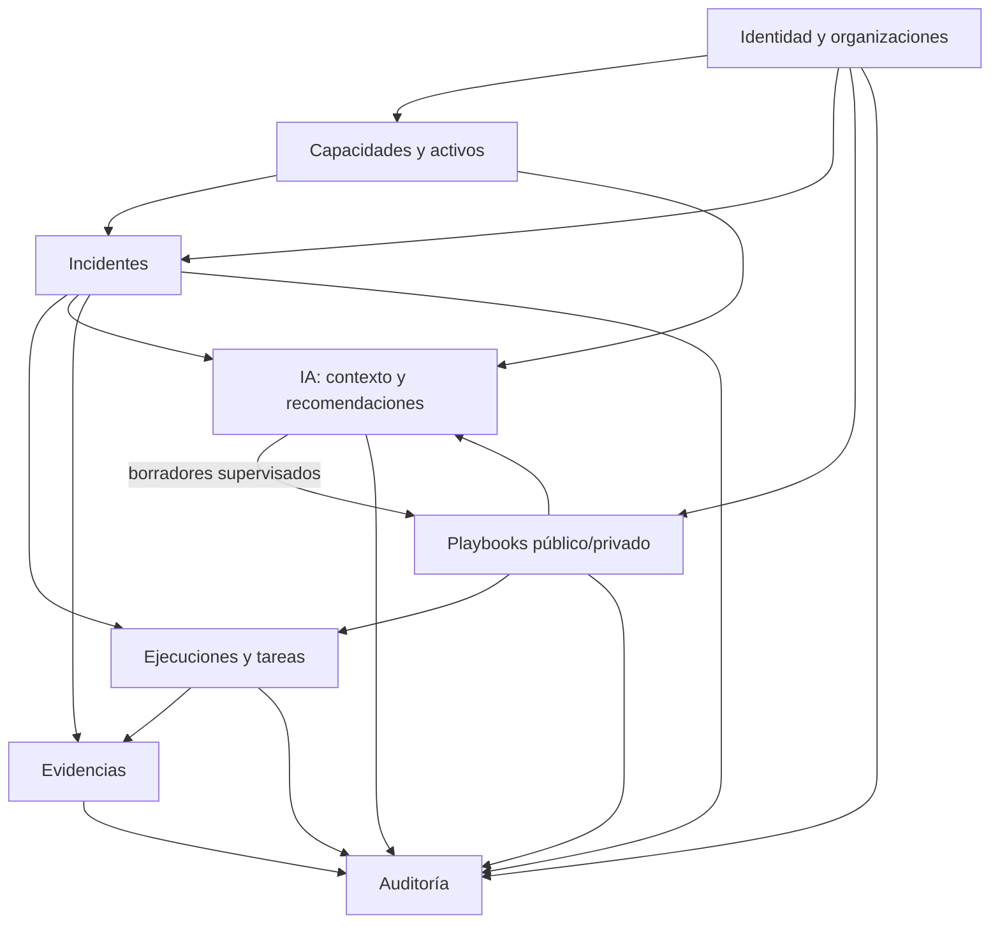

## 13.2. Cardinalidades críticas

- Users ↔ Organizations: N:M por OrganizationMemberships; una única membresía por par.
- Organizations → Incidents/Assets/Capabilities: 1:N; tenant obligatorio.
- Incidents ↔ Assets: N:M vía IncidentAssets, con activo opcional cuando no inventariado.
- Incidents → PlaybookExecutions: 1:N históricas, máximo una activa.
- Playbooks → PlaybookVersions → PlaybookSteps: 1:N sucesivas.
- PlaybookStepDependencies: grafo de pares de pasos de la **misma versión**.
- PlaybookVersions → PlaybookExecutions: 1:N, incluso versiones históricas retiradas.
- PlaybookExecutions → ExecutionTasks: 1:N; un paso por ejecución.
- Incident → Evidences: 1:N; ExecutionTask → Evidences: 0:N.
- AIContextSnapshot → AIRequests → AIRecommendations: 1:N; AIRecommendation → AIReview: 0:1.
- AIRecommendation → AIPlaybookProposal: 0:N, sujetas a aprobación humana.
- Evidence → EvidenceFile: 0:1.

# 14. Diseño físico de PostgreSQL y reglas de integridad

## 14.1. Convenciones

- PostgreSQL 17; schemas `auth`, `app` y `audit`.
- Tablas y columnas `snake_case`, plural para tablas, UUID para identificadores principales.
- Fechas: `timestamptz` en UTC; revisión de negocio: `bigint`.
- Códigos y estados: `varchar` con `CHECK` cuando corresponde.
- `jsonb` solamente para contexto, contenido de recomendaciones, parámetros, cambios propuestos y detalles limitados.
- Índices `ix_*`, únicos `ux_*`, claves foráneas `fk_*`.
- `ON DELETE RESTRICT` para referencias históricas y entidades auditables.

## 14.2. Restricciones clave (fragmentos ilustrativos, no migraciones listas)

```sql
-- Organizaciones: una membresía por usuario, independientemente del rol.
UNIQUE (organization_id, user_id)

-- Tenant de la asociación: el activo y el incidente deben compartir organización.
FOREIGN KEY (organization_id, incident_id)
  REFERENCES app.incidents (organization_id, id);
FOREIGN KEY (organization_id, asset_id)
  REFERENCES app.assets (organization_id, id);

-- Máximo una ejecución activa por incidente.
CREATE UNIQUE INDEX ux_executions_one_active_per_incident
  ON app.playbook_executions (incident_id)
  WHERE status = 'IN_PROGRESS';

-- Un paso ejecutado debe pertenecer a la versión de su ejecución.
FOREIGN KEY (organization_id, execution_id, playbook_version_id)
  REFERENCES app.playbook_executions
  (organization_id, id, playbook_version_id);
FOREIGN KEY (playbook_version_id, playbook_step_id)
  REFERENCES app.playbook_steps (version_id, id);

-- Auditoría: el usuario ordinario de conexión no podrá modificar históricos.
-- REVOKE/GRANT exactos se definirán al crear los roles y esquemas.
```

**Requisitos de materialización:** todas las combinaciones referenciadas deben estar respaldadas por UNIQUE/PK compatibles; las columnas obligatorias llevan NOT NULL. Las referencias con columnas opcionales requieren verificar conscientemente el comportamiento de claves nulas. Las claves foráneas por sí solas no comprueban los roles de los usuarios ni la vigencia de una versión.

## 14.3. Reglas que requieren transacción/validación de dominio

| Regla | Estrategia física o de dominio |
|---|---|
| Último administrador organizacional | Serializar cambios de membresías; impedir dejar cero ORG_ADMIN activos. |
| Alta de organización | Insertar organización y primer ORG_ADMIN en una misma transacción. |
| Cambio de severidad | Registrar evento e incrementar máximo histórico de manera monotónica. |
| Cierre | Exigir resolución, aprobación aplicable y misma revisión. |
| Publicación de playbook | Validar DAG y contenido; publicar y actualizar versión vigente atómicamente. |
| Retirada de versión insegura | Bloquear ejecuciones afectadas y auditar dentro de coordinación transaccional. |
| Clonación | Copiar playbook/versión/pasos, remapear identificadores y dependencias en transacción. |
| Conversión de propuesta IA | Crear borrador privado controlado sin duplicados por concurrencia. |
| Evidencia física | Estados de archivo y reconciliación; no existe transacción distribuida con sistema de archivos. |
| Auditoría | Insertar evento junto con operación de negocio crítica. |

## 14.4. Control de concurrencia

`revision` de negocio identifica la versión del incidente/tarea a la que está vinculada una aprobación y deberá incrementarse con cambios relevantes. Un token técnico de concurrencia EF Core/PostgreSQL no sustituye esa semántica. Las escrituras conflictivas se rechazarán/reintentarán de forma controlada. Índices únicos y transacciones evitan operaciones simultáneas incompatibles.

## 14.5. Permisos y RLS

Separamos migrador, aplicación y propietario de objetos. El usuario de aplicación tendrá únicamente las operaciones requeridas; sobre `audit.audit_events` será append-only, con lectura autorizada por backend. `PLATFORM_ADMIN` es rol de negocio y **no** equivale a superusuario PostgreSQL.

RLS está acordado para el endurecimiento antes de cualquier despliegue operativo con información real de múltiples organizaciones. Su diseño deberá contemplar propietarios/BYPASSRLS, variables seguras de contexto tenant, agrupación de conexiones, procesos globales y pruebas de fugas; no basta con activar políticas genéricas.

# 15. Estrategia de migraciones y pruebas de aceptación

<!-- FIG:13:Dependencias de implementación -->
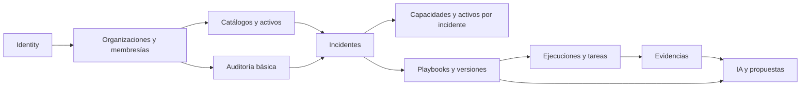

**Orden lógico validado:** (1) Identity, (2) organizaciones, (3) auditoría básica, (4) catálogos/activos, (5) incidentes, (6) relaciones de contexto, (7) playbooks/versiones, (8) ejecución, (9) evidencias, (10) IA. No implica exactamente diez migraciones físicas. El diseño de playbooks tiene una referencia circular controlada (`playbooks` ↔ `playbook_versions`) que se resolverá en la secuencia de creación/alteración de constraints.

## 15.1. Matriz mínima de pruebas de negocio y seguridad

| Caso | Resultado esperado |
|---|---|
| Crear organización sin primer administrador | Transacción completa revertida. |
| Revocar simultáneamente últimos administradores | Al menos uno permanece activo. |
| Reutilizar membresía de otra organización | Operación rechazada. |
| Vincular activo del tenant B a incidente de A | Rechazo por integridad y/o autorización. |
| Consultar incidente ajeno/sin membresía | Denegación. |
| Disminuir máxima severidad histórica | Operación rechazada. |
| Cerrar incidente antes crítico sin ORG_ADMIN | Rechazo de cierre. |
| Reutilizar aprobación después de cambiar incidente | Aprobación invalidada. |
| Modificar contenido de versión publicada | Modificación rechazada. |
| Iniciar ejecución con versión no vigente/retirada | Rechazo. |
| Iniciar dos ejecuciones activas concurrentes | Solo una prospera. |
| Asignar paso de otra versión a ejecución | Clave/validación rechaza. |
| Dependencia circular de playbook | Publicación rechazada. |
| Omitir tarea obligatoria sin autorización | Omisión rechazada. |
| Continuar ejecución durante bloqueo por seguridad | Transición rechazada. |
| Reutilizar autorización de bloqueo anterior | Rechazo. |
| Intentar descargar evidencia retirada o ajena | Denegación. |
| Cargar archivo inválido/malicioso conocido | Rechazo o cuarentena según controles efectivamente implantados. |
| Intentar UPDATE/DELETE de auditoría con rol app | Permiso denegado. |
| Caída Ollama durante ejecución | Playbook manual sigue disponible. |
| Salida IA con claves alteradas o permiso falso | Validación rechaza recomendación. |
| Expirar respuesta original IA | Contenido eliminado bajo política, métricas permitidas preservadas. |
| Recuperación de respaldos | Restauración documentada y probada en entorno seguro. |
| Políticas RLS antes del despliegue multi-tenant | Pruebas positivas/negativas verificadas. |

**Estado de la matriz:** criterios previstos, **no** suite implementada ni ejecutada aún.

# 16. Metodología de evaluación de la investigación

Se propone evaluar OpenIRP con **escenarios simulados y reproducibles** de phishing, compromiso de cuenta y ransomware, que no requieran acceso a una pyme real. Las capacidades organizacionales pueden representarse mediante perfiles ficticios contrastantes: empresa con soporte técnico básico frente a otra con herramientas y personal más especializado.

## 16.1. Comparaciones previstas

- **Condición base:** ejecución manual de playbook publicado sin asistencia de IA.
- **Condición asistida:** mismo escenario y procedimiento, con explicaciones/contexto de IA.
- **Condición adaptada:** propuesta aprobada de playbook privado, cuando exista y corresponda evaluar su reutilización.

El diseño experimental deberá definir previamente tareas, evaluadores, número de ensayos y medidas, evitando atribuir a la IA mejoras que provengan de diferencias en las condiciones de prueba. No hay actualmente resultados científicos verificados ni participantes reclutados.

## 16.2. Indicadores candidatos

| Indicador | Método posible | Limitación |
|---|---|---|
| Tiempo de respuesta | Duración por tarea y escenario | Depende de familiaridad y perfil del usuario. |
| Finalización de tareas | Proporción de tareas resueltas y excepciones justificadas | Finalizar no implica eficacia técnica real. |
| Aplicabilidad de recomendación | Rúbrica técnica por caso | Requiere evaluadores y criterios consistentes. |
| Cumplimiento estructural | Salidas que superan esquema/reglas | No demuestra corrección semántica. |
| Tasa de aceptación humana | Reviews ACCEPTED / total revisadas | Sesgada por capacitación y criterio del evaluador. |
| Tasa de fallos de IA | INVALID_OUTPUT, FAILED | Depende del modelo, prompt y contexto. |
| Latencia | Duración registrada en AIRequests | Condicionada por hardware/carga. |
| Trazabilidad | Completitud de evidencia/eventos | Depende de política de auditoría. |
| Aislamiento entre tenants | Pruebas de acceso cruzado negativas | Requiere validación sistemática; RLS pendiente. |

**Límite metodológico:** no se afirmará que una respuesta es segura por ser aceptada, ni que la plataforma mejora tiempos hasta ejecutar un experimento comparativo válido.

# 17. Riesgos, decisiones pendientes y criterios de salida

## 17.1. Riesgos priorizados

| Riesgo | Impacto | Mitigación planificada |
|---|---|---|
| Fuga de datos multiempresa | Crítico | Permisos, FK compuestas, pruebas cruzadas, RLS antes de producción. |
| Salida errónea/hallucination de IA | Alto | Contratos, reglas deterministas, revisión humana, no ejecución automática. |
| Alteración de playbook publicado | Alto | Protección de contenido, nueva versión, auditoría. |
| Procedimiento inseguro ya en ejecución | Alto | Retirada con bloqueo y revisión por ORG_ADMIN. |
| Uso indebido de autoaprobaciones | Alto | Justificación visible y auditoría, no confundir con independencia. |
| Evidencia potencialmente peligrosa | Alto | Validación, aislamiento, límites y restricciones de formato. |
| Inconsistencia BD/archivos | Medio-alto | Estados PENDING/FAILED, reconciliación y limpieza segura. |
| Exceso de alcance de 32 entidades | Alto | Implementación por módulos y límites MVP. |
| Pérdida/exposición de datos de IA | Alto | Cifrado, mínima retención, claves protegidas, expiración. |
| Ausencia de pyme piloto | Medio-alto | Casos sintéticos, perfiles reproducibles, reconocer límites externos. |
| Ausencia de evidencias de pruebas | Alto | Matriz con pruebas automatizadas, registros y artefactos verificables. |

## 17.2. Pendientes que no bloquean el inicio del Paso 26, pero sí hitos posteriores

1. Especificar y verificar la **regla determinista de severidad** basada en CIA, criticidad y alcance, incluida política para valores desconocidos.
2. Definir **plazos y bases de retención** de evidencias, auditoría y respuestas originales de IA; procedimiento de eliminación y respaldos.
3. Diseñar **gestión real de claves de cifrado** y acceso al contenido original de respuestas de IA.
4. Materializar de forma precisa las **claves únicas/foráneas compuestas**, incluyendo relaciones versión-ejecución-tarea-evidencia y propiedad del borrador IA.
5. Completar diseño de **inmutabilidad física** y protección de estados publicados.
6. Establecer política de **cuotas de almacenamiento**, disponibilidad, copia y recuperación.
7. Implementar y verificar **RLS** antes del despliegue multi-tenant con datos reales.
8. Definir permisos específicos para evidencias `RESTRICTED` y sus pruebas.
9. Alinear las **rúbricas, hipótesis, criterios de evaluación y evidencias** con los cinco objetivos específicos ya definidos y la versión académica aprobada.
10. Acordar estándares operativos de despliegue, observabilidad, pruebas de seguridad y gestión de secretos.

## 17.3. Criterios mínimos antes de uso real multiempresa

- Autenticación y autorización verificadas; zero cross-tenant en pruebas negativas previstas.
- RLS y roles de SQL restringidos y ensayados.
- Evidencias con validación, almacenamiento no público y restauración probada.
- Auditoría activa, íntegra desde el modelo de permisos y con retención definida.
- Gestión de secretos y backups/restauración con procedimientos probados.
- Evaluación de riesgos de IA, controles de salida y revisión humana.

# 18. Hoja de ruta a partir del Paso 26

**No quedan pasos adicionales obligatorios de planificación general.** El Paso 26 comienza el desarrollo del primer agregado de dominio y la primera migración, usando el esquema consolidado.

| Fase de implementación | Objetivo | Evidencia de aceptación |
|---|---|---|
| Paso 26 / Iteración 1 | Identity, organizaciones y membresías | Migraciones controladas; acceso autenticado y pruebas de roles/tenant. |
| Iteración 2 | Catálogos, capacidades y activos | Operaciones CRUD autorizadas y FK compuestas verificadas. |
| Iteración 3 | Incidentes, CIA, historial, cierre | Transiciones, máximo histórico y aprobaciones probadas. |
| Iteración 4 | Playbooks, versiones, DAG y clonación | Publicación, inmutabilidad, retirada y aislamiento probados. |
| Iteración 5 | Ejecuciones, tareas, omisiones | Concurrencia, dependencias, bloqueos y aprobaciones probados. |
| Iteración 6 | Evidencias y auditoría integral | Cargas seguras, restricciones, retirada y logs auditable. |
| Iteración 7 | Ollama y recomendaciones | Contextos, validación, revisión y borradores supervisados. |
| Endurecimiento | RLS, backups, secretos, integraciones seguras | Batería de seguridad y recuperación superada. |
| Evaluación académica | Casos reproducibles y medición | Datos y análisis sustentados; límites transparentes. |

**Criterio de inicio de la implementación:** aceptar esta documentación como línea base, mantener los pendientes explícitos y no crear todas las tablas en una única migración inicial.

# 19. Glosario y documentos de referencia

| Término | Significado en OpenIRP |
|---|---|
| Multi-tenant | Una plataforma sirve a varias organizaciones con aislamiento de datos. |
| Tenant | Organización dueña de incidentes, activos, evidencias y playbooks privados. |
| Membership | Asociación de usuario y organización que define el rol local. |
| Playbook | Plantilla versionada de pasos para responder a un incidente. |
| Ejecución | Instancia histórica de una versión de playbook aplicada a un incidente. |
| Dependencia | Condición entre pasos que regula cuándo puede comenzar una tarea. |
| Omisión autorizada | Excepción documentada que no equivale a completar una tarea. |
| CIA | Confidencialidad, integridad y disponibilidad. |
| Severidad máxima | Nivel más alto alcanzado en todo el ciclo de vida del incidente. |
| RLS | Row-Level Security de PostgreSQL; filtrado de filas según políticas. |
| FK compuesta | Relación que incluye identificador y organización para impedir mezcla de tenants. |
| Snapshot | Instantánea inmutable de contexto relevante para una evaluación de IA. |
| Append-only | Registros que la aplicación puede agregar, pero no editar o borrar ordinariamente. |
| Residual risk | Riesgo que permanece tras medidas y excepciones aplicadas. |
| MVP | Producto mínimo viable delimitado para la tesis. |

### Bases de la compilación

- Decisiones del proyecto **OpenIRP** registradas durante las conversaciones de planificación (pasos 1–25, octubre de 2026).
- Información técnica previamente reportada del entorno Docker/.NET/PostgreSQL/Ollama; **no se realizó una nueva inspección del repositorio ni del equipo** al producir este documento.
- Referencia académica del proyecto: presentación `OpenIRP_Exposicion_15min_Referencias.pptx` y trabajo AICC300 del 16 de octubre de 2026, de donde se mantienen el título y los cinco objetivos específicos. Documentos de instrucciones identificados: `aicc200_s1_instrucciones.pdf`, `aicc200_s1_orientaciones.pdf` y `aicc300_s1_instrucciones.pdf`. No se atribuyen a estos PDFs las decisiones técnicas que se tomaron en las conversaciones; la alineación detallada con sus rúbricas deberá revisarse al preparar el informe académico.

### Documentación técnica oficial útil para la implementación (enlaces de referencia)

- PostgreSQL 17: <https://www.postgresql.org/docs/17/>
- PostgreSQL — restricciones: <https://www.postgresql.org/docs/17/ddl-constraints.html>
- PostgreSQL — Row-Level Security: <https://www.postgresql.org/docs/17/ddl-rowsecurity.html>
- ASP.NET Core Identity: <https://learn.microsoft.com/aspnet/core/security/authentication/identity>
- EF Core: <https://learn.microsoft.com/ef/core/>
- Npgsql EF Core: <https://www.npgsql.org/efcore/>
- Ollama: <https://docs.ollama.com/>

Los enlaces sirven de referencia general, no de certificación de que una versión o una característica esté implementada.

# 20. Anexos de reglas y casos de prueba

## Anexo A. Decisiones cerradas

| Código de decisión | Acuerdo definitivo |
|---|---|
| DEC-01 | Catálogo público + privado; usuarios multi-organización. |
| DEC-02 | ORG_ADMIN/ANALYST/VIEWER por membresía; PLATFORM_ADMIN separado. |
| DEC-03 | Seis estados de incidente y cierre por máxima severidad histórica. |
| DEC-04 | Evaluación CIA estructurada, fórmula por definir. |
| DEC-05 | Tareas flexibles, dependencias explícitas y una ejecución activa por incidente. |
| DEC-06 | Excepciones para tareas obligatorias con riesgo residual y ORG_ADMIN. |
| DEC-07 | Autoaprobación excepcional y auditada por ORG_ADMIN. |
| DEC-08 | Propuestas de IA convertidas a borrador solo con autorización de ORG_ADMIN. |
| DEC-09 | Perfil de capacidades más excepciones por incidente y snapshots de IA. |
| DEC-10 | Activos no inventariados pueden registrarse en incidente y vincularse luego. |
| DEC-11 | Adjuntos privados controlados; retirada justificada; retención aplicable. |
| DEC-12 | Solo versión vigente para nuevas ejecuciones; retirada sin sustituta permitida. |
| DEC-13 | Retirada por seguridad bloquea tareas de ejecuciones activas hasta revisión. |
| DEC-14 | Respuestas originales IA cifradas y temporales; política pendiente. |
| DEC-15 | Auditoría append-only, sin cadena criptográfica en MVP. |
| DEC-16 | RLS durante endurecimiento, antes de uso real multiempresa. |
| DEC-17 | Creación de organizaciones exclusiva de PLATFORM_ADMIN. |

## Anexo B. Reglas de autorización y límites de IA

Una operación debe vincular usuario, organización activa, membresía vigente, permiso de acción y objeto del mismo tenant. Para playbooks públicos se aplicará un régimen de lectura global, sin facultades de edición a administradores organizacionales. Para la IA, la solicitud deberá pasar por autorización y minimización, validación estructural, reglas deterministas y revisión humana; el contenido generado nunca tendrá capacidad directa de ejecución.

## Anexo C. Evidencias académicas a producir

1. Migraciones y diagramas ER definitivos desde el esquema ejecutado.
2. Pruebas automáticas positivas/negativas de tenant y permisos.
3. Capturas y registros de escenarios sintéticos con distintos recursos.
4. Métricas de inferencia y validación del modelo, sin revelar datos sensibles.
5. Matriz de comparación entre procedimiento base, asistencia IA y adaptación supervisada.
6. Informe técnico de resultados, riesgos residuales y limitaciones del prototipo.

---

**Fin de la línea base de planificación.** Próxima actividad autorizada: Paso 26 — implementación incremental de Identity, organizaciones y membresías. Cualquier desviación de las decisiones cerradas deberá documentarse con su motivación, impacto, nueva versión del diseño y pruebas asociadas.
