# OpenIRP — Documento maestro de planificación y diseño técnico

**Open Incident Response Platform (OpenIRP)**  
**Título académico del proyecto:** “Implementación de una plataforma web para la recomendación contextual de playbooks de respuesta a incidentes de ciberseguridad con IA asistida para PYMES.”  
**Versión del documento:** 1.0 — línea base previa a implementación  
**Corte de información:** 21 de octubre de 2026  
**Estado:** planificación funcional y diseño físico preliminar consolidados; implementación del núcleo de negocio pendiente  
**Ámbito:** investigación académica, producto MVP open source y arquitectura de software segura para pymes  
**Repositorio de trabajo declarado:** `github.com/Romulo3094/OpenIRP`

> **Control de alcance.** Este documento recopila los acuerdos alcanzados en los pasos 1–25 de planificación. Especificaciones, reglas, esquemas SQL y diagramas representan diseños aprobados o propuestas de materialización; **no prueban que las tablas, controles ni funciones estén implementados**. Las pruebas locales históricas de Ollama, Docker y la API se distinguen expresamente de las pruebas de negocio futuras. No constituye todavía evidencia de validación productiva ni una tesis final.

## Índice de contenido

1. Resumen ejecutivo y estado del proyecto
2. Trazabilidad de los 25 pasos de planificación
3. Problema, objetivos y delimitación del MVP
4. Arquitectura y despliegue previstos
5. Usuarios, organizaciones, roles y seguridad multi-tenant
6. Capacidades organizacionales y activos tecnológicos
7. Incidentes: ciclo de vida, impacto CIA y aprobaciones
8. Playbooks: catálogo, versiones, pasos y publicación
9. Ejecuciones, tareas, dependencias y excepciones
10. Asistencia local mediante IA y propuestas supervisadas
11. Evidencias, archivos privados y trazabilidad
12. Auditoría de seguridad y separación de funciones
13. Modelo entidad-relación consolidado (32 entidades)
14. Diseño físico de PostgreSQL y reglas de integridad
15. Estrategia de migraciones y pruebas de aceptación
16. Metodología de evaluación de la investigación
17. Riesgos, decisiones pendientes y criterios de salida
18. Hoja de ruta a partir del Paso 26
19. Glosario y documentos de referencia
20. Anexos de reglas y casos de prueba

---

# 1. Resumen ejecutivo y estado del proyecto

OpenIRP es una **plataforma web abierta de apoyo a la respuesta a incidentes de ciberseguridad**, dirigida principalmente a pequeñas y medianas organizaciones con recursos humanos y tecnológicos limitados. Su propuesta consiste en combinar playbooks reutilizables y versionados, seguimiento operativo de tareas, evidencias y trazabilidad, con asistencia contextual de **inteligencia artificial local mediante Ollama**, sin conferirle capacidad de ejecutar acciones sobre la infraestructura de la empresa.

La plataforma será multiempresa (*multi-tenant*): utilizará una base de datos PostgreSQL compartida, pero protegerá los datos de cada organización mediante identidad, membresías, autorización, integridad referencial compuesta y, antes de cualquier uso operativo con información real de varias organizaciones, políticas Row-Level Security (RLS) verificadas.

**Situación al corte.** Se completaron 25 pasos de decisión funcional y diseño conceptual/físico preliminar. El paso 26 inicia la **implementación**. No quedan nuevos pasos de planificación obligatorios antes de comenzar, aunque aún existen detalles técnicos que deben resolverse al materializar las migraciones, pruebas y políticas operativas.

### 1.1. Hechos técnicos previamente reportados y alcance de su verificación

| Componente | Situación reportada en sesiones previas | Lo que no debe inferirse |
|---|---|---|
| Equipo de desarrollo | Windows, 32 GB RAM, CPU Intel Core i7-8700 y RTX 3070 8 GB | No implica capacidad dimensionada para producción multiusuario. |
| Infraestructura local | Docker Desktop/WSL2; PostgreSQL 17 y Ollama en contenedores; persistencia y conectividad local probadas | No se han realizado pruebas de carga, respaldo/restauración productiva ni seguridad completa. |
| Ollama | `qwen3:4b` y `qwen3:4b-instruct`; prueba local con aceleración GPU | No certifica seguridad o calidad de todas sus recomendaciones. |
| Pruebas de IA | Respuestas útiles, pero también errores de claves JSON y de campos de aprobación; aproximación de inferencia de unos segundos en un caso local | Los tiempos no son SLA y los errores impiden confiar en la salida sin validación. |
| Backend | Solución .NET 10 con proyectos Domain, Application, Infrastructure y Api; endpoint `/api/health` probado | No equivale a tener implementados incidentes, autenticación, playbooks o migraciones. |
| Base de datos | Contenedor PostgreSQL y acceso desde el entorno local, con persistencia revisada | No equivale a existencia de tablas del dominio ni RLS. |

**Entregables de esta línea base:** este Markdown, el documento Word equivalente y una biblioteca de figuras reproducibles. Una vez aceptados, se puede iniciar el Paso 26 sin regresar al levantamiento general de requisitos.

# 2. Trazabilidad de los 25 pasos de planificación

Los pasos se documentan según las decisiones de negocio y diseño realizadas a lo largo del proyecto. En los primeros pasos, los números agrupan el dominio trabajado; en los pasos 11–25 corresponden a los bloques de diseño expresamente revisados.

| Pasos | Materia | Acuerdo o resultado |
|---|---|---|
| 1 | Modelo de organizaciones | Multi-tenant compartido, aislamiento estricto por empresa. |
| 2 | Usuarios y roles | Un usuario puede pertenecer a varias empresas; rol independiente por membresía. |
| 3 | Gestión de incidentes | Seis estados; cierre por severidad con autorización. |
| 4 | Catálogo de playbooks | Catálogo público global + playbooks privados por organización. |
| 5 | Ejecución | Tareas flexibles con dependencias; evidencias y aprobaciones. |
| 6 | IA asistiva | Contextualización y propuestas reutilizables, siempre supervisadas. |
| 7 | Capacidades de las pymes | Perfil general más limitaciones por incidente. |
| 8 | Activos | Inventario flexible y activos todavía no inventariados. |
| 9 | Evidencias y auditoría | Documentación textual, adjuntos controlados, historia y trazabilidad. |
| 10 | Consolidación de negocio | Solo PLATFORM_ADMIN crea organizaciones y designa primer ORG_ADMIN. |
| 11 | Identidad ER | ASP.NET Core Identity + membresías propias de OpenIRP. |
| 12 | Capacidades ER | Instantáneas de contexto relevante para cada evaluación de IA. |
| 13 | Incidentes ER | Cierre según máxima severidad histórica alcanzada. |
| 14 | Playbooks ER | Solo versión vigente inicia nuevas ejecuciones. |
| 15 | Ejecuciones ER | Omisiones obligatorias excepcionales autorizadas por ORG_ADMIN. |
| 16 | IA ER | ORG_ADMIN autoriza convertir una propuesta en borrador privado. |
| 17 | Evidencias ER | Retirada controlada con mínimos metadatos y auditoría. |
| 18 | Auditoría y revisión | Autoaprobación excepcional de ORG_ADMIN con justificación explícita. |
| 19 | Diseño físico inicial | Integridad y permisos primero; RLS obligatorio antes de operación real multi-tenant. |
| 20 | Incidentes físicos | Impactos C/I/A estructurados y reglas deterministas de severidad pendientes. |
| 21 | Playbooks físicos | Retirada de versión vigente incluso sin sustituta. |
| 22 | Ejecución física | Bloqueo preventivo de tareas si versión retirada por seguridad. |
| 23 | IA física | Retención temporal protegida de respuestas originales de Ollama. |
| 24 | Evidencias físicas | Auditoría append-only con privilegios restringidos, transacciones y respaldos. |
| 25 | Revisión integral | Correcciones transversales y secuencia de migraciones validadas como línea base. |

# 3. Problema, objetivos y delimitación del MVP

## 3.1. Necesidad de investigación

Las organizaciones pequeñas pueden carecer de equipos SOC, personal de respuesta especializado, SIEM o herramientas de contención. Un procedimiento de respuesta genérico puede resultar poco aplicable si exige recursos ausentes. OpenIRP busca estudiar la **viabilidad y utilidad** de apoyar la ejecución documentada de playbooks mediante recomendaciones de IA contextualizadas a capacidades y condiciones del incidente, sin automatizar acciones peligrosas ni reemplazar el juicio humano.

## 3.2. Objetivo funcional central

Diseñar, implementar y evaluar un prototipo web open source que permita gestionar incidentes y ejecutar playbooks versionados, incorporando asistencia de IA local con controles deterministas, revisión humana, evidencia y auditoría en un contexto multiempresa.

### 3.2.1. Cinco objetivos específicos mantenidos en la presentación académica

Se conserva la redacción de los **cinco objetivos específicos** de la presentación académica de OpenIRP del 16 de octubre de 2026:

1. **Analizar** las necesidades de respuesta a incidentes de ciberseguridad en las PYMES, mediante la revisión de antecedentes técnicos y procedimientos existentes, para identificar los criterios que permitan contextualizar las recomendaciones de la plataforma.
2. **Diseñar** un conjunto de playbooks de respuesta a incidentes de ciberseguridad, mediante la definición de procedimientos estructurados para distintos tipos de incidentes, con la finalidad de establecer una base de conocimiento que permita orientar las recomendaciones.
3. **Implementar** una plataforma web que permita registrar las características de un incidente y el contexto de una organización, mediante el desarrollo de funcionalidades para la selección y presentación de playbooks de respuesta.
4. **Integrar** un componente de inteligencia artificial asistida para recomendar y adaptar playbooks de respuesta a incidentes, utilizando los procedimientos previamente definidos y la información contextual proporcionada por los usuarios.
5. **Evaluar** el funcionamiento de la plataforma y la pertinencia de sus recomendaciones, mediante la ejecución de casos de prueba basados en incidentes simulados, con la finalidad de verificar su correspondencia con las características y necesidades de respuesta establecidas.

Estos objetivos orientan la implementación y la evaluación. Aún resta concretar rúbricas, indicadores operacionales y alcance empírico de cada uno; **no corresponde reformularlos sin una decisión explícita**.

## 3.3. Alcance del MVP

**Incluye:** identidad y roles, organizaciones, incidentes de phishing/compromiso de cuentas/ransomware, clasificación por impacto CIA y severidad, catálogo público y privado de playbooks, versionado inmutable, ejecución manual guiada con tareas y dependencias, aprobaciones y excepciones, inventario simplificado, capacidades organizacionales y limitaciones de incidente, Ollama asistivo, evidencias textuales y adjuntos controlados, trazabilidad y auditoría.

**Excluye en esta fase:** integración SIEM/SOAR, respuesta autónoma, ejecución remota de comandos, aislamiento real de endpoints, motor BPMN, descubrimiento automático de activos, análisis forense de malware, entrenamiento/fine-tuning de modelos, despliegue multiempresa productivo sin RLS y controles pendientes.

## 3.4. Principios no negociables

1. El backend decide permisos y transiciones; el frontend nunca es fuente de autoridad.
2. La IA sugiere, explica y propone borradores; no modifica estados por sí misma.
3. Las versiones de playbooks publicadas no cambian de contenido.
4. Las acciones y omisiones se documentan, con permisos y trazabilidad.
5. Los datos privados nunca se mezclan entre organizaciones.
6. El prototipo debe funcionar sin Ollama, usando los playbooks originales.
7. Ningún esquema o control planificado se declarará probado sin evidencia verificable.

# 4. Arquitectura y despliegue previstos

<!-- FIG:01:Arquitectura funcional OpenIRP -->
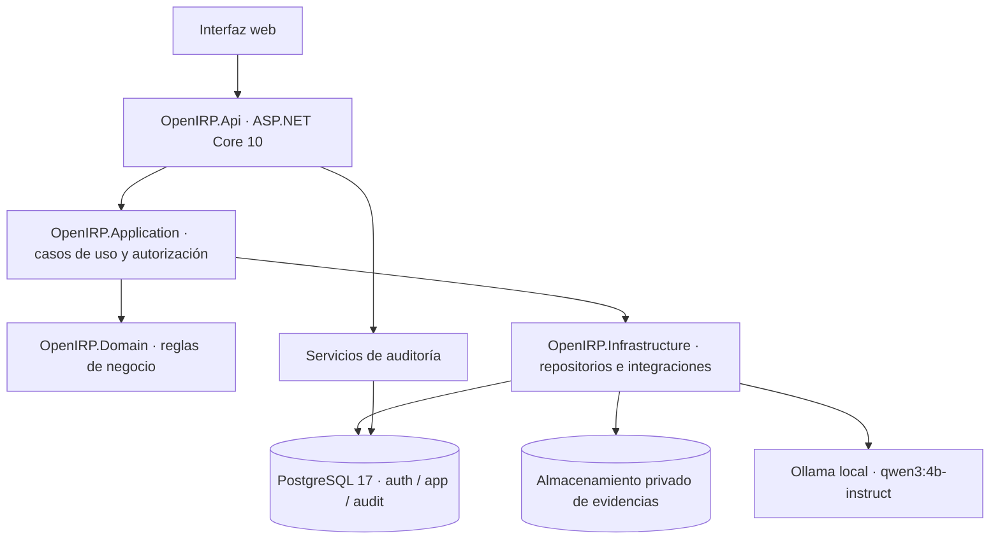

La solución está concebida como **modular monolith** para un MVP: dominio, aplicación, infraestructura y API separados, pero sin distribuir prematuramente el negocio en microservicios. La interfaz web consumirá la API; PostgreSQL gestionará persistencia transaccional, mientras Ollama operará como servicio local y los archivos se almacenarán en un volumen privado.

### 4.1. Componentes de proyecto ya creados (según reporte histórico)

- `apps/api/OpenIRP.slnx`
- `OpenIRP.Domain`: reglas y entidades de dominio, sin dependencia directa de EF Core.
- `OpenIRP.Application`: casos de uso, validaciones de negocio y coordinación.
- `OpenIRP.Infrastructure`: EF Core, Npgsql, almacenamiento, integración Ollama.
- `OpenIRP.Api`: controladores, autenticación, middleware y endpoints.
- `infra/compose.yaml`: infraestructura local para PostgreSQL/Ollama.

La API y la base de datos se consideran infraestructura inicial, **no** implementación completada del negocio. La adopción de Identity/EF Core y todas las migraciones siguen sujetas al Paso 26.

<!-- FIG:02:Despliegue local y límites de confianza -->
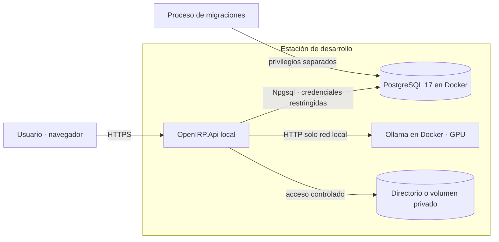

**Puertos reportados del desarrollo local:** PostgreSQL en `127.0.0.1:5433`, Ollama en `127.0.0.1:11435`, API de desarrollo en `https://localhost:7080` para su endpoint de salud. Estos son datos del entorno local histórico, no interfaces que deban exponerse públicamente.

# 5. Usuarios, organizaciones, roles y seguridad multi-tenant

## 5.1. Identidad y membresía

Un usuario dispone de una identidad global y puede mantener una membresía por organización, con rol distinto en cada una. `PLATFORM_ADMIN` es una facultad global independiente de los roles organizacionales; no obtiene acceso automático a información privada de incidentes y evidencias.

<!-- FIG:03:Identidad y pertenencia multiempresa -->
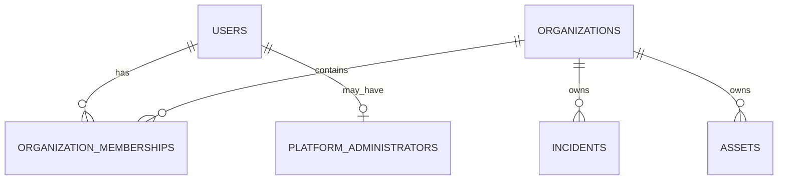

## 5.2. Matriz inicial de roles

| Acción | PLATFORM_ADMIN | ORG_ADMIN | ANALYST | VIEWER |
|---|---|---|---|---|
| Crear organización/primer administrador | Sí | No | No | No |
| Administración global de catálogo público | Sí | No | No | No |
| Ver incidentes privados sin membresía | No, por defecto | No | No | No |
| Administrar miembros de su organización | No por rol global | Sí | No | No |
| Publicar playbooks privados de su empresa | No por rol global | Sí | No | No |
| Registrar/gestionar incidentes propios del tenant | No por rol global | Sí | Sí | Solo lectura |
| Ejecutar tareas de playbook | No por rol global | Sí | Sí | No |
| Revisar recomendaciones de IA del incidente | No por rol global | Sí | Sí | Solo lectura autorizada |
| Aprobar cierre de incidente alto/crítico | No por rol global | Sí | No | No |
| Autorizar omisión obligatoria | No por rol global | Sí | No | No |
| Retirar evidencia | No por rol global | Sí, controlado | No | No |

La pertenencia y rol se revisan en **cada operación protegida**. La organización activa no se considera confiable por aparecer en la URL, cuerpo o encabezado de una solicitud. Debe existir al menos un `ORG_ADMIN` activo por organización; su revocación requiere operación segura frente a concurrencia.

## 5.3. Alta de organizaciones

Solo `PLATFORM_ADMIN` crea una organización y designa a su primer `ORG_ADMIN`. Ambas escrituras se ejecutarán dentro de una misma transacción. El primer administrador global se aprovisionará mediante proceso seguro de inicialización, sin credenciales predeterminadas ni endpoints públicos.

## 5.4. Defensa en profundidad

- **Autenticación:** ASP.NET Core Identity con UUID, hash y mecanismos estándar.
- **Autorización:** membresía y rol vigentes; separación entre roles globales y organizacionales.
- **Integridad:** claves foráneas compuestas con `organization_id`.
- **Persistencia:** usuario de API con privilegios limitados, distinto al de migraciones.
- **RLS:** políticas PostgreSQL diseñadas e implementadas antes del uso operativo con datos reales de varias empresas; no presentes en primera iteración local.
- **Pruebas:** acceso cruzado, suspensiones, duplicidad de membresía y carrera de último administrador.

# 6. Capacidades organizacionales y activos tecnológicos

Las recomendaciones de IA deberán considerar **recursos declarados por la empresa** y **limitaciones particulares del incidente**. Una capacidad ausente de catálogo organizacional se interpreta como `UNKNOWN`, no como no disponible. La disponibilidad en un incidente puede diferir del perfil general sin reescribirlo.

<!-- FIG:04:Capacidades generales y condiciones del incidente -->
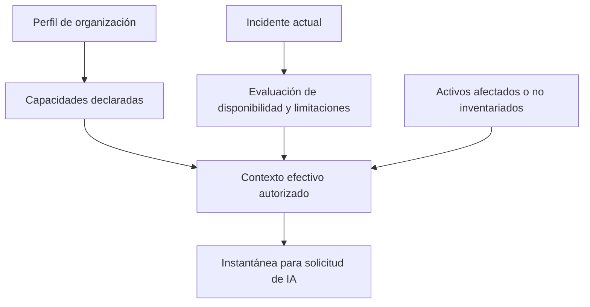

**Catálogo inicial:** IT_STAFF, SECURITY_SPECIALIST, EXTERNAL_SUPPORT, ENDPOINT_PROTECTION, SECURITY_LOGS, MFA, BACKUPS, DEVICE_ISOLATION y otras capacidades extensibles. Estados: AVAILABLE, UNAVAILABLE y UNKNOWN. Solamente ORG_ADMIN cambia el perfil general; un ANALYST puede documentar limitaciones específicas durante el incidente.

## 6.1. Activos y vinculación flexible

El inventario incluye servidores, estaciones de trabajo, servicios en nube, cuentas, aplicaciones, dispositivos de red y servicios críticos. Criticidad: LOW, MEDIUM, HIGH; distinta de la severidad del incidente. Un incidente puede afectar múltiples activos y un activo aparecer en varios incidentes.

Si un activo no está inventariado, el analista registra `reported_name`, `reported_type` y contexto dentro de `incident_assets` con `asset_id = NULL`. Puede vincularse más tarde a `assets`, **sin sobrescribir los datos y criticidad históricos registrados**.

# 7. Incidentes: ciclo de vida, impacto CIA y aprobaciones

## 7.1. Categorías y estados

Categorías iniciales: PHISHING, ACCOUNT_COMPROMISE y RANSOMWARE. El catálogo permite extensiones futuras. Estados: REGISTERED, UNDER_EVALUATION, IN_RESPONSE, RESOLVED, CLOSED, DISCARDED.

<!-- FIG:05:Ciclo de vida de incidentes -->
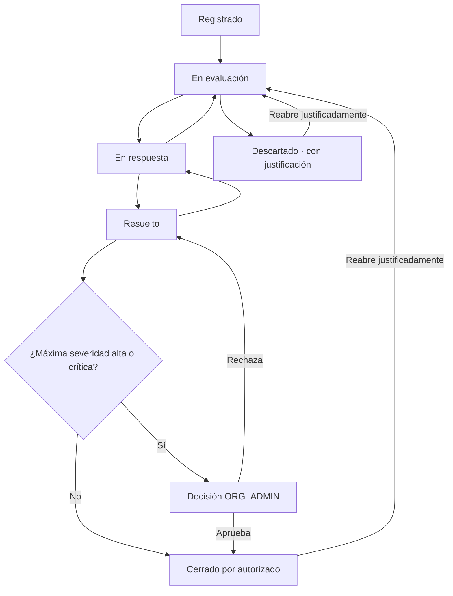

Cada cambio registra el usuario, instante y motivo en `incident_events`. No habrá eliminación física ordinaria de incidentes. El cambio de estado es transaccional y sujeto a permisos.

## 7.2. Severidad e impacto CIA

Se almacenan `confidentiality_impact`, `integrity_impact` y `availability_impact` con valores NONE/LOW/MEDIUM/HIGH y `NULL` cuando la dimensión aún no ha sido evaluada. `severity` expresa gravedad actual (LOW/MEDIUM/HIGH/CRITICAL); `maximum_severity_reached` mantiene el máximo histórico y nunca disminuye.

La severidad se determinará mediante una **regla determinista todavía por especificar y verificar**, considerando impactos CIA, criticidad de activos, alcance y afectación operacional. No se fija una fórmula arbitraria en este documento.

## 7.3. Cierre y autoaprobación

Incidentes LOW/MEDIUM pueden ser cerrados por el analista asignado autorizado, con resolución documentada. Si el incidente alcanzó HIGH o CRITICAL en cualquier momento, el cierre requiere autorización de ORG_ADMIN asociada a una revisión del incidente. Las decisiones APPROVED, REJECTED, PENDING e INVALIDATED se registran; una modificación relevante invalida la aprobación anterior.

Se admite **autoaprobación excepcional por ORG_ADMIN**, identificada expresamente como tal y con justificación. No se presenta como doble control independiente. Reaperturas, descartes y cambios de severidad requieren justificación y auditoría.

# 8. Playbooks: catálogo, versiones, pasos y publicación

Existen playbooks `PUBLIC` (globales; `organization_id IS NULL`) y `PRIVATE` (propiedad de la organización). Solo PLATFORM_ADMIN administra el catálogo público; ORG_ADMIN publica los procedimientos privados.

<!-- FIG:06:Ciclo de vida y clonación de playbooks -->
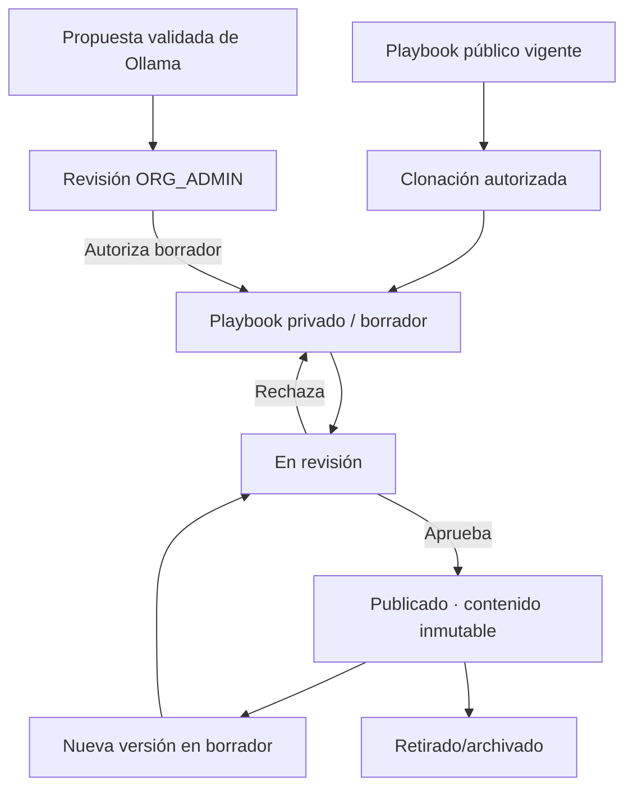

## 8.1. Reglas de versionado

- Cada playbook contiene versiones numeradas; `(playbook_id, version_number)` es único.
- Estados de versión: DRAFT, IN_REVIEW, PUBLISHED y ARCHIVED.
- La versión vigente se indica con `current_published_version_id`; no se infiere mediante `MAX(version_number)`.
- Solo la vigente inicia nuevas ejecuciones; las anteriores permanecen para consulta o ejecuciones históricas.
- Puede retirarse la versión vigente sin sustituta; el puntero pasa a NULL.
- Publicaciones y retiradas son transaccionales y auditadas.
- Un procedimiento clonado obtiene nuevos UUID para playbook, versión, pasos y dependencias, manteniendo `source_version_id` como referencia de origen.
- Las versiones publicadas son inmutables en contenido (objetivo, instrucciones, pasos, dependencias y requisitos); su vigencia administrativa puede cambiar.

## 8.2. Pasos, dependencias y capacidades

Los pasos registran código, posición recomendada, fase, instrucciones, `is_required`, `requires_approval` y `requires_evidence`. Las dependencias explícitas forman un grafo dirigido acíclico (DAG); una versión con ciclos no puede publicarse. Los requisitos del catálogo de capacidades pueden asignarse a la versión completa o a un paso específico, como REQUIRED o RECOMMENDED.

# 9. Ejecuciones, tareas, dependencias y excepciones

Cada ejecución se relaciona con un incidente y una versión publicada específica. Un índice único parcial impedirá más de una ejecución `IN_PROGRESS` por incidente. Estados de ejecución: IN_PROGRESS, COMPLETED y CANCELLED; no se añade un estado PAUSED al MVP.

<!-- FIG:07:Dependencias de tareas de un procedimiento -->
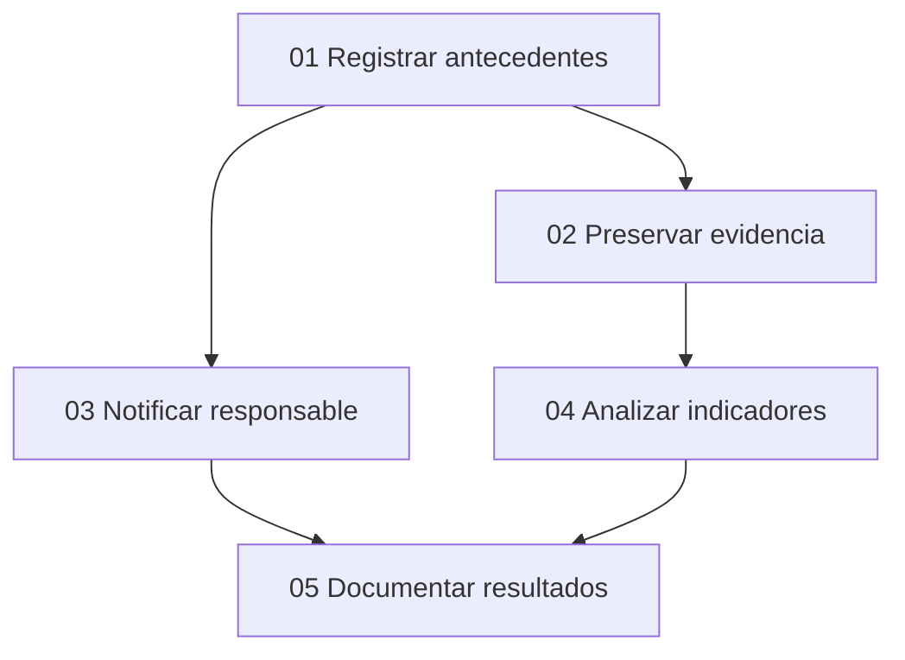

Una ejecución genera una tarea por cada paso de su versión, con estados PENDING, IN_PROGRESS, BLOCKED, COMPLETED y SKIPPED. Se valida que el paso corresponda exactamente a la versión y organización de su ejecución. Las tareas independientes pueden avanzar en paralelo.

## 9.1. Omisiones y autorizaciones

Una tarea bloqueada exige motivo; la omisión siempre exige justificación. Las tareas obligatorias pueden omitirse **excepcionalmente**, con autorización de ORG_ADMIN, evaluación de impacto, riesgo residual y dependencias afectadas. Omitida nunca equivale a completada ni satisface automáticamente dependencias posteriores. Cada dependencia sin satisfacer necesita alternativa validada o excepción independiente.

`STEP_APPROVAL` y `SKIP_AUTHORIZATION` son operaciones diferentes; aceptar una recomendación de IA es otra decisión, y aprobar el cierre de un incidente es una tercera. La autoaprobación del ORG_ADMIN es excepcional, auditable y documentada.

## 9.2. Retirada de versión insegura

Cuando una versión se retira **por seguridad**, las ejecuciones activas basadas en ella bloquean preventivamente nuevas transiciones de tareas. Se conserva la ejecución y puede seguir documentándose el incidente. ORG_ADMIN autoriza justificadamente continuidad o cancelación. La autorización debe referirse al **identificador del bloqueo actual** (`security_hold_id`), nunca a una autorización antigua reaprovechable.

<!-- FIG:08:Bloqueo y revisión de continuidad -->
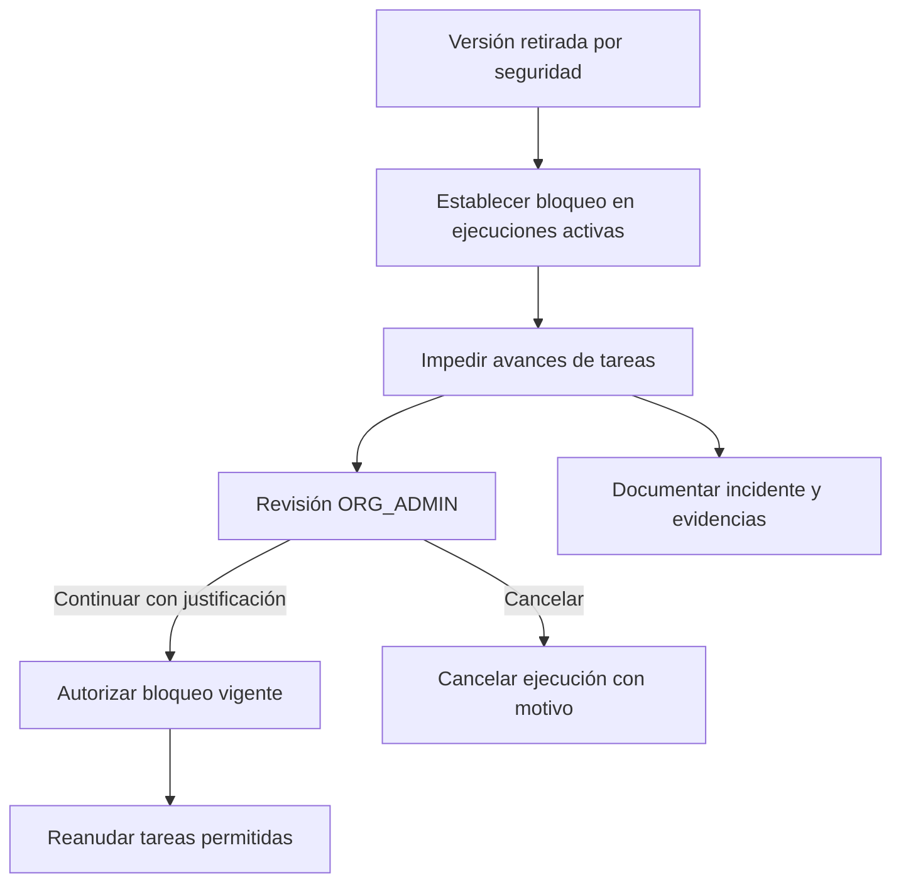

No se cerrará automáticamente un incidente solo porque la ejecución finalice. Las reglas de cierre del incidente siguen operando de forma independiente.

# 10. Asistencia local mediante IA y propuestas supervisadas

Ollama con Qwen3 4B Instruct es el modelo inicial, no una dependencia inamovible del dominio. La plataforma construye contextos mínimos autorizados, llama al modelo, comprueba estructura y reglas, y solicita revisión humana. Ante indisponibilidad de IA, la aplicación debe permitir ejecutar playbooks originales.

<!-- FIG:09:Pipeline de IA con validación determinista -->
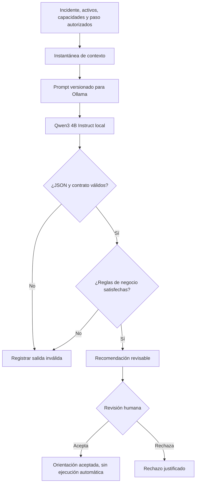

Tipos de solicitud: EXPLAIN_STEP, ADAPT_STEP, PROPOSE_PLAYBOOK y SUMMARIZE_INCIDENT. Cada evaluación conserva contexto (`jsonb` y hash), versión del esquema, modelo, digest si está disponible, plantilla de prompt/versionado, parámetros, duración, resultado y error.

Una recomendación estructuralmente válida **no** implica corrección técnica. El analista o administrador determina pertinencia. Cada recomendación tiene como máximo una decisión definitiva, para evitar sobrescribir el historial.

## 10.1. Propuestas de borradores

Una propuesta de cambios queda PENDING; ORG_ADMIN puede rechazarla o autorizar su conversión transaccional a borrador PRIVATE (`CONVERTED`). La publicación ocurre después mediante el flujo ordinario de playbooks. Las reglas deterministas prohíben degradar silenciosamente obligatoriedad, aprobaciones o dependencias.

## 10.2. Salidas originales del modelo

Las respuestas originales se conservarán **temporalmente** en `ai_response_payloads`, separadas de las métricas y recomendaciones válidas. El contenido se cifrará antes de su almacenamiento, con claves gestionadas fuera de la tabla, límites de tamaño, acceso restringido, expiración y eliminación controlada. Los plazos exactos, la gestión de claves y el tratamiento de respaldos están **pendientes** antes de habilitar almacenamiento real persistente.

# 11. Evidencias, archivos privados y trazabilidad

Las evidencias son de tipo TEXT, FILE o REFERENCE. Deben vincularse a un incidente y organización; su vínculo con una tarea es opcional. Si existe, la tarea deberá pertenecer al mismo incidente y tenant. Un registro FILE podrá tener un único archivo físico; varios adjuntos requieren evidencias independientes.

### 11.1. Tipos, clasificación y ciclo de vida

- Clasificación inicial: INTERNAL, CONFIDENTIAL, RESTRICTED; RESTRICTED exige permisos adicionales.
- Estado: ACTIVE o WITHDRAWN; no se sobrescribe silenciosamente la evidencia.
- ORG_ADMIN puede retirar con justificación. Se restringe acceso y se conserva la historia mínima compatible con retención y privacidad.
- Eliminación física condicionada a política operativa, registros de auditoría y control de almacenamiento.

### 11.2. Archivos

Formatos iniciales propuestos: PDF, PNG, JPEG y TXT; límite propuesto de 10 MB por adjunto. Se excluyen ejecutables y muestras de malware. La validación de extensión/MIME no equivale a detección antimalware. El backend establece un identificador físico seguro, calcula SHA-256 y controla toda descarga sin publicar el directorio de almacenamiento.

<!-- FIG:10:Carga y retirada de evidencias -->
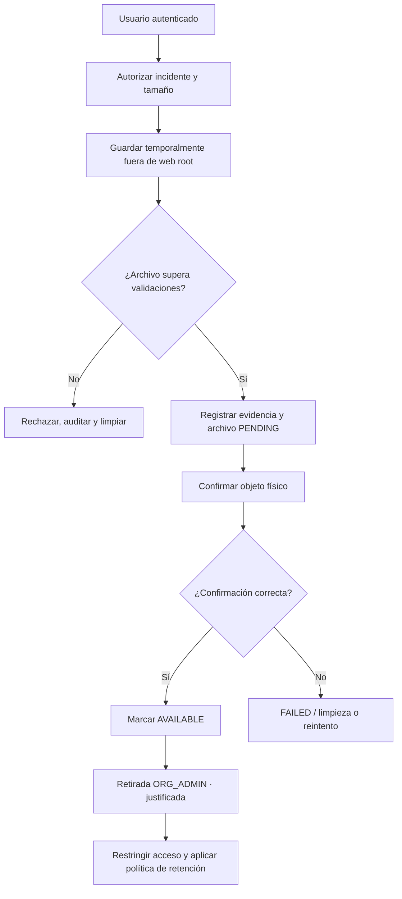

PostgreSQL y el sistema de archivos no comparten transacción: la persistencia se manejará mediante estados PENDING, AVAILABLE, QUARANTINED, FAILED y REMOVED, almacenamiento temporal y limpieza/reintentos idempotentes.

# 12. Auditoría de seguridad y separación de funciones

La auditoría conserva operaciones críticas en el esquema `audit`. Desde la aplicación será **append-only**: las credenciales normales no tendrán UPDATE, DELETE ni TRUNCATE sobre `audit_events`. La auditoría no será calificada como criptográficamente inmutable frente a administradores privilegiados; el encadenamiento criptográfico no forma parte del MVP.

<!-- FIG:11:Trazabilidad transversal -->
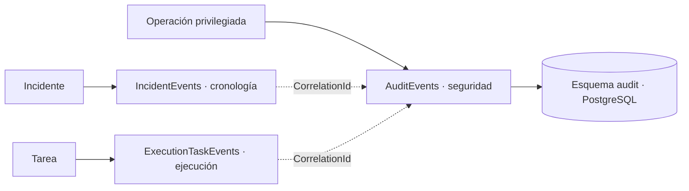

Campos principales: organization_id nullable para eventos globales, actor_user_id nullable, actor_type (USER, SYSTEM, ANONYMOUS), action, resource_type/id, outcome (SUCCESS, DENIED, FAILURE), correlation_id, detalles mínimos JSONB y fecha UTC. No se registrarán contraseñas, tokens, documentos adjuntos ni respuestas completas de Ollama.

Los eventos operativos de incidentes/tareas y la auditoría global son complementarios, no copias idénticas. Las modificaciones críticas de negocio y su evento de auditoría se insertarán en la misma transacción PostgreSQL. Los accesos denegados se registrarán por un mecanismo controlado separado.

# 13. Modelo entidad-relación consolidado (32 entidades)

## 13.1. Catálogo exhaustivo por dominio

| N.º | Entidad lógica | Tabla o implementación física | Datos/relaciones esenciales |
|---:|---|---|---|
| 1 | Users | `auth.asp_net_users` (Identity) | UUID, correo único normalizado, actividad, autenticación. |
| 2 | Organizations | `app.organizations` | UUID, slug único, estado, sector/país/tamaño, creador. |
| 3 | OrganizationMemberships | `app.organization_memberships` | organization_id, user_id, rol, estado; único org-usuario. |
| 4 | PlatformAdministrators | `app.platform_administrators` | user_id, otorgamiento/revocación de rol global. |
| 5 | CapabilityCatalog | `app.capability_catalog` | code único, categoría, descripción. |
| 6 | OrganizationCapabilities | `app.organization_capabilities` | organization_id, capability_id, estado y notas. |
| 7 | IncidentCapabilityAssessments | `app.incident_capability_assessments` | Incidente-capacidad, estado efectivo y motivo. |
| 8 | Assets | `app.assets` | Propiedad organizacional, tipo, criticidad, estado. |
| 9 | IncidentAssets | `app.incident_assets` | Incidente-activo opcional; nombre/tipo y criticidad histórica. |
| 10 | IncidentCategories | `app.incident_categories` | PHISHING, ACCOUNT_COMPROMISE, RANSOMWARE. |
| 11 | Incidents | `app.incidents` | Estado, CIA, severidad actual/máxima, responsables y revisión. |
| 12 | IncidentEvents | `app.incident_events` | Historial, actor, valores previos/nuevos y motivo. |
| 13 | IncidentClosureApprovals | `app.incident_closure_approvals` | Solicitud, revisor, severidad histórica y revisión. |
| 14 | Playbooks | `app.playbooks` | Público/privado, categoría, origen, versión vigente. |
| 15 | PlaybookVersions | `app.playbook_versions` | Número, estado, contenido publicado protegido. |
| 16 | PlaybookSteps | `app.playbook_steps` | Instrucción, posición, obligatorio, evidencia, aprobación. |
| 17 | PlaybookStepDependencies | `app.playbook_step_dependencies` | Predecesor, sucesor, misma versión y DAG. |
| 18 | PlaybookCapabilityRequirements | `app.playbook_capability_requirements` | Requisito por versión o paso. |
| 19 | PlaybookReviews | `app.playbook_reviews` | Revisión y decisión de publicación. |
| 20 | PlaybookExecutions | `app.playbook_executions` | Incidente, versión, estado, revisión, bloqueo de seguridad. |
| 21 | ExecutionTasks | `app.execution_tasks` | Instancia del paso, estado, incidente, asignación, revisión. |
| 22 | ExecutionTaskEvents | `app.execution_task_events` | Historial de cambios y excepciones. |
| 23 | ExecutionTaskApprovals | `app.execution_task_approvals` | Aprobación paso/omisión, riesgo residual y autoaprobación. |
| 24 | AIContextSnapshots | `app.ai_context_snapshots` | JSONB mínimo, esquema, hash y referencias de incidente/tarea. |
| 25 | AIRequests | `app.ai_requests` | Modelo, prompt, parámetros, latencia, resultado técnico. |
| 26 | AIRecommendations | `app.ai_recommendations` | Respuesta validada y estructura JSONB. |
| 27 | AIReviews | `app.ai_reviews` | Decisión definitiva humana única por recomendación. |
| 28 | AIPlaybookProposals | `app.ai_playbook_proposals` | Origen, cambios, revisión y borrador autorizado. |
| 29 | AIResponsePayloads | `app.ai_response_payloads` | Respuesta original cifrada, hash, expiración/eliminación. |
| 30 | Evidences | `app.evidences` | Texto, archivo o referencia, sensibilidad, retirada. |
| 31 | EvidenceFiles | `app.evidence_files` | Objeto privado, tamaño, tipo, hash, estado físico. |
| 32 | AuditEvents | `audit.audit_events` | Actor, acción, resultado, correlación, fecha. |

**Conteo:** 4 identidad + 5 capacidades/activos + 4 incidentes + 6 playbooks + 4 ejecución + 6 IA + 3 evidencias/auditoría = **32 entidades**. Las tablas técnicas adicionales de ASP.NET Core Identity (roles, claims, sesiones/tokens, etc.) no se incluyen en este conteo.

<!-- FIG:12:Mapa de dominios y relaciones -->
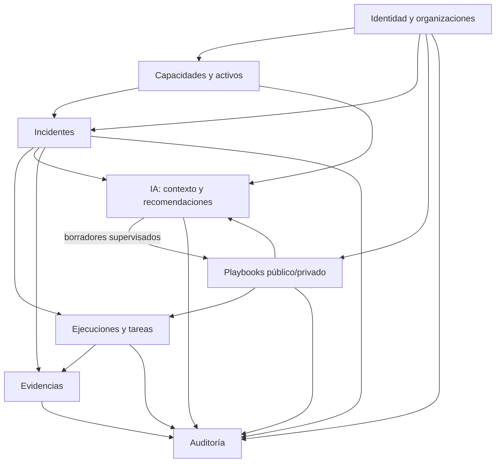

## 13.2. Cardinalidades críticas

- Users ↔ Organizations: N:M por OrganizationMemberships; una única membresía por par.
- Organizations → Incidents/Assets/Capabilities: 1:N; tenant obligatorio.
- Incidents ↔ Assets: N:M vía IncidentAssets, con activo opcional cuando no inventariado.
- Incidents → PlaybookExecutions: 1:N históricas, máximo una activa.
- Playbooks → PlaybookVersions → PlaybookSteps: 1:N sucesivas.
- PlaybookStepDependencies: grafo de pares de pasos de la **misma versión**.
- PlaybookVersions → PlaybookExecutions: 1:N, incluso versiones históricas retiradas.
- PlaybookExecutions → ExecutionTasks: 1:N; un paso por ejecución.
- Incident → Evidences: 1:N; ExecutionTask → Evidences: 0:N.
- AIContextSnapshot → AIRequests → AIRecommendations: 1:N; AIRecommendation → AIReview: 0:1.
- AIRecommendation → AIPlaybookProposal: 0:N, sujetas a aprobación humana.
- Evidence → EvidenceFile: 0:1.

# 14. Diseño físico de PostgreSQL y reglas de integridad

## 14.1. Convenciones

- PostgreSQL 17; schemas `auth`, `app` y `audit`.
- Tablas y columnas `snake_case`, plural para tablas, UUID para identificadores principales.
- Fechas: `timestamptz` en UTC; revisión de negocio: `bigint`.
- Códigos y estados: `varchar` con `CHECK` cuando corresponde.
- `jsonb` solamente para contexto, contenido de recomendaciones, parámetros, cambios propuestos y detalles limitados.
- Índices `ix_*`, únicos `ux_*`, claves foráneas `fk_*`.
- `ON DELETE RESTRICT` para referencias históricas y entidades auditables.

## 14.2. Restricciones clave (fragmentos ilustrativos, no migraciones listas)

```sql
-- Organizaciones: una membresía por usuario, independientemente del rol.
UNIQUE (organization_id, user_id)

-- Tenant de la asociación: el activo y el incidente deben compartir organización.
FOREIGN KEY (organization_id, incident_id)
  REFERENCES app.incidents (organization_id, id);
FOREIGN KEY (organization_id, asset_id)
  REFERENCES app.assets (organization_id, id);

-- Máximo una ejecución activa por incidente.
CREATE UNIQUE INDEX ux_executions_one_active_per_incident
  ON app.playbook_executions (incident_id)
  WHERE status = 'IN_PROGRESS';

-- Un paso ejecutado debe pertenecer a la versión de su ejecución.
FOREIGN KEY (organization_id, execution_id, playbook_version_id)
  REFERENCES app.playbook_executions
  (organization_id, id, playbook_version_id);
FOREIGN KEY (playbook_version_id, playbook_step_id)
  REFERENCES app.playbook_steps (version_id, id);

-- Auditoría: el usuario ordinario de conexión no podrá modificar históricos.
-- REVOKE/GRANT exactos se definirán al crear los roles y esquemas.
```

**Requisitos de materialización:** todas las combinaciones referenciadas deben estar respaldadas por UNIQUE/PK compatibles; las columnas obligatorias llevan NOT NULL. Las referencias con columnas opcionales requieren verificar conscientemente el comportamiento de claves nulas. Las claves foráneas por sí solas no comprueban los roles de los usuarios ni la vigencia de una versión.

## 14.3. Reglas que requieren transacción/validación de dominio

| Regla | Estrategia física o de dominio |
|---|---|
| Último administrador organizacional | Serializar cambios de membresías; impedir dejar cero ORG_ADMIN activos. |
| Alta de organización | Insertar organización y primer ORG_ADMIN en una misma transacción. |
| Cambio de severidad | Registrar evento e incrementar máximo histórico de manera monotónica. |
| Cierre | Exigir resolución, aprobación aplicable y misma revisión. |
| Publicación de playbook | Validar DAG y contenido; publicar y actualizar versión vigente atómicamente. |
| Retirada de versión insegura | Bloquear ejecuciones afectadas y auditar dentro de coordinación transaccional. |
| Clonación | Copiar playbook/versión/pasos, remapear identificadores y dependencias en transacción. |
| Conversión de propuesta IA | Crear borrador privado controlado sin duplicados por concurrencia. |
| Evidencia física | Estados de archivo y reconciliación; no existe transacción distribuida con sistema de archivos. |
| Auditoría | Insertar evento junto con operación de negocio crítica. |

## 14.4. Control de concurrencia

`revision` de negocio identifica la versión del incidente/tarea a la que está vinculada una aprobación y deberá incrementarse con cambios relevantes. Un token técnico de concurrencia EF Core/PostgreSQL no sustituye esa semántica. Las escrituras conflictivas se rechazarán/reintentarán de forma controlada. Índices únicos y transacciones evitan operaciones simultáneas incompatibles.

## 14.5. Permisos y RLS

Separamos migrador, aplicación y propietario de objetos. El usuario de aplicación tendrá únicamente las operaciones requeridas; sobre `audit.audit_events` será append-only, con lectura autorizada por backend. `PLATFORM_ADMIN` es rol de negocio y **no** equivale a superusuario PostgreSQL.

RLS está acordado para el endurecimiento antes de cualquier despliegue operativo con información real de múltiples organizaciones. Su diseño deberá contemplar propietarios/BYPASSRLS, variables seguras de contexto tenant, agrupación de conexiones, procesos globales y pruebas de fugas; no basta con activar políticas genéricas.

# 15. Estrategia de migraciones y pruebas de aceptación

<!-- FIG:13:Dependencias de implementación -->
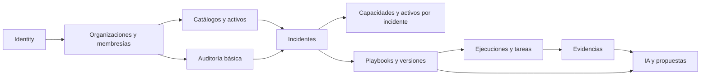

**Orden lógico validado:** (1) Identity, (2) organizaciones, (3) auditoría básica, (4) catálogos/activos, (5) incidentes, (6) relaciones de contexto, (7) playbooks/versiones, (8) ejecución, (9) evidencias, (10) IA. No implica exactamente diez migraciones físicas. El diseño de playbooks tiene una referencia circular controlada (`playbooks` ↔ `playbook_versions`) que se resolverá en la secuencia de creación/alteración de constraints.

## 15.1. Matriz mínima de pruebas de negocio y seguridad

| Caso | Resultado esperado |
|---|---|
| Crear organización sin primer administrador | Transacción completa revertida. |
| Revocar simultáneamente últimos administradores | Al menos uno permanece activo. |
| Reutilizar membresía de otra organización | Operación rechazada. |
| Vincular activo del tenant B a incidente de A | Rechazo por integridad y/o autorización. |
| Consultar incidente ajeno/sin membresía | Denegación. |
| Disminuir máxima severidad histórica | Operación rechazada. |
| Cerrar incidente antes crítico sin ORG_ADMIN | Rechazo de cierre. |
| Reutilizar aprobación después de cambiar incidente | Aprobación invalidada. |
| Modificar contenido de versión publicada | Modificación rechazada. |
| Iniciar ejecución con versión no vigente/retirada | Rechazo. |
| Iniciar dos ejecuciones activas concurrentes | Solo una prospera. |
| Asignar paso de otra versión a ejecución | Clave/validación rechaza. |
| Dependencia circular de playbook | Publicación rechazada. |
| Omitir tarea obligatoria sin autorización | Omisión rechazada. |
| Continuar ejecución durante bloqueo por seguridad | Transición rechazada. |
| Reutilizar autorización de bloqueo anterior | Rechazo. |
| Intentar descargar evidencia retirada o ajena | Denegación. |
| Cargar archivo inválido/malicioso conocido | Rechazo o cuarentena según controles efectivamente implantados. |
| Intentar UPDATE/DELETE de auditoría con rol app | Permiso denegado. |
| Caída Ollama durante ejecución | Playbook manual sigue disponible. |
| Salida IA con claves alteradas o permiso falso | Validación rechaza recomendación. |
| Expirar respuesta original IA | Contenido eliminado bajo política, métricas permitidas preservadas. |
| Recuperación de respaldos | Restauración documentada y probada en entorno seguro. |
| Políticas RLS antes del despliegue multi-tenant | Pruebas positivas/negativas verificadas. |

**Estado de la matriz al cerrar la planificación:** criterios previstos. La evidencia implementada posteriormente para Identity, organizaciones y membresías se registra en las secciones 21 a 23; el resto de la matriz permanece pendiente.

# 16. Metodología de evaluación de la investigación

Se propone evaluar OpenIRP con **escenarios simulados y reproducibles** de phishing, compromiso de cuenta y ransomware, que no requieran acceso a una pyme real. Las capacidades organizacionales pueden representarse mediante perfiles ficticios contrastantes: empresa con soporte técnico básico frente a otra con herramientas y personal más especializado.

## 16.1. Comparaciones previstas

- **Condición base:** ejecución manual de playbook publicado sin asistencia de IA.
- **Condición asistida:** mismo escenario y procedimiento, con explicaciones/contexto de IA.
- **Condición adaptada:** propuesta aprobada de playbook privado, cuando exista y corresponda evaluar su reutilización.

El diseño experimental deberá definir previamente tareas, evaluadores, número de ensayos y medidas, evitando atribuir a la IA mejoras que provengan de diferencias en las condiciones de prueba. No hay actualmente resultados científicos verificados ni participantes reclutados.

## 16.2. Indicadores candidatos

| Indicador | Método posible | Limitación |
|---|---|---|
| Tiempo de respuesta | Duración por tarea y escenario | Depende de familiaridad y perfil del usuario. |
| Finalización de tareas | Proporción de tareas resueltas y excepciones justificadas | Finalizar no implica eficacia técnica real. |
| Aplicabilidad de recomendación | Rúbrica técnica por caso | Requiere evaluadores y criterios consistentes. |
| Cumplimiento estructural | Salidas que superan esquema/reglas | No demuestra corrección semántica. |
| Tasa de aceptación humana | Reviews ACCEPTED / total revisadas | Sesgada por capacitación y criterio del evaluador. |
| Tasa de fallos de IA | INVALID_OUTPUT, FAILED | Depende del modelo, prompt y contexto. |
| Latencia | Duración registrada en AIRequests | Condicionada por hardware/carga. |
| Trazabilidad | Completitud de evidencia/eventos | Depende de política de auditoría. |
| Aislamiento entre tenants | Pruebas de acceso cruzado negativas | Requiere validación sistemática; RLS pendiente. |

**Límite metodológico:** no se afirmará que una respuesta es segura por ser aceptada, ni que la plataforma mejora tiempos hasta ejecutar un experimento comparativo válido.

# 17. Riesgos, decisiones pendientes y criterios de salida

## 17.1. Riesgos priorizados

| Riesgo | Impacto | Mitigación planificada |
|---|---|---|
| Fuga de datos multiempresa | Crítico | Permisos, FK compuestas, pruebas cruzadas, RLS antes de producción. |
| Salida errónea/hallucination de IA | Alto | Contratos, reglas deterministas, revisión humana, no ejecución automática. |
| Alteración de playbook publicado | Alto | Protección de contenido, nueva versión, auditoría. |
| Procedimiento inseguro ya en ejecución | Alto | Retirada con bloqueo y revisión por ORG_ADMIN. |
| Uso indebido de autoaprobaciones | Alto | Justificación visible y auditoría, no confundir con independencia. |
| Evidencia potencialmente peligrosa | Alto | Validación, aislamiento, límites y restricciones de formato. |
| Inconsistencia BD/archivos | Medio-alto | Estados PENDING/FAILED, reconciliación y limpieza segura. |
| Exceso de alcance de 32 entidades | Alto | Implementación por módulos y límites MVP. |
| Pérdida/exposición de datos de IA | Alto | Cifrado, mínima retención, claves protegidas, expiración. |
| Ausencia de pyme piloto | Medio-alto | Casos sintéticos, perfiles reproducibles, reconocer límites externos. |
| Ausencia de evidencias de pruebas | Alto | Matriz con pruebas automatizadas, registros y artefactos verificables. |

## 17.2. Pendientes que no bloquean el inicio del Paso 26, pero sí hitos posteriores

1. Especificar y verificar la **regla determinista de severidad** basada en CIA, criticidad y alcance, incluida política para valores desconocidos.
2. Definir **plazos y bases de retención** de evidencias, auditoría y respuestas originales de IA; procedimiento de eliminación y respaldos.
3. Diseñar **gestión real de claves de cifrado** y acceso al contenido original de respuestas de IA.
4. Materializar de forma precisa las **claves únicas/foráneas compuestas**, incluyendo relaciones versión-ejecución-tarea-evidencia y propiedad del borrador IA.
5. Completar diseño de **inmutabilidad física** y protección de estados publicados.
6. Establecer política de **cuotas de almacenamiento**, disponibilidad, copia y recuperación.
7. Implementar y verificar **RLS** antes del despliegue multi-tenant con datos reales.
8. Definir permisos específicos para evidencias `RESTRICTED` y sus pruebas.
9. Alinear las **rúbricas, hipótesis, criterios de evaluación y evidencias** con los cinco objetivos específicos ya definidos y la versión académica aprobada.
10. Acordar estándares operativos de despliegue, observabilidad, pruebas de seguridad y gestión de secretos.

## 17.3. Criterios mínimos antes de uso real multiempresa

- Autenticación y autorización verificadas; zero cross-tenant en pruebas negativas previstas.
- RLS y roles de SQL restringidos y ensayados.
- Evidencias con validación, almacenamiento no público y restauración probada.
- Auditoría activa, íntegra desde el modelo de permisos y con retención definida.
- Gestión de secretos y backups/restauración con procedimientos probados.
- Evaluación de riesgos de IA, controles de salida y revisión humana.

# 18. Hoja de ruta a partir del Paso 26

**No quedan pasos adicionales obligatorios de planificación general.** El Paso 26 comienza el desarrollo del primer agregado de dominio y la primera migración, usando el esquema consolidado.

| Fase de implementación | Objetivo | Evidencia de aceptación |
|---|---|---|
| Paso 26 / Iteración 1 | Identity, organizaciones y membresías | Migraciones controladas; acceso autenticado y pruebas de roles/tenant. |
| Iteración 2 | Catálogos, capacidades y activos | Operaciones CRUD autorizadas y FK compuestas verificadas. |
| Iteración 3 | Incidentes, CIA, historial, cierre | Transiciones, máximo histórico y aprobaciones probadas. |
| Iteración 4 | Playbooks, versiones, DAG y clonación | Publicación, inmutabilidad, retirada y aislamiento probados. |
| Iteración 5 | Ejecuciones, tareas, omisiones | Concurrencia, dependencias, bloqueos y aprobaciones probados. |
| Iteración 6 | Evidencias y auditoría integral | Cargas seguras, restricciones, retirada y logs auditable. |
| Iteración 7 | Ollama y recomendaciones | Contextos, validación, revisión y borradores supervisados. |
| Endurecimiento | RLS, backups, secretos, integraciones seguras | Batería de seguridad y recuperación superada. |
| Evaluación académica | Casos reproducibles y medición | Datos y análisis sustentados; límites transparentes. |

**Criterio de inicio de la implementación:** aceptar esta documentación como línea base, mantener los pendientes explícitos y no crear todas las tablas en una única migración inicial.

# 19. Glosario y documentos de referencia

| Término | Significado en OpenIRP |
|---|---|
| Multi-tenant | Una plataforma sirve a varias organizaciones con aislamiento de datos. |
| Tenant | Organización dueña de incidentes, activos, evidencias y playbooks privados. |
| Membership | Asociación de usuario y organización que define el rol local. |
| Playbook | Plantilla versionada de pasos para responder a un incidente. |
| Ejecución | Instancia histórica de una versión de playbook aplicada a un incidente. |
| Dependencia | Condición entre pasos que regula cuándo puede comenzar una tarea. |
| Omisión autorizada | Excepción documentada que no equivale a completar una tarea. |
| CIA | Confidencialidad, integridad y disponibilidad. |
| Severidad máxima | Nivel más alto alcanzado en todo el ciclo de vida del incidente. |
| RLS | Row-Level Security de PostgreSQL; filtrado de filas según políticas. |
| FK compuesta | Relación que incluye identificador y organización para impedir mezcla de tenants. |
| Snapshot | Instantánea inmutable de contexto relevante para una evaluación de IA. |
| Append-only | Registros que la aplicación puede agregar, pero no editar o borrar ordinariamente. |
| Residual risk | Riesgo que permanece tras medidas y excepciones aplicadas. |
| MVP | Producto mínimo viable delimitado para la tesis. |

### Bases de la compilación

- Decisiones del proyecto **OpenIRP** registradas durante las conversaciones de planificación (pasos 1–25, octubre de 2026).
- Información técnica previamente reportada del entorno Docker/.NET/PostgreSQL/Ollama; **no se realizó una nueva inspección del repositorio ni del equipo** al producir este documento.
- Referencia académica del proyecto: presentación `OpenIRP_Exposicion_15min_Referencias.pptx` y trabajo AICC300 del 16 de octubre de 2026, de donde se mantienen el título y los cinco objetivos específicos. Documentos de instrucciones identificados: `aicc200_s1_instrucciones.pdf`, `aicc200_s1_orientaciones.pdf` y `aicc300_s1_instrucciones.pdf`. No se atribuyen a estos PDFs las decisiones técnicas que se tomaron en las conversaciones; la alineación detallada con sus rúbricas deberá revisarse al preparar el informe académico.

### Documentación técnica oficial útil para la implementación (enlaces de referencia)

- PostgreSQL 17: <https://www.postgresql.org/docs/17/>
- PostgreSQL — restricciones: <https://www.postgresql.org/docs/17/ddl-constraints.html>
- PostgreSQL — Row-Level Security: <https://www.postgresql.org/docs/17/ddl-rowsecurity.html>
- ASP.NET Core Identity: <https://learn.microsoft.com/aspnet/core/security/authentication/identity>
- EF Core: <https://learn.microsoft.com/ef/core/>
- Npgsql EF Core: <https://www.npgsql.org/efcore/>
- Ollama: <https://docs.ollama.com/>

Los enlaces sirven de referencia general, no de certificación de que una versión o una característica esté implementada.

# 20. Anexos de reglas y casos de prueba

## Anexo A. Decisiones cerradas

| Código de decisión | Acuerdo definitivo |
|---|---|
| DEC-01 | Catálogo público + privado; usuarios multi-organización. |
| DEC-02 | ORG_ADMIN/ANALYST/VIEWER por membresía; PLATFORM_ADMIN separado. |
| DEC-03 | Seis estados de incidente y cierre por máxima severidad histórica. |
| DEC-04 | Evaluación CIA estructurada, fórmula por definir. |
| DEC-05 | Tareas flexibles, dependencias explícitas y una ejecución activa por incidente. |
| DEC-06 | Excepciones para tareas obligatorias con riesgo residual y ORG_ADMIN. |
| DEC-07 | Autoaprobación excepcional y auditada por ORG_ADMIN. |
| DEC-08 | Propuestas de IA convertidas a borrador solo con autorización de ORG_ADMIN. |
| DEC-09 | Perfil de capacidades más excepciones por incidente y snapshots de IA. |
| DEC-10 | Activos no inventariados pueden registrarse en incidente y vincularse luego. |
| DEC-11 | Adjuntos privados controlados; retirada justificada; retención aplicable. |
| DEC-12 | Solo versión vigente para nuevas ejecuciones; retirada sin sustituta permitida. |
| DEC-13 | Retirada por seguridad bloquea tareas de ejecuciones activas hasta revisión. |
| DEC-14 | Respuestas originales IA cifradas y temporales; política pendiente. |
| DEC-15 | Auditoría append-only, sin cadena criptográfica en MVP. |
| DEC-16 | RLS durante endurecimiento, antes de uso real multiempresa. |
| DEC-17 | Creación de organizaciones exclusiva de PLATFORM_ADMIN. |

## Anexo B. Reglas de autorización y límites de IA

Una operación debe vincular usuario, organización activa, membresía vigente, permiso de acción y objeto del mismo tenant. Para playbooks públicos se aplicará un régimen de lectura global, sin facultades de edición a administradores organizacionales. Para la IA, la solicitud deberá pasar por autorización y minimización, validación estructural, reglas deterministas y revisión humana; el contenido generado nunca tendrá capacidad directa de ejecución.

## Anexo C. Evidencias académicas a producir

1. Migraciones y diagramas ER definitivos desde el esquema ejecutado.
2. Pruebas automáticas positivas/negativas de tenant y permisos.
3. Capturas y registros de escenarios sintéticos con distintos recursos.
4. Métricas de inferencia y validación del modelo, sin revelar datos sensibles.
5. Matriz de comparación entre procedimiento base, asistencia IA y adaptación supervisada.
6. Informe técnico de resultados, riesgos residuales y limitaciones del prototipo.

---

**Fin de la línea base de planificación.** Próxima actividad autorizada: Paso 26 — implementación incremental de Identity, organizaciones y membresías. Cualquier desviación de las decisiones cerradas deberá documentarse con su motivación, impacto, nueva versión del diseño y pruebas asociadas.

# 21. Paso 26 — subfase local de administración de identidad (22-10-2026)

## 21.1. Alcance implementado

Sobre `feature/paso26-identidad-organizaciones`, desde `f53c99a`, se añadieron contratos y servicios de aplicación para aprovisionamiento offline del primer `PLATFORM_ADMIN`, alta atómica de organización/cuenta/primer `ORG_ADMIN`, administración de membresías y desactivación controlada de cuentas. Se conserva el esquema y la migración aprobada `20261022130822_InitialIdentityOrganizations` sin reescribirla ni agregar cambios al modelo.

El bootstrap requiere comando y habilitación explícitos; cualquier concesión histórica impide repetirlo y nunca se promueven cuentas existentes. No existe registro público ni endpoint de bootstrap. Los permisos de plataforma no conceden acceso implícito a datos del tenant: las operaciones organizacionales verifican membresía, rol y estado vigentes en base de datos.

La regla del último administrador activo se comprueba dentro de la misma transacción de suspensión, revocación, degradación o desactivación de cuenta. Las escrituras administrativas toman un advisory lock transaccional común en PostgreSQL y releen la autorización después de adquirirlo. Esta estrategia conservadora también coordina cambios globales de cuenta con sus múltiples organizaciones. Las revisiones de membresía y los conflictos/tiempos de espera se expresan mediante HTTP 409.

Se incorporaron sesiones por cookie HTTPS, CSRF por token, bloqueo por intentos fallidos, comprobación de cuenta/security stamp por petición y rutas de organizaciones, membresías y estado de cuenta. El arranque normal no aplica migraciones ni crea administradores.

## 21.2. Evidencia ejecutada localmente

| Comprobación | Resultado verificado |
|---|---|
| Git inicial | Rama solicitada y árbol limpio; sin cambios previos que sobrescribir. |
| SDK y compilación | .NET SDK 10.0.402; compilación Release con 0 errores y 0 advertencias. |
| PostgreSQL 18.3 nativo aislado | Migración y comprobaciones SQL correctas; 22 pruebas correctas, 0 fallidas, 0 omitidas. |
| PostgreSQL 17.11 en contenedor aislado | Migración y comprobaciones SQL correctas; mismas 22 pruebas correctas, 0 fallidas, 0 omitidas. |
| Concurrencia | Las pruebas comprueban en pg_locks que ambos escritores están esperando antes de liberar el bloqueo. Solo un bootstrap/slug prospera; siempre queda un administrador tras revocaciones o desactivación frente a degradación. |
| CLI offline real | Rechazo sin habilitación; creación única en base temporal; rechazo al repetir. |
| Consistencia del modelo | `dotnet ef migrations has-pending-model-changes`: sin diferencias respecto a la migración aprobada. |
| Base habitual local | `openirp_dev`, usuario `openirp`, 127.0.0.1:5433; inspeccionada sin tablas antes de migrar. |
| Respaldo previo | Dump custom de la base vacía, restaurado con éxito en otro contenedor PostgreSQL 17 antes de aplicar la migración. |
| Migración habitual | Historial confirma `20261022130822_InitialIdentityOrganizations` / EF 10.0.5. Usuarios, organizaciones y administradores de plataforma permanecen en cero. |
| API real en Windows | Arranque mediante `ci/Start-LocalApi.ps1`; HTTPS health 200, CSRF 200 con token, acceso anónimo a organizaciones 401. Proceso de comprobación detenido después. |

Los casos cubren rollback tras insertar la organización, contraseñas rechazadas, correo/slug duplicados, bootstrap histórico, ausencia de promoción de cuentas existentes, límites entre tenants, privilegios de plataforma sin bypass organizacional, revisiones obsoletas, suspensión de permisos, invalidación de sesión y bloqueo por contraseña errónea.

Artefactos locales ignorados por Git, bajo la raíz `D:\Desarrollos\OpenIRP`:

- `artifacts/paso26-f858a3dc5f2c4a00a2513efe8329985b/paso26.trx`: PostgreSQL 18, 22/22; el mismo directorio contiene SQL idempotente y dump temporal.
- `artifacts/paso26-pg17-ff41cf6a313549f999e0a8f3cfcf2141/paso26-pg17.trx`: PostgreSQL 17, 22/22.
- `artifacts/paso26-dev-migration-8a6c4702a55c4e62acce7d8282a997fa/openirp_dev-before-paso26.dump`: respaldo previo, SHA256 `55ABB09C9FD46E842D87990B13981711D2CBA356CE78211664058B162A717172`.
- `artifacts/paso26-http-smoke/`: logs de la comprobación HTTPS real. Solo esa comprobación omitió la validación del certificado local; el servidor y sus cookies conservan HTTPS/Secure.

Docker Desktop se inició para comprobar PostgreSQL 17; con ello se reactivaron los contenedores locales existentes de PostgreSQL y Ollama. Los contenedores y procesos temporales de validación se detuvieron/eliminaron; el servicio PostgreSQL 18 del sistema no se modificó.

## 21.3. Uso local y pendientes explícitos

La [guía operativa del Paso 26](Paso26_Administracion_Local.md) contiene el inventario de archivos, contratos HTTP, comandos de repetición y manejo de secretos. Para comenzar con una identidad real, ejecutar `./ci/Start-LocalApi.ps1 -Bootstrap` en terminal interactiva con correo verificado fuera de banda y contraseña elegida por el operador; después `./ci/Start-LocalApi.ps1`. No se guardan esas credenciales en el repositorio ni se inventó un administrador del usuario durante la intervención.

La garantía del último administrador pertenece a estos servicios: SQL directo y futuros escritores deben respetar el mismo protocolo. El advisory lock común limita la concurrencia de las escrituras administrativas y puede sustituirse posteriormente por coordinación más granular con pruebas equivalentes. RLS, auditoría integral, separación de permisos SQL operativos, recuperación de cuenta, MFA, cambio obligatorio de contraseña inicial y verificación mediante envío de correo siguen pendientes antes del uso operativo multiempresa. Las cuentas de alta controlada se marcan confirmadas bajo verificación del operador, sin afirmar que hubo envío de correo.

El archivo CI PostgreSQL 17 se actualizó solo en disco para ejecutar esta suite en futuras ejecuciones autorizadas. **No se hizo push, merge, commit ni modificación remota de GitHub/PR #1.**

# 22. Paso 26 — auditoría administrativa básica (22-10-2026)

Se implementó `audit.audit_events` y la migración nueva `20261022175420_BasicAdministrativeAudit`, preservando la inicial aprobada y los cambios locales de la subfase anterior. Las escrituras administrativas y su evento SUCCESS comparten transacción; un fallo del evento revierte la operación. Los rechazos administrativos se registran por conexión separada tras rollback, siempre en ámbito global y con metadatos mínimos sin secretos ni datos de la petición.

Los endpoints `GET /api/organizations/{id}/audit` y `GET /api/audit/global` tienen paginación limitada y permisos distintos: ORG_ADMIN del tenant frente a PLATFORM_ADMIN solo para eventos globales. Se conserva la prohibición de acceso implícito a tenants. El servidor genera y devuelve la correlación de cada scope HTTP.

La protección append-only combina validación EF, trigger PostgreSQL que rechaza UPDATE/DELETE/TRUNCATE y un script de permisos SELECT/INSERT para una cuenta SQL limitada. Se probó la operación completa de Identity con dicha cuenta en una base desechable, incluido el rechazo de alteración/desactivación del trigger. El helper de desarrollo conserva la cuenta propietaria previa; no se afirmó una separación operativa ya aplicada a las credenciales habituales.

**Decisión física acotada respecto a §14.1:** la PK interna de auditoría es BIGINT IDENTITY para un cursor indexado que no dependa del reloj, mientras actores, organización, recursos y correlación mantienen UUID. El ID no concede autorización ni representa un orden de commit global. Impacto: solo los contratos de eventos/cursor usan valores numéricos. La paginación, el aislamiento y la ausencia de duplicados en las páginas se verificaron. Las referencias históricas no tienen cascadas hacia datos mutables de identidad.

**Resultados:** Release sin errores ni advertencias; 37/37 pruebas en PostgreSQL 17.11 y 37/37 en 18.3, sin omitidas. Se incluyen las 22 pruebas previas más 15 casos de auditoría: rollback por fallo del sink, separación de rechazos, caída de su persistencia sin sustituir el error original, inmutabilidad SQL/EF, permisos runtime reales, correlación HTTP, paginación y aislamiento. Reversión/reaplicación de la migración verificada solo en base vacía desechable; modelo sin cambios pendientes.

La migración local se aplicó a `openirp_dev` después de respaldar y restaurar la copia en un contenedor PostgreSQL 17 aislado. Los conteos de usuarios, organizaciones, membresías y concesiones se conservaron (todos cero); la tabla de auditoría comienza vacía. No se crearon identidades de negocio ni roles SQL en el cluster habitual.

Evidencias bajo `D:\Desarrollos\OpenIRP`:

- PostgreSQL 17: `artifacts/paso26-pg17-b504fc4e9dea4f4d9a97fec03248c7e5/paso26-pg17.trx`.
- PostgreSQL 18: `artifacts/paso26-f63100bfc31a4ee69f340d5112729b9d/paso26.trx`.
- Respaldo/SQL/conteos: `artifacts/paso26-audit-dev-f32518942a594799ba871ad1c15cb8bc/`. Dump SHA256: `201D7A60C1BE17F4D86B804ED6D1A0FBE1DF394AE08C54F4814E2ABECA59550E`.
- HTTPS real: `artifacts/paso26-audit-http-29aae799f01b4426b6bfdc31b218c92f/`; health 200, auditoría anónima 401 y correlación propia del servidor. Procesos temporales detenidos después.

La [guía de auditoría local](Paso26_Auditoria_Local.md) contiene el inventario exacto de archivos, comandos y decisión física. Los rechazos tienen persistencia acotada a tres segundos; si falla se mantiene la denegación y se emite alarma operativa, sin prometer entrega duradera. Login/logout, 401/CSRF/model binding anteriores al servicio, cola duradera de seguridad, auditoría integral, retención, RLS y separación operativa completa de roles SQL siguen pendientes. Un propietario/superusuario puede alterar objetos; no se afirma inmutabilidad criptográfica.

Se añadió `ci/Test-IdentityDocker.ps1` para repetir PostgreSQL 17 sin volúmenes existentes. Docker/PostgreSQL/Ollama habituales se conservan activos; las instancias temporales se eliminaron/detuvieron. **No hubo commit, push, merge ni modificación remota.** El siguiente módulo del orden validado es catálogos, capacidades y activos.

# 23. Iteración 2 — catálogos, capacidades y activos (22-10-2026)

Se implementaron `app.capability_catalog`, `app.organization_capabilities`, `app.assets` y `app.incident_categories`, con la nueva migración `20261022183846_CatalogsCapabilitiesAssets`. Las migraciones previas y el trabajo local permanecen preservados. Se incorporaron las ocho capacidades iniciales y PHISHING/ACCOUNT_COMPROMISE/RANSOMWARE como referencias versionadas, sin usuarios ni privilegios de negocio predeterminados.

El perfil general devuelve Unknown/revisión 0 para capacidades no declaradas, sin insertar filas durante la lectura. Solo ORG_ADMIN cambia declaraciones. Restablecer Unknown conserva la revisión de la fila. Las referencias inactivas no aceptan nuevas modificaciones del perfil y conservan las declaraciones previas marcadas como inactivas.

Se añadieron catálogos extensibles por PLATFORM_ADMIN y un inventario con creación, consulta, edición, retirada lógica y reactivación. Decisión conservadora de permisos de esta iteración: ORG_ADMIN escribe el inventario; Analyst/Viewer de la organización solo leen. No se deriva acceso a datos del tenant del rol global. Los códigos de referencia permanecen inmutables desde la API y no se borran físicamente; los activos conservan UUID e historia al retirarse. La criticidad del activo no determina automáticamente la severidad de un incidente.

Las entidades nuevas usan UUID como PK, FK restrictivas, unicidad de org-capacidad, claves compuestas org-ID y revisiones positivas como tokens de concurrencia. Las escrituras comparten el advisory lock de Identity, releen permisos dentro de la transacción y guardan su auditoría SUCCESS de forma atómica. No se copian nombres, notas ni descripciones a los eventos. La paginación es acotada por skip/limit, con orden estable sin prometer una instantánea para cambios concurrentes.

**Verificación:** Release sin errores/advertencias; 68/68 pruebas en PostgreSQL 17.11 y 68/68 en 18.3, sin omitidas. Son las 37 pruebas previas más 31 casos nuevos; se amplió también la prueba de cuenta SQL limitada existente. Se verificaron Unknown implícito, catálogo extensible/inactivo, roles, suspensión/revocación, aislamiento, claves compuestas reales, restricciones SQL, concurrencia forzada, revisiones, retirada, rollback por fallo de auditoría, CSRF, JSON con clasificación/precondiciones obligatorias y recuperación de la migración en base vacía desechable. EF no detecta cambios pendientes de modelo.

La migración local se aplicó después de respaldar/restaurar la copia de `openirp_dev` en otro contenedor PostgreSQL 17 y cotejar sus conteos. Usuarios, organizaciones, membresías, concesiones y auditoría conservaron sus ceros. Hay ocho capacidades y tres categorías de referencia; declaraciones y activos permanecen vacíos.

Evidencias bajo `D:\Desarrollos\OpenIRP`:

- PG17: `artifacts/paso26-pg17-e46bc813f16e4ffba6f784810a0e8e46/paso26-pg17.trx`.
- PG18: `artifacts/paso26-81c815f60bf0439a82899d62a4201944/paso26.trx`.
- Respaldo/SQL/conteos: `artifacts/inventory-dev-ffb7a367c40545598553e4e6b241a909/`. Dump SHA256 `457A90BF6003D1524D3941D757225999770D6E5F2AEBA39A9920AB42B32151DA`.
- HTTPS/OpenAPI real: `artifacts/inventory-http-dbd3fffada1041abaf9ccde3037e18e4/`; health 200, nuevos endpoints anónimos 401, esquema OpenAPI 200. Proceso temporal detenido después.

La [guía de la Iteración 2](Iteracion2_Catalogos_Capacidades_Activos.md) detalla contratos, inventario de archivos y decisiones. Las asociaciones de activos y capacidades por incidente se implementarán con su agregado, conservando los snapshots históricos acordados. La fórmula de severidad sigue pendiente de definición antes de codificarla. RLS y separación operativa de roles SQL continúan pendientes del endurecimiento; no se cambiaron roles habituales, no se activó registro público y no se hicieron commit, push, merge ni cambios remotos.

# 24. Iteración 3 — registro inicial de incidentes (local)

El avance anterior de Identity, auditoría e inventario se guardó en el commit `d7ced5f213f343e01468eacc0679ccf3d50d289b` y se publicó, por autorización expresa del usuario, en `feature/paso26-identidad-organizaciones`. No hubo merge. Las afirmaciones anteriores sobre ausencia de commit/push corresponden al momento de ejecución de esas subfases. El desarrollo descrito en esta sección permanece local, posterior a ese commit.

Se implementó una primera subfase de incidentes: registro, consulta/listado, corrección y asignación/desasignación justificada. ORG_ADMIN y ANALYST activos de la organización pueden escribir; VIEWER puede leer; PLATFORM_ADMIN no obtiene acceso organizacional implícito. El responsable debe ser una membresía activa ORG_ADMIN/ANALYST del mismo tenant, con cuenta activa y no bloqueada. Una suspensión posterior conserva referencias históricas sin conservar permisos.

`app.incidents` mantiene la revisión actual; `app.incident_events` conserva un snapshot por revisión con actor, instante, motivo y correlación. Hay claves compuestas de organización para incidente y membresía, FK restrictivas, revisiones como token EF y protección append-only tanto en EF como por trigger SQL. El rol SQL limitado obtiene solo SELECT/INSERT en el historial. Los textos privados permanecen en el agregado/historial del tenant; la auditoría administrativa recibe solo identificadores y revisión.

Las escrituras toman el mismo bloqueo transaccional de Identity, releen permisos y confirman incidente, snapshot y auditoría juntos. La API exige precondiciones explícitas; un cliente obsoleto recibe 409. La asignación nula debe aparecer expresamente en el JSON. No se habilitaron cambios de estado ni eliminación HTTP: esta entrega conserva `REGISTERED`. CIA, fórmula determinista de severidad, máximo histórico, respuesta, resolución, aprobaciones de cierre, asociaciones de activos y excepciones de capacidades por incidente siguen pendientes. No se presume severidad baja para lo aún no evaluado.

**Verificación:** Release con cero errores/advertencias, EF sin cambios pendientes; 94/94 pruebas en PostgreSQL 17.11 y 94/94 en 18.3, sin fallidas ni omitidas. Son los 68 casos anteriores más 26 nuevos y la ampliación de permisos SQL runtime. Incluye concurrencia forzada de revisiones y revocación, aislamiento, snapshots, rollback frente a fallos de ambos historiales, inmutabilidad, HTTP/CSRF y contratos JSON.

La migración `20261022192153_InitialIncidentRegister` se aplicó solo a la base local habitual después de respaldar y restaurar una copia en otro contenedor PostgreSQL 17. Los conteos anteriores se conservaron: cuentas/organizaciones/membresías/concesiones/auditoría/activos/declaraciones continúan en cero; ocho capacidades y tres categorías. Incidentes e historial comienzan vacíos; no se inventaron cuentas ni se modificaron roles SQL habituales.

Evidencias bajo `D:\Desarrollos\OpenIRP`:

- PG17: `artifacts/paso26-pg17-d8b0f6e0d9a447668651bdec8ac6b656/paso26-pg17.trx`.
- PG18: `artifacts/paso26-142262e01c0840d2b433d0ec4eab067e/paso26.trx`.
- Respaldo/SQL/conteos: `artifacts/incident-dev-7dd8764e670a42d9b22ab2e809b87ab9/`; dump SHA256 `BE868CA51C305358F4A7C0F20FF6A399F24B06ACE8744F563BB320DCAF643A28`.
- HTTPS: `artifacts/incident-http-ba483fd3079f4029b717fe100f5fcfaf/`; health 200, nuevas rutas privadas anónimas 401, OpenAPI 200. Proceso propio detenido al terminar.

La [guía de registro inicial de incidentes](Iteracion3_Registro_Incidentes.md) detalla rutas, contratos, archivos y límites. La inmutabilidad no protege frente a un propietario que altera objetos; RLS y separación operativa de credenciales siguen pendientes. Los snapshots por revisión dependen del protocolo de estos servicios, que también deberán respetar futuros escritores. Se mantiene la planificación completa de §7 para las siguientes subfases.

# 25. Iteración 4 — activos afectados por incidente (local)

Se añadió `app.incident_assets` con reporte de activos aún no inventariados, asociación directa desde inventario y vinculación posterior de un reporte. Un activo puede aparecer en varios incidentes; solo puede vincularse una vez dentro del mismo incidente. Reportes todavía no identificados pueden compartir nombre. La identidad procede del UUID, no del texto.

Se conservan nombre, tipo, contexto y criticidad originales. La primera vinculación completa únicamente el UUID de inventario y su revisión; no reemplaza lo reportado con datos actuales. La criticidad desconocida se expresa como null explícito y no equivale a baja ni determina severidad. Cambios o retirada posteriores en inventario no alteran la historia. Nuevas asociaciones/vinculaciones requieren activo activo del tenant.

ORG_ADMIN y ANALYST activos de la organización pueden operar; VIEWER lee; PLATFORM_ADMIN no obtiene bypass. Las FK compuestas vinculan organización-incidente y organización-activo. Hay índices para las FK, listado por tenant/incidente e índice único parcial para activo identificado. Toda escritura exige motivo y revisión vigente del incidente y participa de la misma transacción/bloqueo que Identity e inventario.

`incident_events.details.asset` conserva el snapshot en cada operación ASSET_REPORTED/ASSET_ATTACHED/ASSET_LINKED; los eventos previos conservan sus valores con details vacío. La auditoría administrativa solo recibe revisión/UUID mínimos. Un fallo de cualquiera de los historiales revierte asociación y revisión. Un trigger SQL protege el reporte contra modificaciones, borrado y truncado, y permite solo la primera vinculación. El rol runtime limitado puede actualizar únicamente las columnas del vínculo, sin alterar el snapshot. No se cambiaron roles SQL habituales; las garantías de revisión/historial siguen requiriendo el protocolo de los servicios para futuros escritores y SQL directo.

**Verificación:** Release sin errores/advertencias; 127/127 pruebas en PostgreSQL 17.11 y 127/127 en PostgreSQL 18.3, sin omitidas ni fallidas. Son 33 casos nuevos sobre los 94 existentes y una ampliación de la prueba runtime. Cubren snapshots históricos, criticidad desconocida, permisos/tenants, FK reales, unicidad, concurrencia forzada y retirada, fallos de ambos historiales para las tres operaciones, JSON/CSRF y protección SQL. Upgrade probado con eventos existentes; downgrade rechazado cuando perdería reportes del módulo. EF sin diferencias de modelo.

Migración nueva `20261022194422_IncidentAssetSnapshots`, sin reescribir las cuatro anteriores. Se aplicó a `openirp_dev` después de respaldar/restaurar una copia en otro PostgreSQL 17 aislado y comparar conteos/historial. Los datos anteriores se conservaron: cuentas/organizaciones/membresías/concesiones/auditoría/activos/declaraciones/incidentes/historial en cero, ocho capacidades y tres categorías. La tabla nueva comienza vacía. Un error de nombres en el chequeo final del helper se corrigió y resolvió mediante verificación independiente de solo lectura, sin volver a migrar.

Evidencias bajo `D:\Desarrollos\OpenIRP`:

- PG17: `artifacts/paso26-pg17-b421678a926b49bea6df7e92026dde92/paso26-pg17.trx`.
- PG18: `artifacts/paso26-f79ee6740b564729b9ce523a9caf4f9a/paso26.trx`.
- Respaldo/SQL/conteos/restauración: `artifacts/incident-assets-dev-e60cbe94cd45401ba9f6e9f46d80ad5f/`. Dump SHA256 `960D7A8A5ADC5A44E2048D6567056BA51CE025FD4E27CD71BA6815F938E78A6C`; incluye `post-migration-verified.txt`.
- HTTPS/OpenAPI: `artifacts/incident-assets-http-f2ef50acdf3f40ee9ce359391aa143d8/`; health 200, listado privado anónimo 401 y cuatro rutas nuevas en OpenAPI. Proceso temporal detenido.

La [guía de activos afectados](Iteracion4_Activos_Incidente.md) contiene contratos, archivos y límites. Los cambios permanecen locales junto con el registro de incidentes anterior, sin nuevo commit/push/merge. El remoto conserva `d7ced5f`. RLS, credenciales operativas separadas, corrección auditable de vínculos, excepciones de capacidades, CIA y regla de severidad/ciclo de vida siguen pendientes. El propietario SQL puede alterar objetos; no se afirma protección criptográfica frente a él.

# 26. Iteración 5 — capacidades y limitaciones por incidente (local)

Se implementó `app.incident_capability_assessments` para conservar la decisión vigente de una capacidad dentro de un incidente, sin reescribir el perfil organizacional. ORG_ADMIN y ANALYST activos pueden evaluar/documentar limitaciones; VIEWER lee. Solo ORG_ADMIN modifica el perfil general; PLATFORM_ADMIN no tiene acceso organizacional implícito.

**Decisión física y semántica:** se almacena un override nullable, limitaciones, motivo y revisión de la última evaluación; la disponibilidad efectiva se deriva del contexto vigente para evitar duplicar un perfil heredado que puede cambiar. `availability=null` hereda; `Unknown` explícito prevalece sobre un perfil Available. Las limitaciones son independientes y pueden acompañar la herencia. No se elimina la fila al restablecerla: conserva UUID y avanza la revisión. Catálogo inactivo fuerza Unknown/origen InactiveCatalog, conservando referencias e historia. Se prohíben nuevas evaluaciones explícitas sobre referencias inactivas, pero se permite restablecer herencia para retirar overrides anteriores.

Los cambios del perfil actualizan en vivo las capacidades heredadas y no reescriben el historial del incidente. Las evaluaciones explícitas permanecen hasta ser revisadas. Cada PUT exige revisión del incidente, revisión de la declaración organizacional (cero si ausente) y revisión del catálogo, además del motivo; si cualquiera cambió, se rechaza el contexto obsoleto. El listado obtiene revisión y dependencias dentro de una instantánea REPEATABLE READ, con autorización revalidada y paginación acotada. Las páginas distintas no representan una exportación congelada.

Toda escritura coordina con Identity/inventario mediante su mismo bloqueo y confirma decisión, revisión, historial y auditoría juntos. `incident_events.details.capability` conserva la entrada de catálogo, el perfil observado, override, limitaciones, origen y estado efectivo. El motivo se mantiene en el evento. La auditoría administrativa recibe metadatos mínimos del incidente y no copia el texto privado. Estos snapshots no sustituyen las futuras instantáneas completas de solicitudes de IA.

FK compuesta organización-incidente, FK de capacidad, unicidad organización-incidente-capacidad e índices de FK. La revisión de evaluación es token EF. Triggers SQL protegen la identidad, exigen avance de revisión e impiden DELETE/TRUNCATE; el rol runtime limitado solo puede actualizar los campos de evaluación. SQL directo y futuros escritores siguen obligados a respetar el protocolo de revisión/historial. La garantía no protege frente a un propietario que altera objetos; RLS, granularidad del bloqueo y credenciales operativas separadas continúan pendientes.

Nueva migración `20261022204102_IncidentCapabilityAssessments`; las cinco anteriores se conservaron. Upgrade probado con historia previa y downgrade rechazado cuando perdería decisiones/eventos nuevos. **Verificación:** Release sin errores/advertencias; 156/156 pruebas en PostgreSQL 17.11 y 156/156 en PostgreSQL 18.3, cero fallidas/omitidas. Son 29 casos nuevos sobre los 127 previos y la ampliación del caso SQL runtime. EF sin diferencias pendientes. Se verificaron herencia, Unknown explícito, precondiciones, aislamiento/permisos, concurrencia forzada frente a perfil/catálogo, rollback de ambos historiales, Unicode máximo, JSON/CSRF e integridad SQL.

Se aplicó la migración solo a `openirp_dev` después de respaldar/restaurar una copia aislada y comparar conteos/historial. Los conteos anteriores permanecieron en cero para identidades/organizaciones/membresías/concesiones/auditoría/activos/declaraciones/incidentes/eventos/asociaciones; se conservan ocho capacidades y tres categorías. Evaluaciones nuevas en cero, ambos triggers activos. No se crearon cuentas de negocio ni roles SQL en el cluster habitual. Docker Desktop estaba detenido; se inició para recuperar PostgreSQL 17. El servicio PostgreSQL 18 del sistema no se modificó.

Evidencias bajo `D:\Desarrollos\OpenIRP`:

- PG17: `artifacts/paso26-pg17-17fe2143645645549af752bfaffb85b6/paso26-pg17.trx`.
- PG18: `artifacts/paso26-f59bbe65ee684c099c1125f150f5c4a4/paso26.trx`.
- Respaldo/SQL/conteos/restauración/triggers: `artifacts/incident-capabilities-dev-f4287cbca0f4488aacc578eb05c56d5b/`. Dump SHA256 `560C39E26F6BB696D33CD253E4D4E90E85490829B164EC41550E42F4C39999B1`.
- HTTPS/OpenAPI: `artifacts/incident-capabilities-http-1b6e121c13ea433d99e95a5cb78a29f8/`; health 200, listado privado anónimo 401 y rutas nuevas presentes. Proceso de comprobación detenido.

La [guía de capacidades por incidente](Iteracion5_Capacidades_Incidente.md) contiene contratos, archivos y límites. Los cambios siguen locales junto con las subfases anteriores pendientes, sin nuevo commit/push/merge. CIA, regla determinista de severidad, ciclo de vida completo y aprobaciones siguen pendientes; no se calculó una severidad arbitraria ni se habilitaron registro público, bypass global o acciones remotas sobre activos.

# 27. Iteración 6 — evaluación CIA y propuesta de severidad (23-10-2026)

Se implementaron confidentiality_impact, integrity_impact y availability_impact, nullable, en el incidente y sus eventos. None/Low/Medium/High son valores explícitos; NULL representa sin evaluar. Las tres dimensiones deben aparecer en el PUT, aunque sean null. La bandera isImpactAssessmentComplete indica que las tres fueron evaluadas, sin inferir severidad ni autorizar cierre. El estado del incidente sigue REGISTERED en esta subfase.

ORG_ADMIN y ANALYST activos del tenant pueden evaluar, corregir o devolver dimensiones a null con motivo y revisión vigente. VIEWER lee y PLATFORM_ADMIN no obtiene bypass organizacional. La transacción/bloqueo compartido revalida permisos y confirma las tres dimensiones, revisión, historial y auditoría juntos. Se conservan los valores CIA vigentes en todos los eventos posteriores, incluidas modificaciones de activos/capacidades/asignación. Los eventos anteriores siguen null, sin evaluación retroactiva. Auditoría global conserva metadatos mínimos, sin motivo privado.

Nueva migración `20261023032311_IncidentImpactAssessment`, preservando las seis anteriores. Añade seis columnas nullable sin DEFAULT y checks de enumeración; amplía la acción IMPACT_ASSESSED. La protección append-only del historial se conserva. El downgrade rechaza pérdida de evaluaciones actuales o históricas, incluso cuando la evaluación vigente volvió a null.

**Validación final:** 181/181 pruebas correctas en PostgreSQL 17.11 y 181/181 en PostgreSQL 18.3, cero fallidas/omitidas; Release sin errores/advertencias y EF sin diferencias pendientes. Son 25 casos nuevos sobre los 156 anteriores y la ampliación del caso runtime SQL. Se verificaron null/None, niveles CIA, parcialidad/reset, snapshots comunes, permisos/tenants, contextos inactivos, precondiciones, concurrencia forzada, rollback de ambos historiales, integridad SQL, HTTP/CSRF, upgrade y downgrade protegido. El primer ensayo detectó una lectura doble del stream en una prueba HTTP; se corrigió la prueba y se repitió la suite completa con éxito.

Se respaldó/restauró una copia de openirp_dev antes de aplicar la migración local. Los conteos anteriores se conservaron: datos de negocio/identidad/auditoría/incidentes/contexto en cero, ocho capacidades y tres categorías. Se comprobaron las seis columnas nullable y los checks/protección del historial. No se crearon identidades de negocio ni roles SQL en el cluster habitual.

Evidencias bajo `D:\Desarrollos\OpenIRP`:

- PG17: `artifacts/paso26-pg17-a875949ae95a4505b75285cf250b10ae/paso26-pg17.trx`.
- PG18: `artifacts/paso26-20c37bc4411e44059ee03631cd303af9/paso26.trx`.
- Respaldo/SQL/conteos/restauración: `artifacts/incident-impact-dev-67c3b4aaae204b71a91d533979e20c02/`. Dump SHA256 `429B5325C5E4E35C3B55EBAC12B3756BBD17574D97C8F5FC86B814122F1A58B8`.
- HTTPS/OpenAPI: `artifacts/incident-impact-http-e4d4b0381211436eacdd57e9680535fd/`; health 200, PUT CIA anónimo 401 y ruta documentada. Proceso propio detenido.

La [guía CIA](Iteracion6_Evaluacion_CIA.md) enumera contratos y archivos. También se redactó una [propuesta explícita de severidad v1](Propuesta_Regla_Severidad_v1.md): umbrales ordenados por CIA, criticidad evaluada, alcance y afectación operacional; versión de regla y tratamiento del máximo histórico. El vocabulario CIA tiene referencias primarias NIST, pero los umbrales son una propuesta propia de OpenIRP y no se presentan como equivalencia normativa ni validación empírica.

El prototipo matemático aislado pasó 3072 combinaciones completas, 12800 comparaciones de monotonicidad, seis casos de entrada desconocida y 14 escenarios. Evidencia: `artifacts/severity-proposal-fa6ccb7aec6040c0b0a11ccabf19e88c/`. Está fuera de la API y deja activatedInApi=false; esos casos no se suman a las 181 pruebas de integración. El usuario confirmó el 23 de octubre de 2026 Pending estricto y severity=null mientras falte cualquier entrada requerida, sin severidad provisional. Una evaluación actual Pending no borrará el máximo histórico ya calculado y no habilitará cierre. Esta decisión no activa el motor; siguen pendientes la validación de umbrales/operación, criticidad reevaluada e inicialización del máximo histórico antes de activarlo.

Los cambios continúan locales, sin nuevo commit/push/merge. Severidad actual/máxima, alcance/afectación operacional, ciclo de vida completo y aprobaciones continúan pendientes; RLS y credenciales operativas separadas siguen en endurecimiento. No se habilitaron registro público, permisos globales de tenant ni acciones remotas sobre dispositivos.

# 28. Iteración 7: alcance y afectación operacional (23 de octubre de 2026)

Las iteraciones 3–6, la evaluación CIA y la decisión Pending estricto se confirmaron y publicaron en `0c706696499ae3a935c69aee5cdf135d541f5488` sobre `feature/paso26-identidad-organizaciones`, a petición del usuario. Antes de publicar se repitieron las 181 pruebas PostgreSQL 17: todas correctas, sin omitidas; Release sin errores/advertencias y modelo sin cambios pendientes. El remoto quedó en ese commit, sin merge.

Después se implementó localmente PUT `/api/organizations/{org}/incidents/{incident}/context`, con alcance Single/Multiple/OrganizationWide y afectación operacional None/Degraded/MajorInterruption/CriticalInterruption. Ambas entradas son nullable, explícitas y se reemplazan juntas con motivo y expectedRevision. La [guía de la Iteración 7](Iteracion7_Contexto_Incidente.md) define las categorías cualitativas, contratos, permisos, archivos y evidencias. No se infieren entradas del inventario, las capacidades, la categoría o CIA; isContextAssessmentComplete solo cubre estas dos entradas.

El servicio mantiene la transacción/bloqueo común y revalida el contexto de autorización activo; ORG_ADMIN y ANALYST escriben, VIEWER consulta y PLATFORM_ADMIN no recibe permisos implícitos de tenant. La revisión, evaluación, evento CONTEXT_ASSESSED y SUCCESS de auditoría se confirman o revierten juntos. Los snapshots de todos los eventos posteriores conservan el contexto; CIA permanece independiente. El motivo privado no se copia a auditoría administrativa.

Migración `20261023141918_IncidentContextAssessment`: cuatro columnas nullable sin DEFAULT, dos checks y ampliación del check de acciones. Preserva las siete migraciones anteriores, los datos y el trigger append-only. Down impide perder valores o eventos de evaluación, incluso tras un reset a null. Se amplió también la prueba del LOGIN SQL limitado.

Verificación local:

- Release sin errores ni advertencias; EF sin cambios de modelo pendientes.
- PostgreSQL 17: **216/216 correctas**, sin fallidas/omitidas. Son 35 pruebas nuevas sobre las 181 anteriores, además de ampliar el caso runtime. Incluyen las 12 combinaciones completas, null/None/reset, snapshots posteriores/CIA, roles/contextos inactivos, tenants, valores inválidos/revisión, concurrencia forzada, rollback de ambos historiales, checks SQL, upgrade/downgrade y HTTP/CSRF. TRX: `artifacts/paso26-pg17-9ad09aae3b724ca19c9a115ef074a948/paso26-pg17.trx`.
- PostgreSQL 18.3 nativo aislado: **216/216 correctas**, sin fallidas/omitidas. TRX: `artifacts/paso26-f5ea5bc7ebe048cb91c31f10c55d1f90/paso26.trx`. Modelo sin cambios pendientes; clúster temporal detenido. No se modificó el servicio PostgreSQL del sistema.
- Migración aplicada solo a `openirp_dev`, PostgreSQL 17 habitual en 127.0.0.1:5433. Se restauró el respaldo completo en un contenedor separado sin puertos ni volúmenes y se compararon conteos/historial antes de aplicar. Conteos previos conservados: todas las tablas de negocio/identidad/auditoría vacías, ocho capacidades y tres categorías; ningún registro de contexto fabricado. Cuatro columnas nullable sin DEFAULT, dos checks validados y protección del historial verificados.
- Respaldo/SQL/conteos/restauración/esquema: `artifacts/incident-context-dev-b97445be42bb4b18a93232ccf9d9116e/`. Dump `openirp_dev-before-incident-context.dump`, SHA256 `C84739AA53EE432127C9BBB779EE03C0F90C9DD6A70F7C85079C2DF1A42A20CA`.
- HTTPS real: health 200, OpenAPI 200 con PUT de contexto, escritura anónima 401; proceso propio detenido. Evidencia: `artifacts/incident-context-http-966ba763f3e5412089ab1c0c2ef0190b/`. Solo el cliente de comprobación aceptó el certificado local, sin cambiar HTTPS/cookies de la API.

Esta nueva subfase queda local, posterior a 0c70669, sin otro commit/push/merge. La regla permanece sin activar; sigue confirmada la política Pending/severity=null cuando falte cualquier entrada requerida. Quedan por desarrollar la criticidad evaluada, validar los umbrales e inicializar justificadamente el máximo histórico, además del ciclo de vida/aprobaciones. RLS y separación operativa de credenciales continúan pendientes.

# 29. Iteración 8: criticidad evaluada del incidente (23 de octubre de 2026)

Se implementó PUT `/api/organizations/{org}/incidents/{incident}/criticality` con valor explícito Low/Medium/High/NotApplicable/null, motivo y revisión. La evaluación es independiente del inventario y de los snapshots originales de activos. Una reducción respecto del máximo reportado o de la última evaluación conocida exige justificación adicional. El servicio consulta el historial para que un reset o una invalidación no eluda ese control.

Los cambios de activos (reporte, adjunto o vinculación) invalidan la criticidad vigente en su misma transacción y conservan la decisión anterior en el historial. CIA, contexto operacional, título, asignación y capacidades conservan la evaluación. Cada snapshot incluye assessedCriticality y criticalityAssessedAtRevision; la bandera de completitud cubre solo esta entrada.

El evento CRITICALITY_ASSESSED conserva el contexto de reportes observado: cantidades, máximo conocido, revisión de fuentes, huella SHA-256 versionada de UUID/revisiones y referencia a la última decisión conocida. Los identificadores se leen en streaming ordenado por UUID bajo el bloqueo común y el resumen tiene tamaño acotado. La [guía de la Iteración 8](Iteracion8_Criticidad_Incidente.md) documenta la reconstrucción de fuentes y las limitaciones de la huella: no constituye una firma ni reemplaza los eventos originales.

Se mantienen autorización organizacional y revalidación del contexto activo, revisión optimista, auditoría mínima y rollback conjunto de datos/historiales. La prueba LOGIN runtime limitado también se amplió; no se alteran credenciales o roles habituales. El SQL directo y futuros escritores deben respetar el protocolo existente.

Migración `20261023200334_IncidentCriticalityAssessment`: cuatro columnas nullable sin DEFAULT, dos checks de valores/revisiones y ampliación del check de acciones. Conserva las ocho migraciones anteriores; no inventa evaluaciones previas ni desactiva triggers. Down se niega si perdería valores, referencias o eventos de evaluación, incluso tras un reset.

- Compilación Release sin errores ni advertencias; EF sin diferencias de modelo.
- PostgreSQL 17: **259/259 correctas**, cero fallidas/omitidas. TRX: `artifacts/paso26-pg17-a39d69f630d240e4a66f75f945bf968d/paso26-pg17.trx`.
- PostgreSQL 18.3 nativo aislado: **259/259 correctas**, cero fallidas/omitidas. TRX: `artifacts/paso26-00d12df41413483eb2be6dfdd7ded010/paso26.trx`. EF sin diferencias; clúster temporal detenido. No se modificó el servicio PostgreSQL del sistema.
- Se agregaron 43 casos sobre las 216 pruebas anteriores y se amplió el LOGIN SQL limitado. Cubren valores/null/NotApplicable, conservación de reportes, reducciones justificadas y protección tras reset/invalidation, fuentes y huellas, snapshots posteriores, roles/contextos inactivos/tenants, validación/revisión, carreras forzadas, rollback de evaluación/invalidation si falla cualquiera de los historiales, checks SQL, upgrade/downgrade y HTTP/CSRF.
- La primera ejecución PostgreSQL 17 pasó 253/253. Después se incorporaron seis casos de reducción frente a la última decisión conocida y se repitió la batería completa sobre el código final; la evidencia final es 259/259.
- Migración aplicada únicamente a openirp_dev en PostgreSQL 17 habitual, 127.0.0.1:5433. Dump completo restaurado en otro contenedor sin puertos ni volúmenes y conteos/historial cotejados antes de aplicar. Se preservaron todas las tablas de negocio/identidad/auditoría vacías, ocho capacidades y tres categorías. No se fabricaron evaluaciones.
- Respaldo/SQL/conteos/restauración/esquema: `artifacts/incident-criticality-dev-ff919de8d006485ba3f289176b550d26/`. Dump `openirp_dev-before-incident-criticality.dump`, SHA256 `34BE59A865E43397EE9AA868DC488C073C9F385D4B6D1803E7A5E42B705B18C8`. Cuatro columnas nullable sin DEFAULT, dos checks validados, acción nueva y trigger del historial verificados.
- HTTPS real: health 200, OpenAPI 200 con PUT de criticidad y escritura anónima 401. Evidencia: `artifacts/incident-criticality-http-c2b015aeb71c4172882448816f84583f/`. El proceso propio se detuvo al terminar. Solo el cliente de comprobación aceptó el certificado local; la API conserva HTTPS/cookies Secure.
- Sin nuevo commit/push/merge. Los cambios quedan locales junto con la Iteración 7, posteriores al commit publicado 0c70669.

Los cambios de las iteraciones 7 y 8 permanecen locales después de `0c70669`, sin nuevo commit/push/merge. CIA, alcance, afectación operacional y criticidad ya disponen de contratos de evaluación, pero el motor de severidad sigue inactivo: faltan validación de umbrales e inicialización del máximo histórico. Se mantiene Pending/severity=null para entradas incompletas como política de la futura clasificación. Transiciones/cierre/aprobaciones, RLS y endurecimiento operativo continúan pendientes.

# 30. Iteración 9: clasificación determinista y máximo histórico (23 de octubre de 2026)

El usuario adoptó la matriz v1 como regla inicial del MVP, conservando Pending/severity=null para entradas incompletas y sujeta a evaluación con casos reales. También aprobó que los incidentes anteriores inicien el máximo histórico desde una primera clasificación explícita y auditable, sin reescribir eventos ni atribuir severidades retrospectivas.

Se implementó `openirp-severity-v1` en el dominio y PUT `/api/organizations/{org}/incidents/{incident}/severity`. Los incidentes nuevos comienzan Pending con la versión registrada. Los anteriores quedan NotEvaluated hasta ese endpoint; tras activarse, los cambios en CIA, contexto, criticidad o activos recalculan dentro de la misma transacción. Los cambios de activos invalidan la criticidad antes de calcular; las demás modificaciones conservan los valores y la referencia a su cálculo.

Los snapshots tipados exponen severity, maximumSeverityReached, severityRuleVersion y severityAssessedAtRevision. Cada cálculo conserva las seis entradas, regla coincidente, revisión y máximo anterior/nuevo en details.classification, integrado con los detalles anteriores del evento. El máximo nunca disminuye ni se borra cuando el resultado vuelve a Pending. Un trigger SQL bloquea también rebajas directas con SQLSTATE 23514.

Se mantienen autorización por organización y revalidación del contexto activo, motivo/revisión explícitos, concurrencia bajo el bloqueo común, rollback conjunto e historiales protegidos. No se habilitan transiciones ni cierre: el estado continúa REGISTERED. No se agregan permisos globales, registro público ni comandos remotos.

Migración `20261023202856_IncidentSeverityClassification`: ocho columnas nullable sin DEFAULT, dos checks, nueva acción y función/trigger para el máximo histórico. No rellena clasificaciones previas ni desactiva protecciones. Down se niega a perder clasificaciones/metadatos, incluso Pending. Los tests de migraciones anteriores utilizan fixtures representativos de datos previos a la activación; los contratos HTTP se adaptaron a los campos aditivos.

La [guía de la Iteración 9](Iteracion9_Severidad_Incidente.md) detalla reglas, contratos, permisos, archivos y límites.

- Release sin errores ni advertencias; EF sin diferencias de modelo.
- PostgreSQL 17: **314/314 correctas**, cero fallidas/omitidas. TRX: `artifacts/paso26-pg17-4d303a84e27640e5a61e924988ed69ba/paso26-pg17.trx`.
- PostgreSQL 18.3 nativo aislado: **314/314 correctas**, cero fallidas/omitidas. TRX: `artifacts/paso26-5f1c386fc6f64613a31e23d44a7abb0c/paso26.trx`. EF sin diferencias y clúster temporal detenido. El servicio PostgreSQL del sistema no se modificó.
- Son 55 casos nuevos sobre los 259 anteriores: 20 del evaluador de dominio (incluyen las 3072 combinaciones y 12800 comparaciones de monotonicidad) y 35 de integración PostgreSQL. La suite suma 314; las combinaciones internas no se suman de nuevo al total. Los 20 casos del evaluador también pasaron aisladamente en `artifacts/severity-rule-v1/severity-rule-v1.trx`.
- La integración cubre los cuatro niveles, Pending, máximo no decreciente, invalidación por activos, conservación en otras modificaciones, adopción explícita sin reescribir historia, roles/contextos inactivos/tenants, revisiones, concurrencia forzada, rollback de clasificación/máximo y primera adopción, checks/trigger, upgrade/downgrade y HTTP/CSRF. La prueba del LOGIN SQL limitado también clasifica y verifica que no puede rebajar el máximo.
- Migración aplicada únicamente a openirp_dev, PostgreSQL 17 habitual en 127.0.0.1:5433. El respaldo completo se restauró en un contenedor separado sin puertos ni volúmenes; conteos e historial coincidieron antes de aplicar. Las tablas de negocio/identidad/auditoría siguen vacías, con ocho capacidades y tres categorías; ninguna clasificación fabricada.
- Respaldo/SQL/conteos/restauración/esquema: `artifacts/incident-severity-dev-40016ca50f244c529f225141e8a5c342/`. Dump `openirp_dev-before-incident-severity.dump`, SHA256 `7D8C72F3C542F13202C42E7A685BDA343F12884BA450057FD8139E24F3610FBB`. Ocho columnas nullable sin DEFAULT, dos checks validados, acción nueva y triggers del máximo/historial habilitados.
- HTTPS real: health 200, OpenAPI 200 con PUT de severidad y escritura anónima 401. Evidencia: `artifacts/incident-severity-http-5757098c6bce4ad09fcc4e8f5973bc11/`. El proceso propio se detuvo; solo el cliente de comprobación aceptó el certificado local, sin modificar HTTPS/cookies Secure de la API.
- Sin nuevo commit/push/merge; las iteraciones 7–9 continúan locales después del commit publicado 0c70669.

Las iteraciones 7–9 continúan locales después de 0c70669, sin nuevo commit/push/merge. El siguiente bloque son transiciones, resolución, descarte/reapertura y aprobaciones de cierre vinculadas a revisión. La evaluación empírica de umbrales, RLS y el endurecimiento operativo siguen pendientes.

# 31. Iteración 10: ciclo de vida y cierre (23 de octubre de 2026)

Se implementaron las nueve transiciones de §7.1 y los endpoints PUT state, POST closure-requests y PUT closure-requests/{request}. Resolver requiere resolución documentada; cerrar exige clasificación completa y responsable asignado activo. LOW/MEDIUM cierra el responsable; HIGH/CRITICAL histórico exige decisión ORG_ADMIN, incluso si la severidad actual disminuyó. Pending y NotEvaluated no habilitan cierre.

La aprobación confirma CLOSED y su decisión en la misma transacción. Una autoaprobación requiere ORG_ADMIN, marca explícita y justificación adicional. Se revalidan solicitante, asignación y contexto del revisor bajo el bloqueo compartido. Modificar el incidente invalida su revisión pendiente; reabrir invalida la decisión anterior en el estado vigente, conservándola en el historial.

La resolución y la revisión vigente se materializan sobre el agregado; los snapshots inmutables conservan cada solicitud y decisión. Los campos incluyen identidad de solicitud, revisión y usuario solicitantes, estado de revisión, decidor/revisión, marca y justificación de autoaprobación. No se atribuye doble control a una excepción de autoaprobación.

CLOSED y DISCARDED requieren reapertura antes de escrituras ordinarias. PostgreSQL bloquea saltos ilegales, ediciones terminales y cierres sin la coherencia requerida. La protección del máximo y el historial append-only permanecen habilitados. Estado, resolución, revisión, decisión, snapshot y SUCCESS de auditoría confirman o revierten juntos.

Migración `20261023220910_IncidentLifecycleClosure`: dieciocho columnas nullable sin DEFAULT, cuatro checks de ciclo/revisión, ampliación de checks de estados/acciones, FK de usuarios, UUID de solicitud vigente único y trigger de ciclo de vida. Conserva las diez migraciones anteriores y rechaza downgrade con datos/historia de workflow.

La [guía de la Iteración 10](Iteracion10_Ciclo_Vida_Cierre.md) detalla permisos, campos, endpoints, archivos y límites del cierre manual.

- Release sin errores ni advertencias; EF sin diferencias de modelo.
- Prueba enfocada del módulo: **49/49 correctas** en PostgreSQL 17, cero fallidas/omitidas. TRX: `artifacts/workflow-focused-pg17-c7f680e9bf824e41b62de77756658567/paso26-pg17.trx`.
- Regresión completa PostgreSQL 17: **363/363 correctas**, cero fallidas/omitidas. TRX: `artifacts/paso26-pg17-e2d7321a98b64e10b2bfcf11654df4a9/paso26-pg17.trx`.
- Regresión completa PostgreSQL 18.3 nativo aislado: **363/363 correctas**, cero fallidas/omitidas. TRX: `artifacts/paso26-ad8a64f0e02d4433ba0aeacc135d8397/paso26.trx`. EF sin diferencias; clúster temporal detenido y servicio del sistema sin modificar.
- Son 49 casos nuevos sobre los 314 anteriores: dos de dominio (36 pares de estados, nueve transiciones permitidas) y 47 de integración. Los 49 enfocados ya están incluidos en los 363, no se suman otra vez. Se amplió también el LOGIN SQL limitado para asignar, transicionar, resolver, solicitar, autoaprobar justificadamente, rechazar edición terminal y reabrir.
- Cobertura: cierre LOW/MEDIUM asignado, máximo HIGH/CRITICAL aun con severidad actual baja, Pending/NotEvaluated, rechazo/reemplazo de solicitudes, autoaprobación y declaraciones inconsistentes, invalidación por modificaciones/reapertura, roles/contextos inactivos/solicitante reasignado, aislamiento de tenants/incidentes, transiciones y campos inválidos, bloqueo de todas las escrituras ordinarias terminales, carreras forzadas, rollback por fallos de ambos historiales, protecciones SQL, upgrade/downgrade e HTTP/CSRF.
- Migración aplicada solo a openirp_dev en PostgreSQL 17 habitual, 127.0.0.1:5433. Dump completo restaurado en otro contenedor sin puertos ni volúmenes; conteos e historial cotejados antes de aplicar. Se preservaron las tablas de negocio/identidad/auditoría vacías, ocho capacidades y tres categorías. No se fabricaron cuentas, resoluciones o decisiones.
- Respaldo/SQL/conteos/restauración/esquema: `artifacts/incident-workflow-dev-1b661a9a3b1345f5a980a76fdeb4da19/`. Dump `openirp_dev-before-incident-workflow.dump`, SHA256 `84E749E806012E412060F2B2302D121635A76503843CB8B556D9A6DD8015FDE2`. Dieciocho columnas nullable sin DEFAULT, cuatro checks nuevos y cuatro FK validados, identidad única de solicitud y triggers de ciclo/máximo/historial habilitados.
- HTTPS real: health 200, OpenAPI 200 con las tres rutas nuevas, PUT estado/POST solicitud/PUT decisión anónimos 401. Evidencia: `artifacts/incident-workflow-http-1feb3e491dd64658b2e3fa4e60a9bcf5/`. Proceso propio detenido; solo el cliente de comprobación aceptó el certificado local.
- Cambios locales, sin nuevo commit/push/merge. Los contenedores habituales PostgreSQL/Ollama se conservan y las instancias temporales se detuvieron.

Las iteraciones 7–10 permanecen locales después de 0c70669. El primer catálogo de borradores se incorpora en §32; quedan publicación de versiones inmutables, ejecución guiada y evidencias. Sus precondiciones de cierre se integrarán al implementar esos módulos. RLS, separación operativa completa de credenciales y evaluación empírica de umbrales siguen pendientes.


# 32. Iteración 11 — Catálogo administrativo y borradores de playbooks

Fecha: 2026-10-23. Se incorpora la primera subfase del módulo previsto en §8: creación, consulta, listado y reemplazo de borradores estructurados de playbooks PUBLIC/PRIVATE.

Solo PLATFORM_ADMIN activo administra los borradores globales (organization_id NULL); solo ORG_ADMIN activo administra los privados de su organización. PUBLIC no habilita acceso anónimo ni lectura de borradores por cualquier usuario. El rol global no evita las comprobaciones de membresía privada. ANALYST/VIEWER no acceden a borradores en esta subfase.

Cada playbook crea su versión 1 DRAFT, con objetivo/instrucciones, pasos con flags explícitos, dependencias DAG y requisitos REQUIRED/RECOMMENDED por versión o paso. La edición reemplaza íntegramente el grafo del borrador, conserva UUID de agregado/versión e incrementa revisión. Las posiciones no sustituyen las dependencias. El servicio valida códigos, duplicados, referencias, límites y ciclos en cualquier componente.

No se implementan todavía publicación, nuevas versiones, revisión, puntero vigente, retirada, clonación ni ejecución. El esquema rechaza estados/números distintos del primer DRAFT. El historial narrativo y snapshots de contenido de borradores no forman parte de esta entrega; la auditoría registra actor, ámbito, revisión y versión con metadatos mínimos. La guía detalla esta limitación y el contrato completo.

Mutación, reemplazo del grafo y SUCCESS de auditoría son una transacción. Se reutiliza el gate compartido con identidad, se revalida autorización después de obtenerlo y se comprueba expectedRevision. Lecturas de agregado coherentes con REPEATABLE READ. Pruebas con dos escritores realmente en espera y fallo inyectado del log verifican concurrencia y rollback.

Migración 20261023231051_PlaybookDraftCatalog: cinco tablas, 31 columnas, 11 FK, ocho checks, índices de referencias/unicidad parcial y cuatro triggers de identidad/no eliminación. FK compuestas impiden dependencias/requisitos de pasos entre versiones. Down bloquea pérdida de datos si existen playbooks. El LOGIN SQL restringido puede reemplazar borradores, pero no cambiar propietario/identidad ni publicar.

[Guía de Iteración 11, ejemplos y archivos](Iteracion11_Catalogo_Borradores_Playbooks.md).

- Compilación Release limpia y EF sin cambios de modelo pendientes.
- **44/44 pruebas enfocadas correctas**; **407/407 correctas tanto en PostgreSQL 17 como en PostgreSQL 18.3**, sin fallidas ni omitidas. Los 44 casos nuevos (seis de dominio y 38 de integración) están incluidos en los 407.
- TRX: artifacts/playbook-focused-pg17-0995967ced0d45cbb7a0eda8c0daa2f9/paso26-pg17.trx; artifacts/paso26-pg17-0ec5d58e886542b5a6241dd41ca88e7e/paso26-pg17.trx; artifacts/playbooks-full-pg18-0706134505774c7c81ff84998be0423f/paso26.trx.
- Migración aplicada solo a openirp_dev (127.0.0.1:5433) tras backup/restauración aislada verificados. Datos existentes conservados: negocio/identidad/auditoría vacíos, ocho capacidades y tres categorías; las cinco tablas nuevas están vacías.
- Respaldo/SQL/conteos/esquema: artifacts/playbook-drafts-dev-4101114a8542483fadf53d24f8ec905b/. Dump openirp_dev-before-playbook-drafts.dump, SHA256 21AEF2D19A7A9BE221C53B66CA9C6519664EFF045C009B4B03140E9A7E058045. El ensayo definitivo esperó disponibilidad TCP antes de restaurar.
- Verificación local de cinco tablas/31 columnas/11 FK/ocho checks/cuatro guards e índices parciales. HTTPS real: health/OpenAPI 200 y ocho operaciones anónimas 401; artifacts/playbook-drafts-http-a5578bb6dd08419889a79773a93040e7/.
- Instancias temporales detenidas, servicios habituales preservados. Cambios locales sin nuevo commit, push ni merge; no se detectaron bloqueantes para la siguiente subfase.

Las iteraciones 7–11 permanecen locales después de 0c70669. El ciclo de revisión/publicación, versiones sucesivas y retirada se incorpora en §33. Quedan clonación entre playbooks, ejecución guiada/evidencias y sus condiciones de cierre. RLS, separación operativa de credenciales y evaluación empírica de severidad siguen pendientes.


# 33. Iteración 12 — Revisión, publicación inmutable y vigencia

Fecha: 2026-10-23. Se amplía §32 con revisión, publicación, versiones sucesivas del mismo playbook y retirada sin sustituta.

DRAFT pasa a IN_REVIEW con solicitud UUID nueva, solicitante y evento de revisión. La decisión actual y expectedRevision son obligatorios. Rechazar vuelve a DRAFT y conserva el historial; reenviar crea otra solicitud. Publicar revalida tanto al revisor como al solicitante y las referencias activas del contenido. Solo PLATFORM_ADMIN administra el ámbito global y ORG_ADMIN el privado.

Una autoaprobación exige declaración explícita y justificación adicional; queda identificada como excepción, no como revisión por dos personas. Decisiones, estado, puntero y SUCCESS de auditoría confirman o revierten juntos bajo el gate compartido con identidad.

Cada versión guarda título/categoría propios. La revisión congela contenido y nodos; published_at hace permanente esa inmutabilidad, también tras ARCHIVED. Un nuevo borrador puede copiar una publicación del mismo playbook con nuevos UUID y source_version_id. Único borrador/revisión activo y numeración creciente; la vigencia jamás se infiere mediante MAX.

current_published_version_id selecciona explícitamente la versión vigente. Retirar la vigente deja NULL; retirar otra histórica conserva la actual. Las publicaciones anteriores siguen disponibles para consulta administrativa. La lectura de vigentes globales requiere cuenta activa; la privada requiere membresía/organización activas, incluidos ANALYST/VIEWER. No hay acceso anónimo ni grant global a datos privados. Los campos de un borrador posterior no aparecen en las publicaciones/listados vigentes.

Migración 20261024010838_PlaybookPublication: tabla de revisiones append-only, puntero y metadatos de versión, copia de título/categoría de borradores anteriores y eliminación de defaults técnicos tras la copia. Módulo con seis tablas/50 columnas/17 FK/14 checks/14 guards, procedencia y puntero compuestos, unicidad de borrador/revisión, checks de estado y verificación diferida del puntero. Down bloquea pérdida de datos cuando hay playbooks o historial.

[Guía de Iteración 12: contratos, archivos, reglas y verificación](Iteracion12_Publicacion_Versiones_Playbooks.md).

- **88/88 pruebas enfocadas correctas**, con los 44 casos anteriores y 44 nuevos de integración.
- **451/451 pruebas correctas en PostgreSQL 17 y PostgreSQL 18.3**, sin fallidas ni omitidas. Compilación Release limpia y EF sin diferencias de modelo. Los enfocados y los nuevos ya están incluidos en los 451.
- TRX: artifacts/publication-focused-pg17-8cd5554734dc46b29bf992b5546cb714/paso26-pg17.trx; artifacts/paso26-pg17-812843d29b124ec383cd8fb02c530b0f/paso26-pg17.trx; artifacts/publication-full-pg18-15bef111c5634f22a84b68238234843c/paso26.trx.
- Migración local aplicada únicamente a openirp_dev (127.0.0.1:5433) tras respaldo/restauración completa aislada y cotejo de conteos/historial. Tablas de negocio/identidad/auditoría/playbooks conservadas vacías, ocho capacidades y tres categorías; nueva tabla de revisiones vacía, trece migraciones.
- Respaldo/SQL/conteos/esquema: artifacts/playbook-publication-dev-35862eb4be274fa6ae6c4bbb3b3fed0d/. Dump openirp_dev-before-playbook-publication.dump, SHA256 20455AFDA67098225FD765BFFD6248E0599940CD3EE77A96A4D627C10175D80C.
- SQL revisado con copia controlada de título/categoría, sin eliminar datos/tablas. Metadatos verificados: seis tablas, 50 columnas, 17 FK, 14 checks, 14 guards y defaults de backfill eliminados.
- HTTPS real: health/OpenAPI 200, 26 operaciones de playbooks presentes y anónimos 401. Evidencia: artifacts/playbook-publication-http-07f72cf2083147688362dcf2816ae141/.
- Instancias temporales detenidas y servicios habituales preservados; sin bloqueantes detectados. Cambios locales, sin nuevo commit/push/merge.

Las iteraciones 7–12 permanecen locales después de 0c70669. La clonación controlada se incorpora en §34; continúan ejecuciones/tareas/evidencias. Las retiradas por seguridad y sus bloqueos de ejecuciones, condiciones de cierre, RLS, separación operativa de credenciales y evaluación empírica de severidad siguen pendientes.


# 34. Iteración 13 — Clonación controlada y procedencia

Fecha: 2026-10-23. Completa la copia autorizada entre playbooks prevista en §8, sobre el versionado de §33.

Se permite PUBLIC vigente → PRIVATE con ORG_ADMIN del destino, PUBLIC vigente → PUBLIC con PLATFORM_ADMIN y PRIVATE vigente → PRIVATE de la misma organización con ORG_ADMIN. Exportar PRIVATE a otra organización o PUBLIC está prohibido, incluso con administración en ambas o grant global. Los borradores, revisiones, archivadas y publicaciones ya no vigentes no sirven como fuente de esta operación.

La solicitud identifica agregado fuente, UUID exacto de versión vigente y expectedSourceRevision del agregado, junto con motivo. Bajo el gate compartido se revalidan actor/destino y fuente/revisión/vigencia. Se exige categoría/capacidades activas, sin eliminar requisitos ni copiar disponibilidad organizacional.

Cada POST aceptado crea agregado y versión 1 DRAFT independientes, con UUID nuevos para todos los nodos. Se copian contenido, flags, enlaces y requisitos; no se heredan revisiones, aprobaciones, fecha de publicación ni puntero vigente. La fuente permanece sin cambios. Copia, todos sus nodos y SUCCESS de auditoría confirman o revierten juntos.

La procedencia externa vive en playbook.sourceVersionId/sourceRevision; la relación interna sourceVersionId de cada versión conserva su significado de predecesora dentro del mismo playbook. GET administrativo /origin devuelve motivo, actor/fecha y referencias de origen. El motivo no aparece en consultas de vigentes ni auditoría mínima. Fuente retirada después de crear no borra ni modifica copias existentes; bloqueos por retirada de seguridad siguen pendientes del módulo de ejecución.

Migración 20261024021251_PlaybookCloning: tres columnas nullable sin DEFAULT en app.playbooks, FK/índice de versión fuente, check de procedencia completa y trigger de origen inmutable. En creación verifica publicación vigente, revisión y compatibilidad de ámbito, con bloqueo FOR SHARE de filas fuente. Down bloquea si hay procedencia. Módulo con seis tablas/53 columnas/18 FK/15 checks/15 guards; no reescribe datos existentes.

[Guía de Iteración 13: permisos, contratos, campos, archivos y verificación](Iteracion13_Clonacion_Playbooks.md).

- Release sin errores ni advertencias y EF sin diferencias de modelo.
- **127/127 pruebas enfocadas correctas** (88 anteriores y 39 nuevas de integración); **490/490 correctas en PostgreSQL 17 y PostgreSQL 18.3**, sin fallidas ni omitidas. Los enfocados ya están incluidos en los 490.
- TRX: artifacts/clone-focused-pg17-1dfdd3f7478641a0b5484998d022478a/paso26-pg17.trx; artifacts/paso26-pg17-542551579640484a91c8841a665acf9c/paso26-pg17.trx; artifacts/cloning-full-pg18-b9b224974c134b53988a4f0481b6ce3e/paso26.trx.
- Migración aplicada solo a openirp_dev (127.0.0.1:5433) después de respaldo/restauración completa aislada y cotejo de conteos/historial. Datos existentes conservados: tablas de negocio/identidad/auditoría/playbooks vacías, ocho capacidades y tres categorías. Ninguna copia, cuenta ni publicación fabricada; catorce migraciones.
- Respaldo/SQL/conteos/esquema: artifacts/playbook-cloning-dev-64af77d210044d7bbbeb5639476bb86f/. Dump openirp_dev-before-playbook-cloning.dump, SHA256 63541323C2C0FB04F241600A7C8D94D0029D22D3170AA4C5E30E78B01DD46845.
- SQL Up sin eliminación ni actualización de datos. Esquema verificado: seis tablas, 53 columnas, 18 FK, 15 checks, 15 guards y tres columnas nuevas nullable sin DEFAULT.
- HTTPS real: health/OpenAPI 200 y 30 operaciones de playbooks anónimas 401. Evidencia: artifacts/playbook-cloning-http-64324e209a4d45fa8464b9cc965f9940/.
- Instancias temporales detenidas, PostgreSQL/Ollama y apps/web preservados. Sin bloqueantes detectados; trabajo local sin nuevo commit/push/merge.

Las iteraciones 7–13 permanecen locales después de 0c70669. El flujo inicial de ejecución/tareas se incorpora en §35; continúan evidencias y aprobaciones/excepciones. Se integrarán retiradas de seguridad, bloqueos de continuidad y condiciones de cierre. RLS, separación operativa de credenciales y evaluación empírica de severidad siguen pendientes.


# 35. Iteración 14 — Ejecuciones y tareas iniciales

Fecha: 2026-10-24. Se implementa el primer flujo operativo de §9: iniciar una publicación vigente sobre incidente IN_RESPONSE, generar una tarea por paso, asignar responsables, aplicar dependencias y completar/cancelar explícitamente.

Solo ORG_ADMIN/ANALYST activos de la organización escriben; VIEWER consulta. El grant global no evita membresía privada. El inicio comprueba revisión de incidente/playbook, versión vigente publicada, ámbito, categoría y referencias activas. Un índice único parcial limita a una ejecución IN_PROGRESS por incidente.

Tareas PENDING/IN_PROGRESS/BLOCKED/COMPLETED con transiciones controladas, motivo y asignación activa actual. Solo el usuario asignado avanza estados; dependencias requieren predecesores COMPLETED. Pasos con RequiresApproval se bloquean antes de iniciar; RequiresEvidence impide completar. SKIPPED se rechaza hasta implementar autorizaciones. No se simulan ni omiten esos controles pendientes.

La versión de ejecución es inmutable. Una publicación anterior aún PUBLISHED puede continuar aunque otra sea vigente. ARCHIVED bloquea asignación/avance/finalización; solo ORG_ADMIN puede cancelar esa ejecución. La continuidad con security_hold_id y su autorización todavía está pendiente.

Cada mutación incrementa revisiones de ejecución e incidente y confirma con snapshot del incidente, evento de tarea/ejecución y SUCCESS de auditoría en la misma transacción/gate. No recalcula severidad por cambios puramente operativos. Una ejecución activa impide cambiar categoría o salir de IN_RESPONSE, incluso para resolución/cierre; completar/cancelar no resuelve ni cierra automáticamente.

Migración 20261024034804_InitialPlaybookExecutions: tres tablas/36 columnas nuevas, diez FK y ocho checks nuevos, índice de ejecución activa, identidad/terminales protegidos, historial append-only e integridad diferida del conjunto exacto de tareas. Se amplían acciones de incidente sin reescribir historia y se protege su transición con ejecución activa. El módulo playbooks/ejecución queda en nueve tablas/89 columnas/28 FK/23 checks; sus guards y el del incidente suman 24. Down bloquea pérdida de datos/historia operativa.

[Guía de Iteración 14: contratos, archivos, permisos y límites](Iteracion14_Ejecuciones_Tareas.md).

- Release sin errores ni advertencias; EF sin diferencias de modelo.
- **90/90 pruebas enfocadas correctas**, con 41 nuevas de ejecución y 49 anteriores de ciclo de vida. **531/531 correctas tanto en PostgreSQL 17 como en PostgreSQL 18.3**, sin fallidas ni omitidas. Los enfocados ya están incluidos en los 531.
- TRX: artifacts/execution-focused-pg17-9cb0cdd9de90471c8eda42557bce4371/paso26-pg17.trx; artifacts/paso26-pg17-9b8a23ee57e3431c84f3e089e0bb0b78/paso26-pg17.trx; artifacts/executions-full-pg18-beb64e18b3c446b784856daea7de7509/paso26.trx.
- Migración local aplicada solo a openirp_dev (127.0.0.1:5433) tras respaldo/restauración completa aislada y cotejo de conteos/historial. Datos existentes conservados: tablas de negocio/identidad/auditoría/playbooks vacías, ocho capacidades y tres categorías; tablas de ejecución/tareas/eventos vacías, quince migraciones.
- Respaldo/SQL/conteos/esquema: artifacts/playbook-executions-dev-1373b58baafe45279fe39aea8f7e4abd/. Dump openirp_dev-before-playbook-executions.dump, SHA256 39BB768D5FFB38AF9BA4ED762E1E4F00518A01274C961430799D7ED945B8E120.
- SQL Up sin eliminar ni actualizar datos existentes. Verificadas nueve tablas del módulo, 89 columnas, 28 FK, 23 checks, 24 guards incluyendo incidente e integridad diferida de tareas.
- HTTPS real: health/OpenAPI 200 y 38 operaciones de playbooks/ejecución anónimas 401. Evidencia: artifacts/playbook-executions-http-dfdd0be74d7143878f221fc197cfa04e/.
- Instancias temporales detenidas y servicios/frontend habituales preservados. Cambios locales, sin nuevo commit/push/merge; sin bloqueantes detectados para la siguiente entrega.

Las iteraciones 7–14 permanecen locales después de 0c70669. Continúan evidencias, aprobación de pasos, omisiones/excepciones y riesgo residual, seguridad de continuidad con bloqueo vigente, integración ampliada de cierre e IA supervisada. RLS, separación operativa de credenciales y evaluación empírica de severidad siguen pendientes.

# 36. Iteración 15 — Aprobación de pasos de ejecución

Fecha: 2026-10-24. Se implementa STEP_APPROVAL de §9.1 sobre las ejecuciones existentes: solicitud del responsable activo y decisión ORG_ADMIN, con motivo, revisión de incidente/ejecución y excepción explícita justificada cuando el administrador aprueba su propia solicitud.

Las solicitudes y decisiones son registros independientes append-only. Cada solicitud admite una sola decisión; el rechazo permite otra con nuevo UUID. Una asignación posterior, incluso a la misma membresía, invalida solicitudes/autorizaciones anteriores. No se reutiliza una aprobación después de reasignar y volver al responsable original. Una tarea controlada iniciada debe bloquearse antes de reasignar.

Se autoriza el paso inmutable y su asignación actual: el permiso sobrevive a bloqueo/reanudación sin reasignación, pero no evita comprobar cuenta, membresía, dependencias, versión PUBLISHED, incidente en respuesta y ejecución activa. STEP_APPROVAL permite iniciar/completar únicamente si también se cumplen los controles restantes. No equivale a omisión, evidencia, aceptación de IA ni aprobación de cierre.

Tres operaciones nuevas: GET/POST del historial/solicitud en executions/{execution}/tasks/{task}/approvals y POST de decisión en approvals/{approvalRequest}/decision, siempre bajo la ruta de organización/incidente. Escrituras con cookie y CSRF; VIEWER solo consulta. PLATFORM_ADMIN no obtiene bypass privado.

Migración 20261024224015_StepApprovals: app.step_approvals (16 columnas, cuatro FK, tres checks), identidad compuesta exacta de solicitud/tarea/responsable, decisión única, guards de participantes/rol/estado y un constraint trigger diferido que exige historia de ejecución correspondiente. Se amplían los checks de acciones sin reescribir eventos anteriores, se actualiza el guard de tarea para exigir autorización vigente y se mantiene el bloqueo de evidencias. Down impide perder aprobaciones/historia; las ejecuciones previas pueden actualizarse sin aprobaciones fabricadas.

La solicitud/decisión, ambas revisiones, evento de ejecución, snapshot del incidente y auditoría SUCCESS se confirman en la misma transacción y gate. Un fallo en cualquier destino revierte todo. Runtime SQL solo SELECT/INSERT sobre la nueva tabla. RLS y separación operativa completa de credenciales siguen pendientes.

[Guía de Iteración 15: contratos, permisos, archivos y verificación](Iteracion15_Aprobaciones_Pasos.md).

- Release sin errores ni advertencias. Primer conjunto 67/67 correcto en PostgreSQL 18.3 temporal, incluido acceso con LOGIN SQL limitado y carreras forzadas. EF sin diferencias; primera instancia detenida.
- **565/565 pruebas correctas** en PostgreSQL 18.3 temporal, cero fallidas/omitidas, con **34 casos nuevos** de aprobación. TRX: artifacts/step-approvals-full-pg18-e1988186f4414b47aadde6e28261e0a8/paso26.trx. Incluye regresión anterior, carreras forzadas, invalidación por reasignación, roles/cuentas/lockout, retirada/cancelación, dependencias/evidencia, rollback en auditoría/eventos/aprobaciones, SQL manipulado, upgrade/downgrade, HTTP/CSRF y LOGIN SQL limitado. EF sin diferencias; clúster detenido.
- HTTPS real: health/OpenAPI 200, 41 operaciones presentes y anónimos 401; sin conexión a la base habitual. Flujos autenticados y CSRF comprobados en bases de prueba.
- Bloqueante inicial de Docker resuelto el 2026-10-25: 565/565 correctas en PostgreSQL 17.11, cero fallidas/omitidas; contenedor temporal detenido. TRX: artifacts/paso26-pg17-d94db28ebf874a2da0804545abd438cc/paso26-pg17.trx.
- StepApprovals aplicada a openirp_dev el 2026-10-25 tras respaldo completo restaurado/verificado y cotejo de datos/historial. Dieciséis migraciones, conteos previos conservados y tabla nueva vacía; sin cuentas/datos de prueba fabricados. Detalles en la regularización siguiente y la guía.
- Trabajo local sin nuevo commit/push/merge; frontend y cambios anteriores preservados.

Las iteraciones 7–15 continúan locales después de 0c70669. Siguen evidencias, omisiones/autorizaciones excepcionales y riesgo residual, continuidad por retirada de seguridad, integración ampliada de cierre e IA supervisada. El siguiente bloque funcional es evidencias de incidente/tarea, conservando controles de acceso y trazabilidad.

## 36.1. Regularización local de Iteración 15 — 2026-10-25

Docker recuperado. Se completó lo pendiente de la entrega inicial:

- **565/565 correctas en PostgreSQL 17.11**, cero fallidas/omitidas. TRX: artifacts/paso26-pg17-d94db28ebf874a2da0804545abd438cc/paso26-pg17.trx. Se mantienen las 565/565 ya verificadas en PostgreSQL 18.3; no hubo cambios de implementación en esta regularización.
- Release sin errores ni advertencias y EF sin diferencias de modelo. El contenedor de pruebas PostgreSQL 17 se detuvo al terminar.
- Respaldo completo de openirp_dev y restauración exitosa en otro PostgreSQL 17, sin puertos ni volúmenes publicados. Conteos e historial restaurados idénticos al origen; se volvió a comprobar que la base habitual no hubiera cambiado antes de migrarla.
- Dump: artifacts/step-approvals-dev-113a8c7cd3e84aa095895425dc33fc48/openirp_dev-before-step-approvals.dump. SHA256 **F0E013202CACB7D61EC3FA4C6C8F398F15265D6382E04730B3ADB7B4C3086CFA**.
- Aplicada únicamente 20261024224015_StepApprovals a openirp_dev, propietario openirp, PostgreSQL 17.11 en 127.0.0.1:5433. **Dieciséis migraciones aplicadas**.
- Conteos previos conservados: ocho capacidades y tres categorías; identidad, auditoría y tablas de negocio/playbooks/ejecuciones vacías. Nueva tabla step_approvals e historial STEP_APPROVAL vacíos. Sin cuentas ni datos de prueba fabricados en la base habitual.
- Esquema real comprobado: 16 columnas, cuatro FK, tres checks, tres triggers, integridad de historial diferida y guard de tarea que exige autorización. Evidencia de respaldo, restauración, SQL incremental, conteos, scripts y esquema: artifacts/step-approvals-dev-113a8c7cd3e84aa095895425dc33fc48/.
- HTTPS con conexión local configurada: health/OpenAPI 200 y 41 operaciones presentes, todas con anónimos 401. Evidencia: artifacts/step-approvals-local-http-944fc1021a1948e1bec5e36ce6b6cf69/. Estas llamadas anónimas no verifican un flujo de negocio autenticado sobre la base habitual; los flujos autenticados/CSRF quedaron cubiertos en las bases PostgreSQL 17 de pruebas.
- API temporal y contenedores propios de prueba/restauración detenidos. PostgreSQL/Ollama habituales y frontend preservados. Sin nuevo commit, push ni merge.

El bloqueo de Docker y la migración local pendiente de esta iteración quedan resueltos. Continúan los pendientes funcionales ya documentados: evidencias, omisiones/excepciones, continuidad por seguridad e IA supervisada.

# 37. Iteración 16 — Evidencias TEXT/REFERENCE de incidente y tarea

Fecha: 2026-10-26. Se implementa la primera subfase de §11, sobre ejecuciones y STEP_APPROVAL.

ORG_ADMIN/ANALYST activos registran; miembros activos, incluido VIEWER, consultan; solo ORG_ADMIN retira. No hay bypass de PLATFORM_ADMIN. Se admiten TEXT y referencias HTTPS sin credenciales, sin consulta/descarga automática, con clasificación INTERNAL/CONFIDENTIAL. FILE y RESTRICTED siguen rechazados hasta completar sus políticas y controles.

El contenido y los vínculos originales son inmutables. El registro comprueba/incrementa la revisión del incidente y confirma evidencia, historia específica, evento de incidente y auditoría en la misma transacción. La retirada usa revisión propia y confirma historia/auditoría sin modificar incidente/ejecución; funciona después de cerrar y conserva la decisión de cierre. Tras retirada se ocultan título y contenido en la API, sin purga física.

Completar una tarea con RequiresEvidence exige completionEvidenceId explícito, activo y ligado a esa tarea, ejecución, versión, incidente y organización exactos. Se mantienen responsable, dependencias, aprobación y fuente utilizable. La tarea conserva el identificador como soporte histórico: una retirada posterior restringe contenido sin reescribir la finalización. Si la retirada gana la carrera, se rechaza completar con ese soporte.

Migración 20261026163753_IncidentTextReferenceEvidence: dos tablas (17+10 columnas), siete FK nuevas, cinco checks nuevos, seis triggers (dos diferidos) y completion_evidence_id nullable sin DEFAULT en tareas. Guard de finalización bloquea/valida la evidencia activa y conserva STEP_APPROVAL. Historial inmutable y Down protegido contra pérdida de datos/historia. SQL runtime limitado a SELECT/INSERT y UPDATE de retirada/selección; RLS y separación operativa completa siguen pendientes.

[Guía de Iteración 16: contratos, permisos, archivos y límites](Iteracion16_Evidencias_Incidente_Tarea.md).

- Compilación Release sin errores/advertencias; EF sin diferencias de modelo.
- **114/114 enfocadas correctas**, con 39 nuevas. **604/604 correctas en PostgreSQL 17 y 604/604 en PostgreSQL 18.3**, cero fallidas/omitidas. TRX: artifacts/evidence-full-pg17-d0080f5384db4b76be53563ebace8217/paso26-pg17.trx y artifacts/evidence-full-pg18-c254354372ca4bb79163d720bd582781/paso26.trx.
- Migración aplicada únicamente a openirp_dev, propietario openirp, PostgreSQL 17.11 en 127.0.0.1:5433, tras restaurar un dump completo en otro contenedor sin puertos/volúmenes publicados y cotejar conteos/historial. **Diecisiete migraciones**; datos originales conservados, ocho capacidades/tres categorías y tablas de negocio vacías. Nuevas evidencias/eventos/referencias vacíos, sin cuentas/datos ficticios.
- Evidencias: artifacts/incident-evidence-dev-8e65fcff819d4d48a3494a1a36cf1e21/. Dump openirp_dev-before-incident-evidence.dump, SHA256 F329B7403FECCDB972C3D46841692B0435D4F98481188F8D00CF3C6351AD55A3.
- SQL Up revisado sin actualización/eliminación de datos previos; esquema real verificado, incluidos scopes, guards e historia diferida.
- HTTPS con conexión local configurada: health/OpenAPI 200 y **46 operaciones** de playbooks/ejecuciones/aprobaciones/evidencias presentes, con anónimos 401. Flujos autenticados/CSRF en bases temporales. Evidencia artifacts/incident-evidence-http-a250e6f8bf5c46578b40decbcb64b1dd/.
- Se ajustan dos pruebas de downgrade anteriores para reaplicar la última migración después de que un Down más antiguo se bloquee; así no consultan la columna nueva con un esquema anterior. TRUNCATE de prueba incluye las tablas relacionadas nuevas.
- Contenedores/clústeres y API temporales detenidos; servicios habituales y frontend preservados. Cambios locales sin commit/push/merge nuevos.

Continúan archivos privados, RESTRICTED/retención, omisiones/excepciones y riesgo residual, continuidad por seguridad, integración ampliada de cierre e IA supervisada. El módulo TEXT/REFERENCE ya permite satisfacer evidencia de tareas; no afirmar que FILE o los demás flujos estén completados.

# 38. Iteración 17 — Archivos privados de evidencia

Fecha: 2026-10-26. El usuario aprobó PDF/PNG/JPEG/TXT hasta 10 MB y conservación privada de retiradas sin purga automática.

Se habilita carga multipart FILE para ORG_ADMIN/ANALYST, metadata por organización/incidente, SHA-256, directorio privado y descarga autorizada de miembros activos. ORG_ADMIN recupera archivos pendientes/fallidos. RESTRICTED permanece rechazado; PLATFORM_ADMIN no obtiene acceso organizacional implícito.

La persistencia se divide en staging validado, metadata PENDING transaccional, movimiento sin sobrescritura y confirmación AVAILABLE/FAILED/QUARANTINED con historial y auditoría. Si el commit es incierto se conserva staging; una ausencia observada no permite inferir que un commit en curso no pueda confirmarse. La recuperación conserva bytes/identidad y verifica hash.

Descargar exige estado/permiso actual, tamaño/hash y autorización final antes de entregar el stream como attachment/no-store. La retirada confirma cuarentena y bloquea nuevas descargas/finalizaciones, sin borrar físicamente ni reescribir tareas ya completadas. Una lectura autorizada previamente puede terminar. Finalización de tarea exige FILE AVAILABLE y comprobación física acotada; conserva dependencias, responsable, STEP_APPROVAL y ámbito exacto.

RootPath absoluto local dedicado; ACL privada en Windows, sin rutas públicas/UNC/reparse points. El arranque local configura -EvidenceRoot, variable existente o .openirp-data/evidence, excluido de Git y grafos. Validación de MIME/extensión/cabeceras y TXT UTF-8 no equivale a antivirus ni parser completo.

Migración 20261026183812_PrivateEvidenceFiles: evidence_files (13 columnas), evidence_file_events (11), tres FK, tres checks nuevos, ampliación de tipo FILE y siete triggers incluidos tres diferidos. Historial inmutable, estados/metadata protegidos, existencia de archivo para FILE y cuarentena al retirar. Down bloquea pérdida de archivos/historia. Permisos SQL de runtime limitados; sin RLS o separación operativa completa todavía.

[Guía de Iteración 17: contratos, operación, límites y archivos](Iteracion17_Archivos_Privados_Evidencia.md).

- Regresión completa: **639/639 en PostgreSQL 17 y 639/639 en PostgreSQL 18.3**, cero fallidas/omitidas. Después del ajuste final para commits inciertos se repitieron **36/36 casos de archivos en cada motor**, incluidos los 35 anteriores y el nuevo caso de confirmación perdida. No sumar 639+36: existe solapamiento. TRX completos: artifacts/private-files-full-pg17-efbb24f1dbc84a40b08f240b64774c64/paso26-pg17.trx y artifacts/private-files-full-pg18-4070a5b5217d496bb5a72a680dab2371/paso26.trx. TRX finales: artifacts/private-files-final-pg17-732290fc9e9a4325840f004a116de253/paso26-pg17.trx y artifacts/private-files-final-pg18-884921537fed4b4fbd90e26721e6c83c/paso26.trx. Release sin errores/advertencias; EF sin diferencias.
- Aplicada únicamente 20261026183812_PrivateEvidenceFiles a openirp_dev (PostgreSQL 17.11, propietario openirp, 127.0.0.1:5433), tras respaldo completo restaurado/verificado y cotejo de conteos/historial. **18 migraciones**, datos previos conservados, ocho capacidades y tres categorías; tablas de negocio vacías, archivos/eventos nuevos vacíos. No se cargaron ejemplos ni se crearon cuentas. Evidencia/SQL/conteos/esquema: artifacts/private-evidence-files-dev-133ea5fec46d43a787de894c07bbb988/. Dump openirp_dev-before-private-evidence-files.dump, SHA256 **15493529627CDAEB35B35E4D20E0075CEBAE4A150F4C08812B4924243B66F3C1**. Este dump anterior a la migración no contiene binarios de filesystem; no había FILE registrados.
- HTTPS con conexión local configurada: health/OpenAPI 200 y **51 operaciones** comprobadas de playbooks/ejecuciones/aprobaciones/evidencias/archivos presentes y con anónimos 401. Evidencia artifacts/private-evidence-files-http-591d18f7b4ae4a1792534332093a85c6/. Flujos autenticados, multipart, CSRF, descarga e integridad probados en bases/directorios temporales; las llamadas anónimas no prueban negocio autenticado sobre la base habitual.
- MCP reindexado y Graphify AST actualizado según AGENTS.md: 2347 nodos, 6184 relaciones y 178 comunidades, con HTML local actualizado. Sin extracción semántica ni llamadas externas de IA. Resultados locales ignorados por Git y datos operativos excluidos.
- API, contenedores y clústeres propios detenidos; servicios habituales y frontend preservados. Sin commit, push ni merge nuevos.

Continúan RESTRICTED, retención/purga física y conciliación de staging desconocido, revisión de cuarentena/antimalware, omisiones/excepciones y riesgo residual, continuidad por seguridad, cierre integrado e IA supervisada.


# 39. Iteración 18 — Omisiones autorizadas

Fecha: 2026-10-26. Se implementa la primera subfase de §9.1 con SKIP_AUTHORIZATION independiente de STEP_APPROVAL.
El responsable activo solicita con motivo, impacto y riesgo residual. ORG_ADMIN aprueba/rechaza;
en esta entrega se exige revisión administrativa también para tareas opcionales como alcance conservador.

Las solicitudes quedan ligadas a revisiones de incidente/ejecución e instantánea de dependencias calculada por el servidor.
Cualquier escritura intermedia exige solicitud actualizada. La autoaprobación requiere excepción explícita justificada.
Aprobar confirma SKIPPED, historial de autorización/ejecución/incidente y auditoría en la misma transacción.
La omisión es terminal, no selecciona evidencia ni satisface dependencias; los sucesores siguen bloqueados.
Cada omisión posterior requiere decisión independiente. Alternativas/excepciones de dependencia quedan pendientes.
Finalizar una ejecución exige tareas COMPLETED o SKIPPED autorizadas y no resuelve ni cierra el incidente.

Migración 20261026203604_SkipAuthorizations: tabla de 20 columnas, cuatro FK, checks e índices únicos,
historia append-only y dos nuevos triggers diferidos de integridad. Se conservan los guards de STEP_APPROVAL,
dependencias y evidencia FILE. Down bloquea pérdida de omisiones/historia; runtime tiene SELECT/INSERT sin edición.

[Guía de Iteración 18: contratos, permisos, archivos y límites](Iteracion18_Omisiones_Autorizadas.md).
Swagger Development está configurado según [guía local](Swagger_Local.md).
El avance API de iteraciones 7–17 se publicó en 9cec6a0; los cambios de Swagger e Iteración 18 son locales.

- **38/38 enfocadas** en PostgreSQL 17, incluidas concurrencia, roles, estado, permisos SQL runtime, historial, downgrade protegido, rollback y HTTP/CSRF. Evidencia: artifacts/skip-focused-pg17-5b04e336c13e40a6b8e88fd8d4b0a6e8/paso26-pg17.trx.
- **678/678 de regresión completa en PostgreSQL 17 y 678/678 en PostgreSQL 18.3**, cero fallidas/omitidas. Las 38 enfocadas son parte de las 678, no pruebas adicionales.
- TRX completos: artifacts/skip-full-pg17-f9235989e33e4cef92d0a4899da01781/paso26-pg17.trx y artifacts/skip-full-pg18-48cc773d90034ad6a04cf7430d4a3ba4/paso26.trx. Duraciones: 18m13s y 20m39s respectivamente.
- Release sin errores/advertencias; EF sin diferencias pendientes de modelo.
- Migración 20261026203604_SkipAuthorizations aplicada únicamente a openirp_dev, propietario openirp, PostgreSQL 17.11 en 127.0.0.1:5433, después de respaldo completo restaurado/verificado en otro contenedor sin puertos publicados y cotejo de conteos/historial. **19 migraciones**; datos previos conservados, ocho capacidades/tres categorías y cero autorizaciones nuevas. Sin cuentas ni ejemplos creados en la base habitual.
- Evidencia local, SQL incremental, conteos y esquema: artifacts/skip-authorizations-dev-3a89b0ccac274e988e116758c987e029/. Dump openirp_dev-before-skip-authorizations.dump, SHA256 **B1D3F189E5942FA2AD64EE4151B657A5D855B479C9E0BEB4D290D7F62BBF1330**. Incluye el estado anterior a la migración 19. No había FILE registrados; futuros respaldos con archivos reales requieren también el directorio privado.
- Esquema real verificado: 20 columnas, cuatro FK, cuatro triggers nuevos (dos diferidos), y conservación de controles STEP_APPROVAL/FILE.
- HTTPS posterior a migración: health/OpenAPI/Swagger 200 y **54 operaciones** del conjunto revisado presentes, anónimos 401. Evidencia: artifacts/skip-authorizations-http-82de0b8db74a487ba13ac4dfd44a4d97/results.json. Es un conjunto comprobado, no el total de endpoints de la API; el flujo autenticado de negocio/CSRF se probó en bases temporales.
- MCP reindexado; Graphify AST/HTML actualizado localmente (2438 nodos, 6506 relaciones, 184 comunidades), sin extracción semántica ni llamadas externas de IA.
- Servidores/clústeres propios de pruebas y API temporal detenidos; PostgreSQL/Ollama habituales y frontend preservados. No se hizo commit, push ni merge nuevos; HEAD sigue en 9cec6a075c918ca88bf02fdda6b8ad750c8cf4a3.

Continúan RESTRICTED y políticas operativas de archivos, alternativas de dependencias/suficiencia de capacidades,
continuidad por bloqueo de seguridad vigente, cierre integrado con riesgo residual e IA supervisada.


# 40. Iteración 19 — Cobertura declarada de capacidades

Fecha: 2026-10-26. Se incorpora la comparación de requisitos de la versión de ejecución con la disponibilidad efectiva
actual del incidente, antes de habilitar alternativas o excepciones de dependencia.

GET capability-readiness evalúa la ejecución completa o una tarea exacta (requisitos de versión más los de su paso).
Conserva referencias REQUIRED/RECOMMENDED separadas, procedencia, revisiones y notas/limitaciones.
Unknown explícito conserva su prioridad; catálogo inactivo no se presenta como disponible.
El resumen distingue NoRequiredCapabilities, DeclaredAvailable, Unknown y Gaps, sin inferir suficiencia técnica.

La lectura usa RepeatableRead, autorización organizacional vigente y consultas en lote. Se admite consulta histórica
de requisitos fijados a VersionId, mostrando estado de versión/ejecución/tarea y capacidades del snapshot actual.
No se reconstruye ni se reescribe retrospectivamente la capacidad disponible al completar una tarea.

RequiresHumanReview es siempre true. La consulta no inicia ni completa tareas, no acepta riesgo, no omite controles,
no satisface dependencias y no cambia severidad. No cambia esquema, migraciones ni permisos SQL.
La base habitual continúa con las 19 migraciones ya aplicadas. Se alinea OpenAPI con los enums textuales de MVC.

[Guía de Iteración 19: contrato, evaluación, archivos y límites](Iteracion19_Cobertura_Capacidades_Ejecucion.md).

- Release final: cero errores/advertencias; EF sin diferencias pendientes de modelo.
- Primera comprobación: 37/37 nuevas en PostgreSQL 17. Después se añadieron tres casos de aislamiento/límite/runtime.
- Selección final de módulos relacionados: **182/182 en PostgreSQL 17 y 182/182 en PostgreSQL 18.3**, cero fallidas/omitidas, incluyendo **40 casos nuevos** (33 integrados y siete del evaluador). Duraciones 7m23s y 7m25s. Cubre cobertura, capacidades de incidente, ejecuciones, STEP_APPROVAL y SKIP_AUTHORIZATION.
- TRX: artifacts/readiness-relevant-pg17-f89282ee88b24bf38c387f06161512ea/paso26-pg17.trx y artifacts/readiness-relevant-pg18-81e1b877e37e427f962187f3dbba0981/paso26.trx. Las 40 nuevas forman parte de las 182; no se suman.
- No se repitió la regresión global de 678 casos de Iteración 18: esos resultados siguen documentados como históricos. Esta entrega usa la selección descrita, más las verificaciones HTTPS del ajuste final de esquemas JSON.
- HTTPS final: health/OpenAPI/Swagger 200; **56 operaciones** del conjunto revisado con anónimos 401. Ambos GET nuevos figuran en OpenAPI y su respuesta es tipada. Enums de cobertura, nivel, disponibilidad y origen contienen valores textuales válidos. Evidencia: artifacts/readiness-http-baed39f398034661942180f29e3ef412/results.json, openapi.json y coverage-enum-schema.json.
- Development: Swagger/recursos/OpenAPI 200; Production: las mismas rutas 404. Login sin CSRF 400 y organizaciones sin sesión 401 en ambos entornos. Evidencia: artifacts/readiness-swagger-env-b7785337475348d681bbe8b29b99fba2/results.json. Instancias temporales detenidas.
- El esquema JSON final se comprueba conforme a los valores enum generados (OpenAPI puede omitir type cuando enum ya restringe a cadenas); se conserva la serialización MVC previa.
- Conteos e IDs de las **19 migraciones locales anteriores idénticos** antes/después: artifacts/readiness-dev-checks-1bfa35949e7146e48e9cdcc95f0d35ed/before-counts.json, after-counts.json y unchanged.txt. No se aplicó ninguna migración, se cargaron ejemplos ni se crearon cuentas en openirp_dev.
- MCP reindexado (2892 nodos/8320 relaciones); Graphify AST/HTML actualizado localmente (2530 nodos/6751 relaciones/187 comunidades), sin llamadas externas de IA.
- Servidores/clústeres de prueba y API temporal detenidos; Docker PostgreSQL/Ollama y frontend habituales preservados. Sin commit, push, merge ni cambios remotos nuevos; HEAD permanece 9cec6a075c918ca88bf02fdda6b8ad750c8cf4a3.

Continúan alternativas/excepciones de dependencias, continuidad por bloqueo de seguridad vigente,
cierre agregado de riesgos, RESTRICTED, controles operativos de archivos e IA supervisada.


# 41. Iteración 20 — Excepciones individuales de dependencias

Fecha: 2026-10-26. Primera subfase de excepciones de §9.1: responsable solicita y ORG_ADMIN decide
sobre una arista cuyo predecesor está SKIPPED con autorización original. Se exige impacto/riesgo,
revisiones, contexto de incidente/capacidades y excepción explícita de autoaprobación cuando corresponda.

No se cambia el DAG publicado ni se convierte SKIPPED en COMPLETED. Cada dependencia no satisfecha exige
decisión independiente; predecesores pendientes/en curso no se pueden eludir. Aprobación de paso y evidencia
siguen siendo controles separados. La excepción no concede suficiencia técnica ni continuidad sobre versión retirada.

La aprobación persiste durante avance ordinario, pero reasignación o cambios de riesgo/capacidades la invalidan.
La transacción y los guards SQL verifican identidad, contexto, historia y estado final de la tarea.
No se hace cierre automático ni se reescribe historia completada.

Migración 20261026224629_DependencyExceptions: tabla de 23 columnas, siete FK, historia append-only,
contexto versionado con valores/revisiones y huellas, cuatro triggers nuevos (dos diferidos) y permisos runtime limitados.
Down conserva datos/historia; predicado común mantiene todos los controles previos.

[Guía de Iteración 20: API, contexto, archivos y límites](Iteracion20_Excepciones_Dependencias.md).

- Compilación Release final: cero errores y advertencias. EF confirma que no hay diferencias pendientes de modelo.
- Regresión global inicial: **767/768 en PostgreSQL 17 y 767/768 en PostgreSQL 18.3**, sin omitidas. El único fallo fue SkipHistoryIsAppendOnlyInSqlAndEf(operation: "truncate"): la nueva FK adelantaba el error 0A000 al 42501 esperado. Se corrigió el fixture para truncar ambas tablas relacionadas y comprobar el guard append-only.
- Verificación final: **54/54 en cada motor**, sin fallidas/omitidas: **51 casos de excepciones** y tres variantes de historial de omisiones. Incluye organización activa en SQL, aislamiento, roles/CSRF, contexto vigente, rollback, concurrencia, múltiples dependencias, aprobación de paso, evidencia y permisos runtime.
- No se repitió toda la suite después del ajuste. Las ejecuciones global y enfocada acreditan 769 IDs de caso distintos aprobados por motor; no equivalen a una ejecución global final de 769/769. Se usan IDs TRX porque dos nombres de presentación truncados coinciden.
- TRX globales: [PG17](../artifacts/dependency-full-pg17-9ca443f12ca648b3a9694cf5a98e18c2/paso26-pg17.trx), [PG18.3](../artifacts/dependency-full-pg18-d1527556f5594b429a0d753d27af0929/paso26.trx). TRX finales: [PG17](../artifacts/dependency-final-pg17-9755baca29034b7a838365203bc023dd/paso26-pg17.trx), [PG18.3](../artifacts/dependency-final-pg18-3b4765896f184c8a8e61184cd4aa02c4/paso26.trx).
- Matrices verificables con hashes: [PG17](../artifacts/dependency-exceptions-dev-66f182a79e0848bf90c3ea7d70cff43b/validation-matrix-pg17.json), [PG18.3](../artifacts/dependency-exceptions-dev-66f182a79e0848bf90c3ea7d70cff43b/validation-matrix-pg18.json).
- Respaldo completo anterior a la migración 20 restaurado en PostgreSQL aislado, con conteos e historial coincidentes. SHA256: 22232280AE668ADD92F72B5ACE17F5C2A3C3F6E6320866D63EEB28C4255E9921. [Restauración](../artifacts/dependency-exceptions-dev-66f182a79e0848bf90c3ea7d70cff43b/restore-verified.txt).
- Migración **20261026224629_DependencyExceptions aplicada únicamente a openirp_dev local, 127.0.0.1:5433**. Se conservan los conteos previos: ocho capacidades, tres categorías, identidad/negocio/historiales vacíos; dependency_exceptions tiene cero filas. Historial de 20 migraciones. [Conteos](../artifacts/dependency-exceptions-dev-66f182a79e0848bf90c3ea7d70cff43b/after-counts.json).
- SQL incremental final revisado; esquema comprobado: 23 columnas, siete FK, cuatro triggers nuevos (dos diferidos). Conserva guards de STEP_APPROVAL, FILE y organización activa. [SQL final](../artifacts/dependency-exceptions-dev-66f182a79e0848bf90c3ea7d70cff43b/DependencyExceptions-final.sql), [comprobación](../artifacts/dependency-exceptions-dev-66f182a79e0848bf90c3ea7d70cff43b/Verify-DependencySchema.sql).
- HTTPS posterior a la migración: health/OpenAPI/Swagger 200; **59 operaciones del conjunto revisado** responden 401 sin sesión. Las tres rutas nuevas y sus contratos figuran en OpenAPI. No es el total de endpoints; health es estático. [Resultados](../artifacts/dependency-exceptions-http-1c9f40f709924ce48852cbbff564ec8b/results.json).
- Las pruebas autenticadas utilizaron bases temporales; no se crearon cuentas ni datos de negocio en la base habitual. Docker se reinició al detectarse detenido; PostgreSQL/Ollama habituales vuelven a estar disponibles. API y procesos propios de prueba se cerraron.
- Grafo MCP reindexado: 3030 nodos/8997 relaciones. Graphify AST/HTML: 2636 nodos/7179 relaciones/193 comunidades, sin IA externa.
- Sin commit, push, merge ni cambios remotos nuevos; HEAD permanece 9cec6a075c918ca88bf02fdda6b8ad750c8cf4a3.


Continúan alternativas verificadas, revocación específica, continuidad por security_hold_id,
cierre agregado de riesgos, RESTRICTED, controles de archivos e IA supervisada.


# 42. Iteración 21 — Vigencia actual de dependencias

GET por tarea muestra predecesores directos, satisfacción actual y metadatos de la última solicitud/decisión.
Distingue APPROVED histórico de excepción vigente, reutilizando el predicado SQL de las transiciones bajo RepeatableRead.
La consulta no concede permiso para avanzar ni sustituye aprobación de paso, evidencia o contexto operativo.
Sin cambios de esquema, migraciones ni grants.

[Guía de Iteración 21](Iteracion21_Vigencia_Dependencias.md).

- Release final con .NET SDK 10.0.403: cero errores y advertencias; EF sin diferencias pendientes de modelo.
- Selección final de módulos relacionados: **118/118 en PostgreSQL 17 y 118/118 en PostgreSQL 18.3**, sin fallidas/omitidas: **27 casos nuevos** de esta consulta y 91 existentes de excepciones/capacidades. Las 27 están incluidas en las 118; no se suman.
- Evidencias finales: [TRX PG17](../artifacts/dependency-readiness-pg17-7aa52980a9924adda338c57ed26b1036/paso26-pg17.trx), [TRX PG18.3](../artifacts/dependency-readiness-pg18-920c0ea56fe046c4a5e02f9a9d96b996/paso26.trx); [matriz y hashes](../artifacts/dependency-readiness/validation.json).
- Cubre estados de predecesores, solicitud/rechazo/aprobación, caducidad, STEP_APPROVAL independiente, múltiples aristas, aislamiento real entre organizaciones/ejecuciones, roles/lockout, HTTP/no-store, cuenta SQL limitada y cambio concurrente de capacidades entre lecturas.
- La primera ejecución obtuvo 100/118 por motor: 17 fallos por alias PascalCase incompatibles con el mapeo snake_case y uno por precondición de capacidad del fixture. Se corrigieron ambos. La segunda ejecución obtuvo 117/118 por motor: el fixture de rechazo enviaba indicadores de autoaprobación y fue corregido. Después se repitieron los 118 casos completos de la selección, con los resultados finales indicados. Los TRX iniciales se conservan en artifacts/dependency-readiness-pg17-ffba734ba0aa472893c45218544c247a y artifacts/dependency-readiness-pg18-bd9d309883794c5c8f4840a76873a252.
- No se repitió la regresión global de toda la API; sus resultados históricos y el ajuste de Iteración 20 permanecen documentados por separado.
- HTTPS final: health/OpenAPI/Swagger 200; **60 operaciones del conjunto revisado** responden 401 sin sesión. El GET nuevo y ExecutionDependencySatisfaction figuran en OpenAPI con enum textual. [Resultados](../artifacts/dependency-readiness-http-ca3b712512ec44eaad3e196932915983/results.json). No representa el total de endpoints y health es estático.
- Base habitual openirp_dev en 127.0.0.1:5433 sin cambios: los mismos IDs de 20 migraciones, ocho capacidades/tres categorías y conteos de identidad/negocio/historiales vacíos. Ninguna migración nueva ni datos de ejemplo. [Comparación](../artifacts/dependency-readiness/unchanged.txt), [antes](../artifacts/dependency-readiness/dev-before.json), [después](../artifacts/dependency-readiness/dev-after.json).
- MCP reindexado: 3110 nodos/9242 relaciones. Graphify AST/HTML: 2691 nodos/7363 relaciones/197 comunidades; sin IA externa.
- Procesos propios temporales de pruebas/HTTPS detenidos al cerrar; PostgreSQL/Ollama habituales preservados. Sin commit, push ni merge nuevos; HEAD sigue en 9cec6a075c918ca88bf02fdda6b8ad750c8cf4a3.

Continúan revocación dedicada, alternativas verificadas, continuidad por security_hold_id vigente, cierre agregado de riesgos, RESTRICTED, operación de archivos e IA supervisada.


# 43. Iteración 22 — Revocación de excepciones de dependencia

Fecha de cierre: 2026-10-27. ORG_ADMIN revoca una aprobación concreta con motivo y revisiones vigentes.
Conserva la decisión original y registra revocación append-only separada. Si la tarea está en curso,
queda BLOCKED en la misma transacción, incluso si su responsable ya no es elegible. No se reescriben tareas
ni ejecuciones terminadas ni se habilita continuidad de versiones retiradas.

El predicado compartido excluye esa aprobación; otras aristas y nuevas aprobaciones conservan su alcance propio.
GET dependency-readiness incorpora la referencia de revocación, separada de APPROVED histórico.

[Guía de Iteración 22](Iteracion22_Revocacion_Excepciones.md).

- Release final con SDK .NET 10.0.403: cero errores/advertencias; EF sin diferencias de modelo pendientes.
- Primera comprobación enfocada: **38/38 en PostgreSQL 17**, incluidas carreras con ambos escritores esperando en pg_locks.
- Selección final ampliada: **280/280 en PostgreSQL 17 y 280/280 en PostgreSQL 18.3**, sin fallidas/omitidas. Incluye **43 casos nuevos** de revocación y 237 existentes: ejecuciones, STEP_APPROVAL, omisiones, excepciones, cobertura/vigencia y protección de definiciones/fixtures TRUNCATE.
- Las 43 están incluidas en las 280. No se repitió la suite global de toda la API. [TRX PG17](../artifacts/revocation-related-pg17-2a3f8b3c43a2477b8a0942ba0b897936/paso26-pg17.trx), [TRX PG18.3](../artifacts/revocation-related-pg18-c358fb522f014cc796a44f3683e8104e/paso26.trx), [matriz y hashes](../artifacts/dependency-revocations/validation.json).
- Cubre motivo/revisiones/CSRF, roles y cuentas actuales, organizaciones distintas, revocación de autorización caducada, responsable deshabilitado, aristas independientes, reautorización nueva, bloqueo atómico, rollback de ambas revisiones/estado/historiales, doble revocación y carrera contra completar, SQL sin eventos, append-only EF/SQL, cuenta runtime y downgrade protegido.
- Respaldo completo anterior a la migración 21 restaurado en PostgreSQL aislado sin puertos publicados, con conteos e historial idénticos. Dump: artifacts/dependency-revocations/openirp_dev-before-dependency-revocations.dump. SHA256: **37CF59FDCDC0F306291E8683DF7FB89A6453447D6CB94D0B398126A8221984BF**. [Restauración](../artifacts/dependency-revocations/restore-verified.txt).
- Migración **20261027024554_DependencyExceptionRevocations aplicada únicamente a openirp_dev local, 127.0.0.1:5433, propietario openirp**. Se comprobaron destino, conteos actuales y hash del respaldo antes de aplicar. **21 migraciones**; conteos previos conservados, ocho capacidades/tres categorías e identidad/negocio/historiales vacíos. Tabla nueva sin filas. [Conteos](../artifacts/dependency-revocations/after-counts.json).
- SQL incremental revisado; esquema real: 18 columnas, dos FK (una compuesta de diez campos), tres triggers nuevos, uno diferido. Predicado previo preservado salvo exclusión por ID de aprobación revocada; guards anteriores de tarea/STEP_APPROVAL/FILE conservados. [SQL](../artifacts/dependency-revocations/DependencyExceptionRevocations.sql), [comprobación](../artifacts/dependency-revocations/Verify-Schema.sql), [resultado](../artifacts/dependency-revocations/schema-verified.txt).
- HTTPS posterior a migración: health/OpenAPI/Swagger 200; **62 operaciones del conjunto revisado** responden 401 sin sesión. GET/POST de revocación figuran con contratos tipados. [Resultados](../artifacts/revocation-http-25d3cea699e542e4862424f6f7a35978/results.json). No es el total de endpoints; health es estático. Los flujos autenticados se probaron en bases temporales, sin fabricar cuentas ni datos en la base habitual.
- MCP actualizado: 3211 nodos/9669 relaciones. Graphify AST/HTML: 2768 nodos/7644 relaciones/202 comunidades, sin IA externa.
- Servidores propios de pruebas/restauración y API temporal detenidos; PostgreSQL/Ollama habituales y frontend preservados. Sin commit, push ni merge nuevos; HEAD continúa en 9cec6a075c918ca88bf02fdda6b8ad750c8cf4a3.

Continúan alternativas verificadas, continuidad por el security_hold_id vigente, cierre agregado de riesgos, RESTRICTED, operación de archivos e IA supervisada.


# 44. Iteración 23 — Bloqueo de seguridad y continuidad

Fecha: 2026-10-27. Retirada explícita de seguridad con identificador nuevo por aviso. La versión queda ARCHIVED
y sus ejecuciones se bloquean operativamente hasta una decisión ORG_ADMIN de su propio ámbito, referida al ID vigente.
CONTINUE conserva todos los controles ordinarios; CANCEL conserva tareas/historia y no resuelve el incidente.
Un aviso posterior invalida autorizaciones anteriores sin reescribir tareas ni otorgar permisos globales.

[Guía de Iteración 23](Iteracion23_Bloqueo_Seguridad_Continuidad.md).

- Release final con SDK .NET 10.0.403: cero errores/advertencias; EF sin diferencias pendientes de modelo.
- Primera selección enfocada completada: **17/17 en PostgreSQL 17**. Dos intentos anteriores de aplicar la migración temporal detectaron terminadores SQL y una expresión CASE, corregidos antes de completar esta selección; no afectaron la base habitual.
- Selección final de módulos relacionados: **312/312 en PostgreSQL 17 y 312/312 en PostgreSQL 18.3**, sin fallidas/omitidas: **32 casos nuevos** de seguridad y 280 existentes. Las 32 están incluidas en las 312. No se repitió la suite global de toda la API.
- [TRX PG17](../artifacts/security-related-pg17-cff5ff6c18264118aec6ba427f65efdb/paso26-pg17.trx), [TRX PG18.3](../artifacts/security-related-pg18-00b62d5d82774e10ad035991f44a692b/paso26.trx), [matriz y hashes](../artifacts/security-holds/validation.json).
- Cubre retirada pública/privada, bloqueo actual, continuidad y cancelación posterior, nueva retirada que invalida decisión antigua, roles/CSRF, scopes, revisión optimista, historia EF/SQL/TRUNCATE, rollback de fuente/ejecución/historiales, carreras forzadas, SQL sin eventos, runtime limitado, snapshots concurrentes y migración reversible en vacío/protegida con historia. STEP_APPROVAL/evidencia permanecen obligatorios tras autorizar continuidad.
- El primer lanzador nativo de PostgreSQL 18 se quedó detenido antes de las pruebas bajo redirección de salida. Se detuvieron solo el PowerShell y clúster propios identificados; se reinició sin esa redirección. La ejecución final es la del TRX enlazado. El servicio PostgreSQL de Windows no se detuvo.
- Respaldo anterior a migración 22 restaurado en PostgreSQL aislado, conteos e historial coincidentes. Dump artifacts/security-holds/openirp_dev-before-security-holds.dump; SHA256 **6FF919DC56211F8ABA78B72CA49C39C2358EE4251F62A27578D34635F807AF21**. [Restauración](../artifacts/security-holds/restore-verified.txt).
- Migración **20261027031839_ExecutionSecurityHolds** aplicada solo a openirp_dev local en 127.0.0.1:5433, propietario openirp, tras comprobar respaldo, conteos y hashes de las siete funciones previas. **22 migraciones**, datos anteriores conservados: ocho capacidades/tres categorías, identidad/negocio/historiales vacíos y ambas tablas nuevas vacías. [Conteos](../artifacts/security-holds/after-counts.json).
- Esquema real comprobado: 8+13 columnas, seis FK y siete triggers nuevos (tres diferidos); controles anteriores de aprobación/FILE/revocación conservados. [SQL final](../artifacts/security-holds/ExecutionSecurityHolds-final.sql), [verificador](../artifacts/security-holds/Verify-Schema.sql), [resultado](../artifacts/security-holds/schema-verified.txt).
- HTTPS posterior a migración: health/OpenAPI/Swagger 200 y **67 operaciones revisadas** con anónimos 401. Los cinco endpoints nuevos tienen contratos tipados. [Resultados](../artifacts/security-http-74e8f27e21c54091a9b36241af0a0c56/results.json). No es el total de endpoints; health es estático. Las operaciones autenticadas de negocio se probaron en bases temporales.
- MCP actualizado: 3369 nodos/10117 relaciones. Graphify AST/HTML: 2884 nodos/8002 relaciones/209 comunidades, sin IA externa.
- Procesos propios temporales de pruebas/restauración/HTTPS cerrados; PostgreSQL/Ollama habituales, frontend y trabajo previo preservados. Sin commit, push ni merge; HEAD sigue en 9cec6a075c918ca88bf02fdda6b8ad750c8cf4a3.

Continúan política de propagación a clones/derivadas, alternativas verificadas, integración agregada del cierre, RESTRICTED, operación de archivos e IA supervisada.


## 45. Iteración 24 — Consulta de preparación para el cierre (2026-10-27)

[Guía de preparación para el cierre](Iteracion24_Preparacion_Cierre.md).

Consulta informativa y consistente del incidente: controles actuales de cierre, permisos del lector, revisión por máximo histórico, agregados de ejecuciones/tareas/evidencias, FILE no disponibles, historia de excepciones/revocaciones y bloqueo vigente de la ejecución activa. No implementa aún aceptación de riesgos residuales ni suficiencia técnica; conserva las reglas de escritura actuales.


- Release .NET SDK 10.0.403: cero errores y advertencias. EF no detecta diferencias pendientes de modelo.
- **146/146 en PostgreSQL 17 y 146/146 en PostgreSQL 18.3**, sin fallidas/omitidas: **24 casos nuevos** y 122 existentes de ciclo de vida, ejecuciones y bloqueos de seguridad. Las 24 están incluidas en las 146. No se ejecutó la suite global completa de la API.
- Cubre clasificación pendiente, máximo histórico, cierre directo/revisión, autoaprobación, invalidación, responsables y cuentas actuales, roles/aislamiento, agregados de tareas/evidencias, FILE fallidos, historia/revocación de excepciones, bloqueo vigente, runtime SQL limitado, HTTP/no-store y cancelación concurrente con instantánea consistente.
- Primera selección: 126/146 por motor, con 20 fallos por ordenar después de construir el DTO de agregación. Se movió el orden antes de la proyección SQL y se repitieron las 146 completas de cada motor. Los TRX iniciales permanecen en artifacts/closure-related-pg17-5503a8895167446e895cbe375602aa4e y artifacts/closure-related-pg18-5b7111f589fe4486bfafb1acfd84655d.
- [TRX PG17](../artifacts/closure-related-pg17-ecee0469546a46309dbb9b365df4aae7/paso26-pg17.trx), [TRX PG18.3](../artifacts/closure-related-pg18-6db491e5a5c746cf9f83c30a1b297b46/paso26.trx), [matriz con hashes](../artifacts/closure-readiness/validation.json).
- HTTPS Development: health/OpenAPI/Swagger 200; nuevo GET devuelve 401 anónimo y tiene contrato IncidentClosureReadiness tipado. HTTP autenticado y no-store probados en bases temporales. Health es estático; no acredita conectividad a servicios. [Resultados](../artifacts/closure-http-969b607caf2b40718dfc3ef38eaeb985/results.json), [OpenAPI](../artifacts/closure-http-969b607caf2b40718dfc3ef38eaeb985/openapi.json).
- Base habitual openirp_dev en 127.0.0.1:5433: mismos conteos de tablas app/auth y mismos 22 IDs de migración antes/después. Ocho capacidades, tres categorías, sin usuarios ni incidentes. No se aplicaron migraciones ni operaciones de negocio. [Comparación](../artifacts/closure-readiness/dev-unchanged.txt), [antes](../artifacts/closure-readiness/dev-before.json), [después](../artifacts/closure-readiness/dev-after.json). No fue necesario un respaldo nuevo: esta iteración no escribe datos ni cambia esquema en la base habitual; el respaldo restaurado de Iteración 23 sigue documentado.


## 46. Iteración 25 — Contexto exacto de revisión de cierre (2026-10-27)

[Guía de contexto de cierre](Iteracion25_Contexto_Revision_Cierre.md).

El usuario confirmó que TODOS los cierres exigirán evaluación vigente de ORG_ADMIN. Esta política queda aprobada y pendiente de implementar en la siguiente subfase: esta entrega proporciona closureContextToken y su comprobación opcional como precondición de concurrencia, conservando compatibilidad. No equivale a evaluación o aceptación de riesgo residual. Identifica cambios externos a la revisión del incidente y conserva el token validado en el evento confirmado.


- .NET SDK 10.0.403, compilación Release sin errores ni advertencias. EF sin cambios pendientes de modelo.
- Selección enfocada inicial: **23/23 en PostgreSQL 17**. [TRX enfocado](../artifacts/closure-context-focused-pg17-4aff12a9793e4717bcb1fa7cf0203a84/paso26-pg17.trx).
- Regresión final relacionada: **169/169 en PostgreSQL 17 y 169/169 en PostgreSQL 18.3**, cero fallidas/omitidas: 23 nuevas incluidas y 146 existentes de preparación/ciclo de vida/cierre, ejecuciones y bloqueos de seguridad. No es la suite global completa de la API.
- [TRX PG17](../artifacts/closure-context-related-pg17-f27581c2e2004d55ab7079ead86c7800/paso26-pg17.trx), [TRX PG18.3](../artifacts/closure-context-related-pg18-6e0579bb13ea4e1387c82bb748208fe1/paso26.trx), [matriz con hashes](../artifacts/closure-context/validation.json).
- Casos nuevos: estabilidad entre lectores, formato, ámbito, ausencia de permiso implícito, escritura con token confirmado en historial; retirada antes de cierre/solicitud/aprobación/rechazo con revisión de incidente intacta; recuperación FILE; alertas posteriores a ejecución terminal; perfiles/catálogos/membresías/categoría; incidentes y organizaciones ajenas; instantánea concurrente y carreras reales con ambos escritores esperando el gate en pg_locks. Las pruebas existentes incluyen lecturas bajo cuenta SQL limitada y revalidación de cuentas/roles.
- HTTPS Development: health/OpenAPI/Swagger 200, GET anónimo 401; contrato de respuesta incluye closureContextToken y los tres contratos de escritura exponen expectedClosureContext opcional. HTTP autenticado y CSRF se prueban en bases temporales. Health es estático. [Resultados](../artifacts/closure-context-http-7ec630e3294940e7931d03f78ff1e6c6/results.json), [OpenAPI](../artifacts/closure-context-http-7ec630e3294940e7931d03f78ff1e6c6/openapi.json).
- openirp_dev en 127.0.0.1:5433 conserva todos los conteos de tablas app/auth/audit y los 22 IDs de migración. Ocho capacidades, tres categorías, sin usuarios ni incidentes. No se ejecutaron migraciones ni operaciones de negocio en ella. No se generó respaldo nuevo para esta entrega sin escrituras; el respaldo restaurado de Iteración 23 sigue documentado. [Antes](../artifacts/closure-context/dev-before.json), [después](../artifacts/closure-context/dev-after.json), [comparación](../artifacts/closure-context/dev-unchanged.txt).
- Grafos actualizados: MCP 3486 nodos/10504 relaciones; Graphify AST/HTML 2990 nodos/8359 relaciones/218 comunidades, sin IA externa.
- Procesos propios temporales de pruebas y API detenidos; servicios habituales preservados. Sin commit, push, merge ni cambios remotos. HEAD se conserva en 9cec6a075c918ca88bf02fdda6b8ad750c8cf4a3.


## 47. Iteración 26 — Evaluación y aceptación de riesgo en todos los cierres (2026-10-27)

[Guía de evaluación de riesgo y cierre](Iteracion26_Evaluacion_Riesgo_Cierre.md).

Implementa la decisión del usuario: todos los cierres requieren evaluación vigente y aceptación explícita de ORG_ADMIN. Historial append-only, precondición por contexto, rechazo que supersede aceptación antigua, declaración propia explícita y guards SQL. La huella semántica no caduca por solicitar aprobación; cambios relevantes sí exigen evaluación nueva. HIGH/CRITICAL conserva su decisión adicional de cierre. Los cierres anteriores permanecen históricos; reapertura exige la política nueva.


- Compilación Release, SDK .NET 10.0.403: cero errores y advertencias. EF sin diferencias pendientes de modelo.
- Selección enfocada inicial: **34/34 en PostgreSQL 17**. [TRX](../artifacts/closure-risk-focused-pg17-1f6469af392b41c09880a64de19d7f04/paso26-pg17.trx).
- Primera selección ampliada: **281/284 en PostgreSQL 17**. Se corrigieron un fixture que comparaba precisión temporal en memoria con la de PostgreSQL y dos escenarios antiguos que no preparaban la aceptación exigida por la política nueva. [TRX inicial](../artifacts/closure-risk-related-pg17-247d9124852f4c86ac5aab059f7433c5/paso26-pg17.trx).
- Suite global: **957/958 en PostgreSQL 17 y 957/958 en PostgreSQL 18.3**, sin omitidas. Único fallo: RestrictedRuntimeCanWriteBusinessAndAppendAuditButCannotMutateHistory, cuyo escenario antiguo cerraba sin evaluación. Se actualizó para registrar la evaluación usando la MISMA cuenta SQL limitada y comprobar el incremento adicional de revisión/auditoría. [Global PG17](../artifacts/closure-risk-full-pg17-810ddd47927244c091d54318d8112df6/paso26-pg17.trx), [global PG18.3](../artifacts/closure-risk-full-pg18-3dc7b88452ca40859db92b838602bf9d/paso26.trx).
- Verificación final después de esa corrección: **285/285 en PostgreSQL 17 y 285/285 en PostgreSQL 18.3**, cero fallidas/omitidas. Incluye las **40 pruebas nuevas**, los módulos relacionados y el caso de cuenta limitada corregido. Las 40 están incluidas en las 285.
- [Final PG17](../artifacts/closure-risk-final-pg17-4f3c50021c504c83ab77d02696345cee/paso26-pg17.trx), [final PG18.3](../artifacts/closure-risk-final-pg18-6a07a226768a43249fec6ba1e93db109/paso26.trx), [matriz y hashes](../artifacts/closure-risk/validation.json).
- No se repitió la suite global completa después del último ajuste de fixture. Las DLL de negocio permanecen byte a byte idénticas a las de las ejecuciones globales. La unión por IDs TRX acredita **958 casos distintos aprobados por motor**, combinando global y final; NO equivale a una ejecución global final de 958/958. [Cobertura PG17](../artifacts/closure-risk/coverage-PG17.json), [cobertura PG18.3](../artifacts/closure-risk/coverage-PG18-3.json), [hashes de negocio](../artifacts/closure-risk/global-business-assemblies.json).
- Cubre aceptación/rechazo y supersesión, vigencia a través de solicitud/aprobación, cambios de contexto sin cambio de revisión, reapertura, cierres anteriores, rol/cuenta/ámbito, declaración propia, validación/CSRF, historial EF/SQL/TRUNCATE, rollback de todos los agregados, SQL sin aceptación/eventos y carreras reales. La cuenta runtime puede registrar evaluación y cerrar, con la misma huella de riesgo bajo timezone distinto, sin mutar historia.
- Respaldo completo anterior a migración 23 restaurado en PostgreSQL 17 aislado, sin puertos publicados. Coinciden todos los conteos app/auth/audit, los 22 IDs de migración previos y las definiciones de funciones. SHA256: **009041B427E5A3564E12F5C3D31838C328762F19D1A6A5A5BA3A17546DB2FA20**. [Restauración](../artifacts/closure-risk/restore-verified.txt), [respaldo y hash](../artifacts/closure-risk/backup-sha256.json).
- Migración **20261027145849_ClosureRiskReviews** aplicada únicamente a openirp_dev local, **127.0.0.1:5433**, propietario openirp, tras comprobar contexto Docker local, destino, respaldo, matriz y ausencia de cambios desde el respaldo. **23 migraciones**; ocho capacidades/tres categorías y conteos previos conservados. closure_risk_reviews tiene cero filas. No se crearon usuarios ni datos de negocio en la base habitual.
- Todas las funciones app/auth previas conservan sus definiciones. Esquema real: 13 columnas, dos FK y cinco triggers nuevos (dos diferidos), con seis funciones. [SQL incremental](../artifacts/closure-risk/ClosureRiskReviews.sql), [verificador](../artifacts/closure-risk/Verify-Schema.sql), [resultado](../artifacts/closure-risk/schema-verified.txt), [conservación](../artifacts/closure-risk/dev-preserved.txt), [antes](../artifacts/closure-risk/dev-before.json), [después](../artifacts/closure-risk/dev-after.json).
- HTTPS posterior: health/OpenAPI/Swagger 200; GET closure-readiness y GET/POST closure-risk-reviews responden 401 anónimos. Contratos tipados y decisiones/revisión/contexto obligatorios presentes en OpenAPI. No es el total de endpoints; health es estático. Los flujos autenticados se verificaron en bases temporales. [Resultados](../artifacts/closure-risk-http-ce7d972b22a646f6a7f7993b5a2b5bdc/results.json), [OpenAPI](../artifacts/closure-risk-http-ce7d972b22a646f6a7f7993b5a2b5bdc/openapi.json).
- MCP actualizado: 3596 nodos/11295 relaciones. Graphify AST/HTML: 3074 nodos/8666 relaciones/231 comunidades, sin IA externa.
- Sin commit, push, merge ni mutaciones remotas. HEAD permanece 9cec6a075c918ca88bf02fdda6b8ad750c8cf4a3. Se preservaron frontend y cambios previos.


## 48. Iteración 27 — Soporte de evidencias por ejecución (2026-10-27)

[Contrato, límites y verificaciones](Iteracion27_Soporte_Evidencias_Ejecucion.md).

GET `.../incidents/{incident}/executions/{execution}/evidence-readiness` detalla el soporte actual de la evidencia seleccionada por cada tarea exacta, referencias retiradas, metadatos FILE no disponibles, omisiones y trabajo pendiente. Lectura RepeatableRead con RiskContextToken del mismo snapshot y lote acotado de hasta cien tareas. No devuelve contenido privado ni abre archivos; FileIntegrityVerified=false, TechnicalSufficiencyVerified=false y RequiresHumanReview=true. No cambia tareas, autorizaciones ni la política de aceptación ORG_ADMIN de todos los cierres.

- Release: cero errores/advertencias, EF sin diferencias pendientes.
- Enfocadas: **31/31 PostgreSQL 17**. Regresión relacionada final: **187/187 PostgreSQL 17.11 y 187/187 PostgreSQL 18.3**, sin fallidas/omitidas; las 31 nuevas están incluidas. No se repitió la suite global completa. [PG17](../artifacts/evidence-readiness-related-pg17-5a7b15e314974346ac0fe524b66a88c9/paso26-pg17.trx), [PG18.3](../artifacts/evidence-readiness-related-pg18-b537067f85b44f6d8a881ac4b3e696e2/paso26.trx), [matriz y hashes](../artifacts/evidence-readiness/validation.json).
- Cubre aislamiento, roles/cuentas y SQL limitado, exactitud del vínculo, retirada/cuarentena, lectura terminal, casos históricos inválidos en bases desechables, cien tareas sin truncar, privacidad del lote y retirada concurrente con contexto coherente.
- Base habitual local: **23 migraciones sin cambios**, conteos de todas las tablas app/auth/audit y funciones app/auth idénticos al inicio. Sin migración ni datos de negocio nuevos. [Conservación](../artifacts/evidence-readiness/dev-unchanged.txt), [antes](../artifacts/evidence-readiness/dev-before.json), [después](../artifacts/evidence-readiness/dev-after.json).
- HTTPS: health/OpenAPI/Swagger 200 y nuevo GET 401 anónimo; contrato tipado y enums string verificados. No es una prueba de todos los endpoints. [Resultados](../artifacts/evidence-readiness-http-99b462422a464c3e987e26137517e519/results.json).
- MCP: 3684 nodos/11626 relaciones; Graphify AST/HTML: 3134 nodos/8895 relaciones/223 comunidades, sin IA externa.
- Quedan suficiencia técnica y alternativas verificadas, propagación a derivadas, RESTRICTED, políticas operativas de archivos, IA supervisada, RLS y validación integral del MVP.
- Procesos propios temporales detenidos y servicios habituales conservados. Sin commit/push/merge; HEAD 9cec6a075c918ca88bf02fdda6b8ad750c8cf4a3. Cambios previos y frontend preservados.


## 49. Tramo previo a IA — Iteraciones 28–32 (2026-10-27)

El usuario autorizó continuar el desarrollo hasta antes de la integración de IA local. [Estado integrado y verificaciones](Entrega_PreIA_Iteraciones28_32.md). Implementación y validación completadas. Base habitual actualizada a 26 migraciones tras respaldo restaurado y ensayo de actualización, con todos los conteos e historial previos conservados.

- [28 — Revisión técnica de evidencias](Iteracion28_Revision_Tecnica_Evidencias.md): decisión humana explícita con método/soporte/contexto, historial inmutable y atomicidad con evento/auditoría.
- [29 — Alternativas operativas validadas](Iteracion29_Alternativas_Operativas_Validadas.md): procedimiento y verificación humana por tarea; no equivale a completar un predecesor ni sustituye excepción por arista.
- [30 — Avisos en derivadas](Iteracion30_Propagacion_Avisos_Seguridad.md): procedencia transitiva, aviso genérico, bloqueo y decisión local independiente; sin copiar contenidos ni conceder permisos en otras organizaciones.
- [31 — RESTRICTED](Iteracion31_Evidencias_RESTRICTED.md): acceso exclusivo ORG_ADMIN local confirmado por el usuario; TEXT/REFERENCE/FILE y controles de selección al completar.
- [32 — Operación de archivos sin purga](Iteracion32_Diagnostico_Archivos_Privados.md): verificación administrativa auditable y diagnóstico offline acotado; conservación sin borrado automático confirmada por el usuario.

Todos los cierres mantienen la aceptación de riesgo de Iteración 26 y HIGH/CRITICAL su aprobación adicional. La validación técnica es humana y no crea una certificación global ni un requisito universal nuevo de cierre. IA supervisada y propuestas quedan para la siguiente etapa; RLS, despliegue/separación operativa, antimalware real y plazos de retención siguen como límites y pendientes posteriores.

Verificación final del tramo: Release cero errores/advertencias, EF sin diferencias pendientes; selección final **42/42 en PostgreSQL 17.11 y 18.3**, incluidos **35 casos nuevos**. Global inicial **1017/1019 por motor** con dos fixtures corregidos; negocio byte a byte idéntico. Unión por IDs TRX: **1023 casos distintos aprobados por motor**, sin ejecución global final de 1023/1023. [Matriz](../artifacts/pre-ai/validation.json), [conservación local](../artifacts/pre-ai/dev-preserved.txt). HTTPS y diagnóstico sin purga verificados. MCP 3880 nodos/12119 relaciones; Graphify AST/HTML 3277 nodos/9291 relaciones/247 comunidades, sin IA externa. Sin commit/push/merge ni cambios funcionales de IA/frontend; HEAD 9cec6a075c918ca88bf02fdda6b8ad750c8cf4a3.


## 50. Iteración 33 — EXPLAIN_STEP local sin thinking (2026-10-27)

[Contrato, activación, límites y evidencias](Iteracion33_Asistencia_Local_Explicacion_Pasos.md). Primera asistencia local: contexto mínimo autorizado de una tarea, JSON con esquema acotado, revalidación de ámbito/permisos/revisiones/contexto después de inferir y evaluaciones append-only con auditoría atómica. No ejecuta acciones ni modifica tareas, flags, DAG o cierres.

Política del usuario: **solo qwen3:4b-instruct, think=false y /no_think**, sin fallback a qwen3:4b; se descartan thinking/reasoning_content y bloques de pensamiento. La etiqueta instalada declara capacidad thinking; el modo se desactiva explícitamente y no se confía solo en su nombre. Una inferencia por proceso sin cola, límites de bytes/tokens, timeout/cancelación y fallo seguro que conserva el flujo manual. Disabled por defecto, activación local explícita.

El contexto lógico JSON se almacena como TEXT validado con comprobación JSON y SHA-256 para reproducir exactamente sus bytes UTF-8, en vez de canonizar JSONB. Se conservan metadata y campos normalizados válidos; no envelope, original message.content ni reasoning. ai_response_payloads/retención cifrada siguen deshabilitados hasta acordar políticas. VALID no es aceptación humana ni certificación técnica.

- Final relacionado: **259/259 PostgreSQL 17.11 y 259/259 PostgreSQL 18.3**, sin fallidas/omitidas, incluidos **55 casos nuevos**. No se ejecutó suite global completa nueva. Prueba real sintética **1/1**, última duración **2506 ms**; medición puntual sin garantía de latencia. [Matriz y hashes](../artifacts/ai-assistance/validation.json).
- Release cero errores/advertencias, EF sin diferencias pendientes. HTTPS posterior health/OpenAPI/Swagger 200 y nuevas rutas 401 anónimas; flujos autenticados verificados en bases temporales.
- Respaldo completo de 26 migraciones restaurado y ensayado a 27; aplicación posterior solo en openirp_dev local 127.0.0.1:5433, con datos, IDs y todas las funciones anteriores intactos. Nueva tabla vacía habitual; no se crearon usuarios o datos de negocio. [Conservación](../artifacts/ai-assistance/dev-preserved.txt).
- MCP 4132 nodos/12706 relaciones; Graphify AST/HTML 3460 nodos/9743 relaciones/262 comunidades, sin IA externa.
- Próximo: decisión humana definitiva de IA, otros tipos de asistencia y propuestas supervisadas a borradores. No se habilitan originales persistentes sin política de claves/plazos/respaldos. RLS, separación operativa y validación empírica siguen pendientes.
- Sin commit/push/merge ni cambios de frontend. HEAD conservado; procesos temporales propios cerrados y servicios habituales preservados.
